<div align="center">

# 🌾 Rai Lanna · ไร่ล้านนา

**A farm-life game set in northern Thailand, played in your browser**

<p>
  
  
  
  
</p>
<p>
  
  
  
</p>

**English** · [ภาษาไทย](README.th.md)

[🚀 Getting started](#-getting-started) · [🎮 How to play](#-how-to-play) · [✨ What is in the game](#-what-is-in-the-game) · [📋 Reference tables](#-in-game-reference-tables) · [🚧 Roadmap](#-roadmap)


</div>

A 2D farm-life game set in northern Thailand that runs in the web browser, built with Phaser 4, TypeScript and Vite.
Grow vegetables, keep an orchard, fish, mine, raise animals, sell at the market and join the village festivals.
It is our own game in the classic farming genre, with Lanna art and atmosphere.

The game is in English by default and can be switched to Thai at any time.

<div align="center">

<table>
  <tr>
    <td align="center" width="25%">🌱<br><b>30</b><br>crops</td>
    <td align="center" width="25%">🎣<br><b>43</b><br>aquatic species</td>
    <td align="center" width="25%">🥭<br><b>15</b><br>fruit trees</td>
    <td align="center" width="25%">💎<br><b>15</b><br>ores</td>
  </tr>
  <tr>
    <td align="center" width="25%">🐄<br><b>16</b><br>ranch animals</td>
    <td align="center" width="25%">🏮<br><b>7</b><br>festivals a year</td>
    <td align="center" width="25%">👥<br><b>36</b><br>villagers</td>
    <td align="center" width="25%">🌦️<br><b>4 · 5</b><br>seasons · kinds of weather</td>
  </tr>
</table>

</div>

> [!NOTE]
> **Status: in development.** The main systems are playable from end to end (see [Roadmap](#-roadmap) for what is still open).
> Every picture on this page is taken from the real game. Some were staged first (crops already planted, animals already bought) so one picture can show a whole system.

> Screenshots and features describe the current development build. This update publishes documentation and screenshots only; the newer gameplay implementation is not included.
> Farm, greenhouse, wheat, barn, pig and night-lighting screenshots were captured from the running game on 16 November 2026. Other images show unchanged systems. Table icons use the actual in-game item artwork.

## 🆕 Latest additions

- **Larger planting spaces:** the cottage field and greenhouse each have five columns of three plants with walking aisles. Slots are 1.5× their previous size; mature crop artwork is 2× its previous size. Till the ground before sowing.
- **30 crops with four growth stages:** visible seeds → seedling → immature plant → harvest-ready plant. Wheat is the newest crop.
- **A working grain barn:** buy your first livestock animal to open the blue-roofed barn beside the cottage. Thresh wheat into clean grain and use it as animal feed.
- **16 livestock kinds:** the new pink domestic pig is separate from the forest pig and produces pig compost when fed.
- **Night lighting:** permanent front lanterns illuminate the cottage, barn, pet house, NPC homes and public buildings from 18:00 to 05:59.
- **Protected growing and early-game pacing:** the second field and hidden greenhouse have their own progression milestones. The greenhouse has a refill basin, grows crops all year and prevents insects, weeds and weather damage. Insects and crop weeds elsewhere begin at level 10. Temple offerings grant Luck +3 for seven days, once every seven days, without stacking.

<table>
  <tr><td width="50%">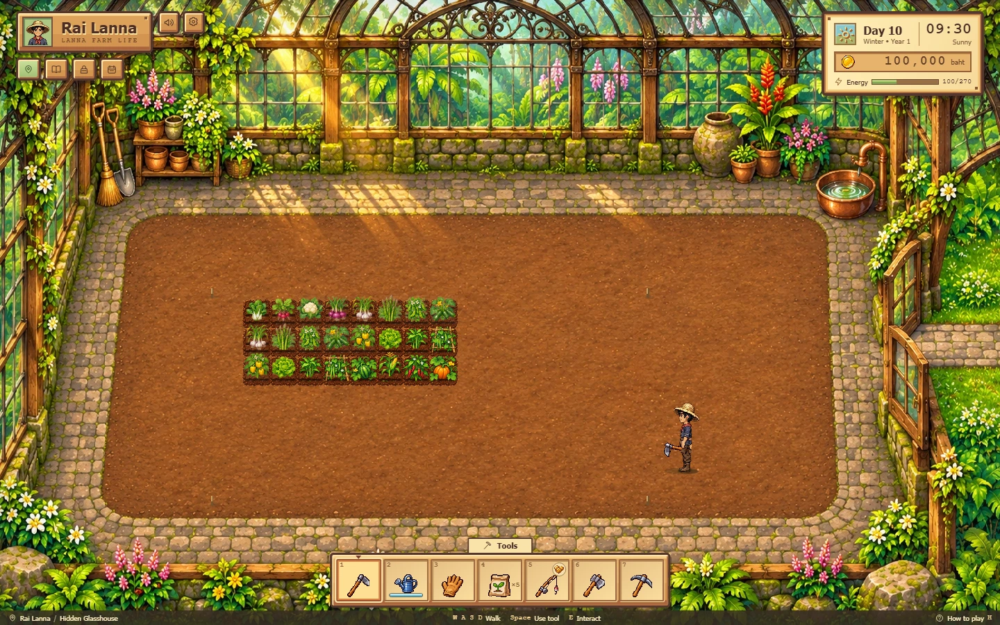</td><td width="50%">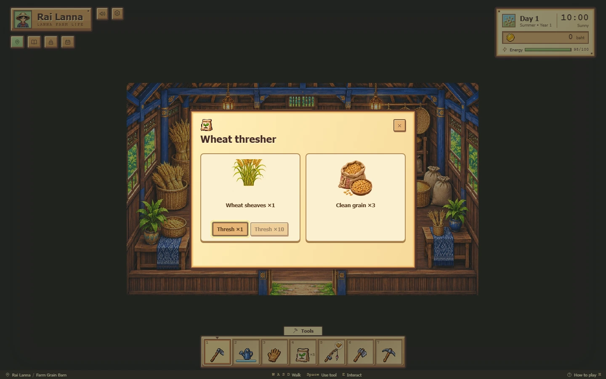</td></tr>
  <tr><td align="center">Larger greenhouse beds and the refill basin</td><td align="center">Wheat sheaves become clean animal feed</td></tr>
</table>

## 🚀 Getting started

You need [Node.js](https://nodejs.org) and npm (tested with Node 26).

```bash
npm install
npm run dev
```

Then open http://localhost:5173 in your browser. Choose **New farm**, name your farm, and confirm to start. **Load farm** continues your saved farm. The title screen also has settings and an exit option. Its artwork follows your computer’s local time: night 18:00–05:59, day 06:00–17:59.

Other commands

| Command | What it does |
|---|---|
| `npm test` | Runs the game-rule tests (Vitest) |
| `npm run typecheck` | Checks types with TypeScript |
| `npm run build` | Checks types, then builds the files to publish into `dist` |
| `npm run preview` | Serves the built files |

This version is for a desktop browser with a keyboard. Mouse and touch input are disabled.

<table>
  <tr>
    <td width="50%">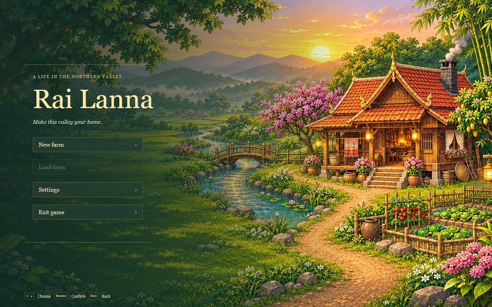</td>
    <td width="50%"></td>
  </tr>
  <tr><td align="center">Daytime title screen — local computer time</td><td align="center">Nighttime title screen — local computer time</td></tr>
</table>

### 🌐 Language

Open **Settings** (the gear at the top) and press the **Language · ภาษา** button. The farm is saved and the game reloads in the other language.
The choice is remembered by the browser.

## 🎮 How to play

Walk beside a plot, face the desired square, then use the hoe, seed bag and watering can with Space. Navigate menus with Tab/arrows and confirm with Enter.

### ⌨️ Keys

| Key | What it does |
|---|---|
| WASD or arrows | Walk |
| Space | Use the tool on the tile in front of you (or cast and reel in) |
| 1 hoe · 2 watering can · 3 harvest hand · 4 seed bag · 5 rod · 6 axe · 7 pickaxe | Choose a tool |
| Q | Switch the seed in the bag |
| E | Interact with the place or person nearby |
| M · I · J · C · H | Travel map · bag · farm journal · calendar · how to play |
| F3 · F10 | Settings · toggle sound |
| Tab / Shift+Tab · arrows · Enter | Select a menu control · navigate · confirm |
| [ / ] · Page Up / Page Down | Change item category · previous / next page |
| F2 | Open the new-farm naming screen |
| Esc | Close a window, put the rod away, or open settings from the farm |

### ☀️ One day

1. Wake up, look at the weather for today and tomorrow, and read the morning report (what sold, what grew, festival news).
2. Work: till, plant, water, harvest, fish, mine, look after the orchard and the animals.
3. Put what you want to sell in the shipping crate (paid next morning), or sell it yourself at your stall in the fresh market.
4. Visit the village and the market for seeds, tools, food and villagers' requests.
5. Go into the cottage and sleep in the bed before your energy runs out. The game saves every morning.

One day (06:00–24:00) lasts about 10 real minutes. If you are still up at bedtime you collapse and pay a clinic fee.
A higher level lets you stay up later and gives you more energy.

### 🧭 Getting around

Every place is its own painted map. Walk off the edge along a road, or through a doorway, and you arrive on the matching road of the next map.
The illustrated valley map (M) shows discovered places. A scene preview is revealed only after you reach that place. The map is informational; travel by walking along roads. There is no automatic return-home system.

The roads form loops, so few places are dead ends: the ranch and the Frontier Meadow both lead down to Pearl Bay Beach, and the orchard
links to Bua Kaew Lake and Sweetleaf Glade. A road leaves one map and enters the next at the same spot on the shared edge.

<table>
  <tr>
    <td width="50%">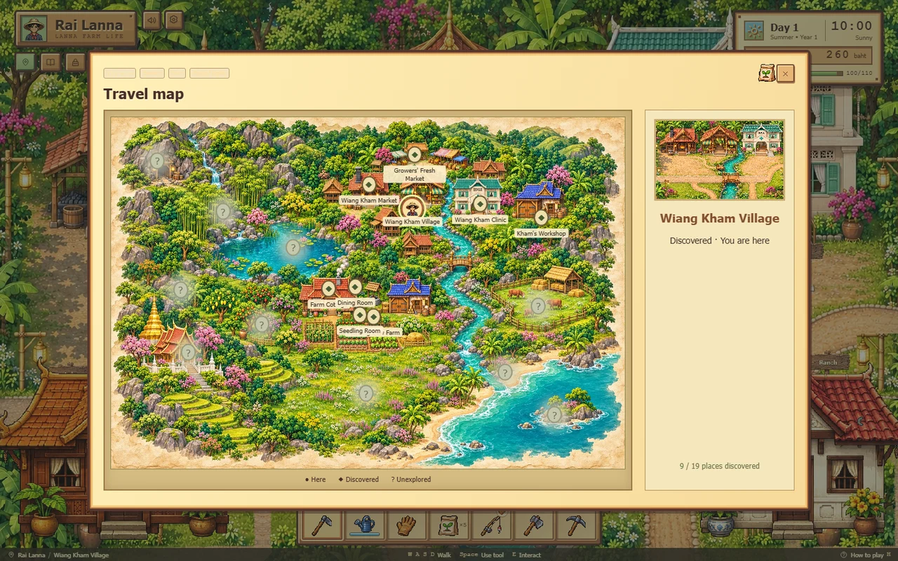</td>
    <td width="50%">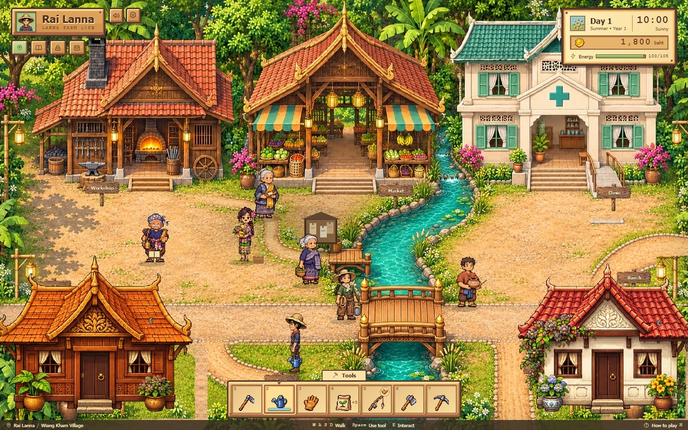</td>
  </tr>
  <tr><td align="center">Exploration map with discovered locations</td><td align="center">Village river and larger NPC homes</td></tr>
</table>

### 🖥️ Desktop version

Keyboard controls cover gameplay, menus, shops, pages, puzzles and fishing. Mouse/touch are disabled; mobile support is deferred.

## ✨ What is in the game

### 🌱 Farm, crops and weather

- **30 crops.** Hoe a square, sow seeds, then water it on each growing day. The cottage field has 15 larger planting spaces in five columns of three, with aisles between columns. Seeds are sold at the seed shop in Wiang Kham Market.
- **Four visible stages.** Newly sown seeds remain visible before becoming seedlings, immature plants and fully grown crops. Growth advances on watered days. Wheat takes six watered days and grows in winter, spring and summer.
- **4 seasons.** Summer → autumn → winter → spring, 14 days each (56 days a year). Crops that cannot stand the new season wither, and the game warns you 3 days ahead.
- **5 kinds of weather.** Sunny, rain, heatwave, storm and snow, always with a forecast for tomorrow. Rain waters the field for you, a storm can wilt plants and a heatwave makes every job more tiring.
- **Day and night.** The sky darkens with the clock. Building front lanterns and player-placed lamps light up from 18:00 to 05:59.
- **Refill the watering can.** A fill waters 10 times (20 with the copper can). The blue bar below the can shows its water level. Select the can at the farm pond, lake, shore or greenhouse basin to refill it.
- **Picture inventory.** The bag is a compact window of small picture cells. Use category tabs and Previous/Next buttons to browse items without vertical scrolling. Start with 15 slots, one per kind of item. Existing stacks still accept more when the bag is full. Tonkla sells 10 more slots per upgrade, up to 150; the final upgrade adds 5. Prices double from ฿200 to ฿1,638,400 on the fourteenth purchase.

Cropped gameplay views of the same wheat plot at each growth stage.

<table>
  <tr><td width="25%"></td><td width="25%">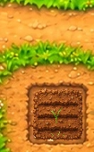</td><td width="25%">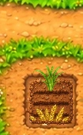</td><td width="25%">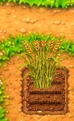</td></tr>
  <tr><td align="center">1 · Seeds</td><td align="center">2 · Seedling</td><td align="center">3 · Immature plant</td><td align="center">4 · Ready to harvest</td></tr>
</table>

### 🎣 Fishing

43 aquatic species: 20 freshwater and 23 saltwater. Sea catches include crabs, prawns, clams, turtles, sea urchins and squid. Shells and exceptionally rare pearls can appear on the beach each day. First-person fishing depends on habitat, season, time, weather, bait, equipment and Luck. Shipped catches are paid the next morning.

<table>
  <tr>
    <td width="50%">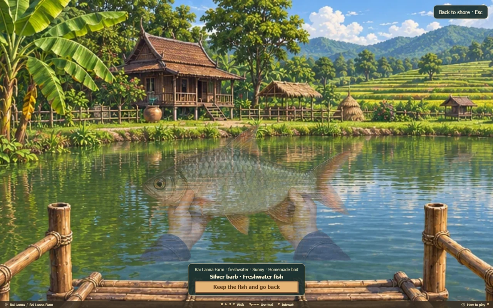</td>
    <td width="50%">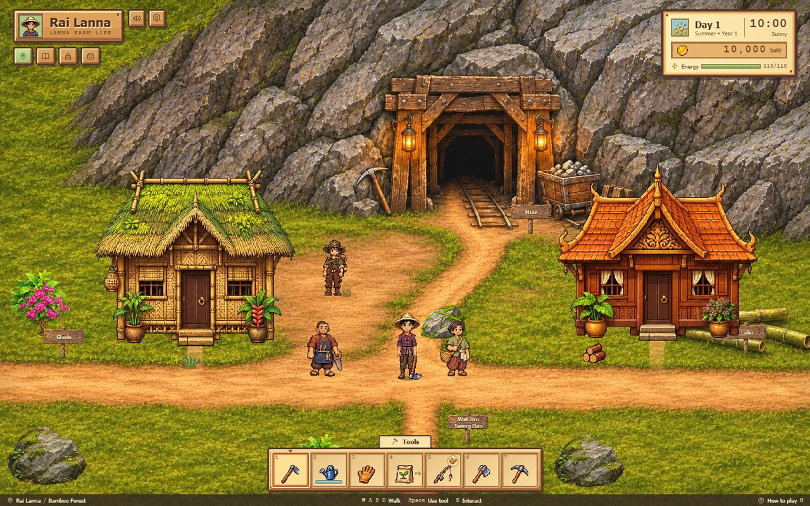</td>
  </tr>
  <tr><td align="center">First-person fishing and the landed catch</td><td align="center">Villager homes and activities in the forest</td></tr>
</table>

### 🥭 Orchard and fruit jam

- Clear trees and rocks from the six western orchard plots before planting. The Fruit Research Center is now in the southwest corner of Sweetleaf Glade, with its own entrance path.
- Fifteen sapling types unlock in seven level tiers (1–30). Prices double by tier, from ฿150 to ฿9,600. Water trees for a full in-game year before they bear fruit in their seasons.
- Fertilizer increases fruit yield; storms can knock fruit down. The dining-room stove turns two fruit into a jar of jam overnight.

<table>
  <tr><td width="50%">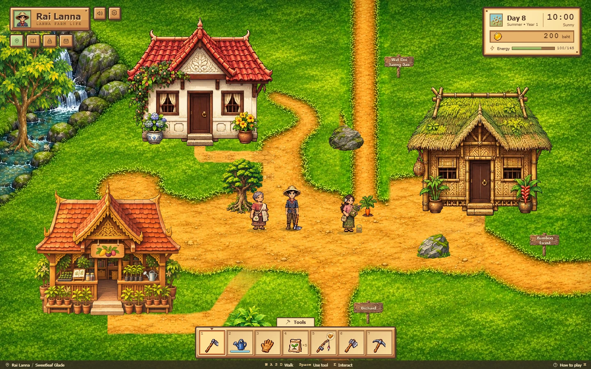</td><td width="50%">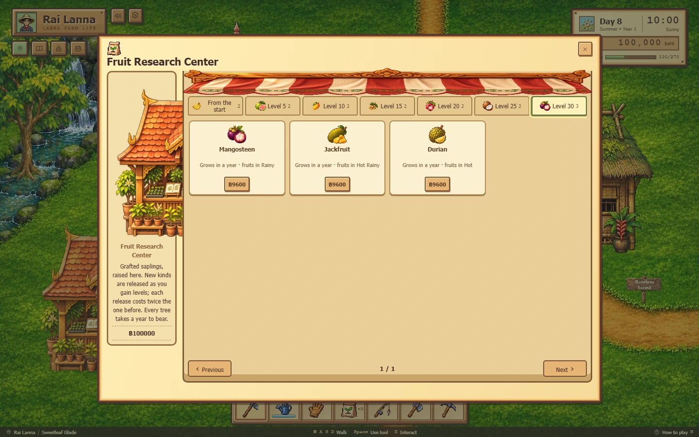</td></tr>
  <tr><td align="center">Fruit Research Center in Sweetleaf Glade</td><td align="center">Saplings and research supplies</td></tr>
</table>

<p align="center"></p>

The compact journal separates status, quests, crops, ore, collections and notes into tabs and pages, with no vertical scrolling.

### ⛏️ Mining, levels and tools

- **Star Stone Cave.** Five floors, with rarer ore deeper down. Buy a rope ladder from the smith or earn one through an ore request to descend. Each vein may or may not be there on a given day and is spent once mined. 15 ores (copper, iron, silver, gold, star crystal, then quartz, jade, amethyst, garnet, topaz, sapphire, emerald, ruby, moonstone and diamond), dug with the pickaxe, with a bonus ore of the next kind depending on Luck.
- **Frontier Meadow.** Open new farmland by clearing grass, trees and rocks, then till and plant it. Later plots need better tools.
- **Levels and stats.** Work earns XP. Each level gives points for Strength, Stamina and Luck, more energy and a later bedtime.
- **Blacksmith.** Trade ore to upgrade the hoe, axe and pickaxe, and buy lamps to place along the paths.
- **Village quests.** Rewards for clearing land, mining and fishing.
- **Hidden carvings and seals.** Explore five shrines; their stones and interaction hints appear as you approach. Solve puzzles or win festival trophies to earn seals that unlock rare seeds, saplings, animals, bait, rods and higher tool upgrades. The first three shrine seals also open the forest cache.

### 🐄 Ranch animals

**16 kinds** live at the Livestock Ranch, including hens, ducks, cows, sheep, goats, forest pigs and the new pink domestic pig. Purchases have no level or festival requirement, but animals and feed are expensive. Feed each animal one portion a day to receive its produce the next morning. You can also have a chicken coop built on your farm.

A domestic pig costs **฿27,200**, sells for **฿12,800** and produces pig compost worth **฿600** when fed. Dogs and cats keep their separate adoption conditions.

<table>
  <tr><td width="50%">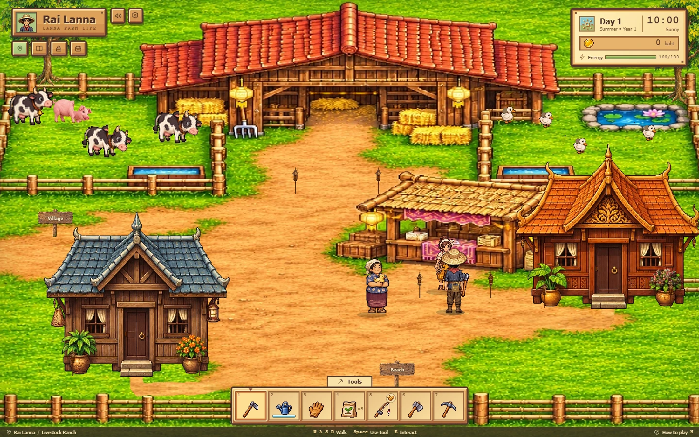</td><td width="50%">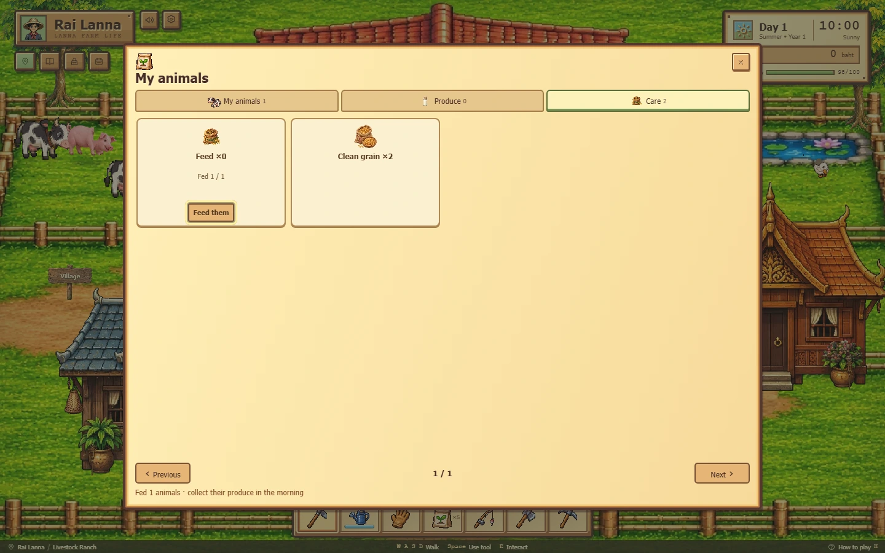</td></tr>
  <tr><td align="center">Pink domestic pig at the ranch</td><td align="center">Feed the herd with cleaned wheat grain</td></tr>
</table>

### 🌾 Wheat and the grain barn

The blue-roofed barn beside the cottage opens permanently after your first successful livestock purchase. Buying a dog or cat does not open it. Walk through the barn entrance, approach the thresher and press **E**. Process one or ten sheaves at a time: **1 wheat sheaf + 2 energy → 3 portions of clean grain**.

Each animal eats one portion per day. Herd care uses bought feed first, then cleaned wheat grain for any shortage. Raw wheat sheaves cannot be fed directly. Clean grain can also be shipped or sold at the fresh market.

| Icon | Item | Source / use | Sale price |
|---|---|---|---|
|  | Clean wheat grain | Thresh wheat; one portion feeds one animal | 25 |
| 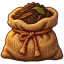 | Pig compost | Collected next morning from a fed domestic pig | 600 |

<p align="center">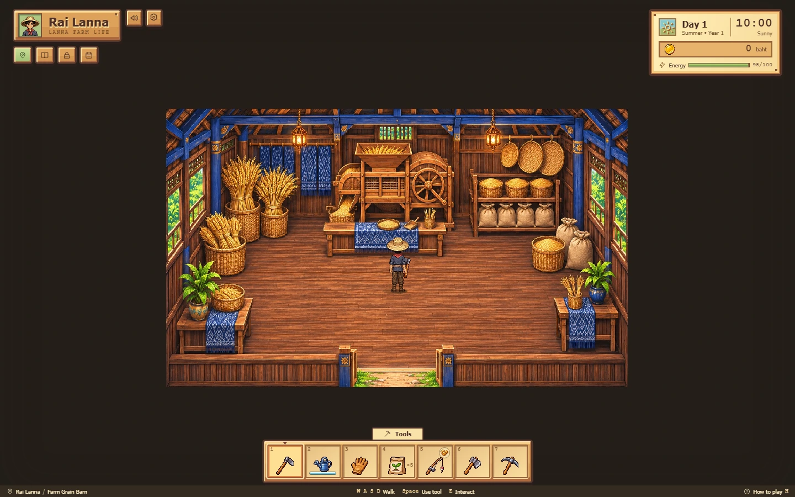</p>

### 🏘️ Village, markets and neighbours

- **Wiang Kham Village.** Mali and Uncle Chai have friendship levels, take gifts and have a daily request. Uncle Chai also sells new farm plots, extends the house as you level up and builds the chicken coop.
- **36 villagers with homes.** 22 roaming residents and 14 workers follow activity schedules, avoid one another and the player, head home after work and sleep at night. Eight private cottages are spread across the village, forest, glade and ranch; the temple adds a shared residence. Players stay outside, and NPCs stay out of the private farm.
- **A village river.** Cross the wooden bridge between banks, fish for freshwater species from the landing, or follow the southern road to the river estuary at the beach. River fishing has its own first-person background and the current ripples downstream.
- **Notice board.** Take one delivery job a day (vegetables for Mali's kitchen or fruit for Uncle Chai) for money and friendship.
- **Wiang Kham Market.** The seed shop, a food stall, the blacksmith and a trader who buys your goods.
- **Shop windows.** Meet the keeper beside a painted awning and illustrated wares. Category tabs and numbered pages keep controls on screen, including on smaller displays. Locked cards show the seals needed. Mali, Uncle Chai and the fruit nursery use the same layout. Buying prices have increased by 50%; selling prices are unchanged.
- **Growers' Fresh Market.** Open your own stall (07:00–18:00): choose an item, a quantity and a price. Customers buy according to their budget, the money comes at once, and festival days bring more of them.
- **Wiang Kham Clinic.** Recover when your energy runs out, or choose any ward bed to sleep until morning for ฿60. The farmer is shown resting in the bed.
- **Sweetleaf Glade and Bamboo Forest.** Gather fiddlehead ferns, wild mulberries and wild bananas in the glade (they grow back in a few days), and herbs and bamboo in the forest.

<p align="center"></p>

Every NPC home and public building has front lanterns, including the research area. They stay lit at night even when residents have gone to bed.

<table>
  <tr><td width="50%">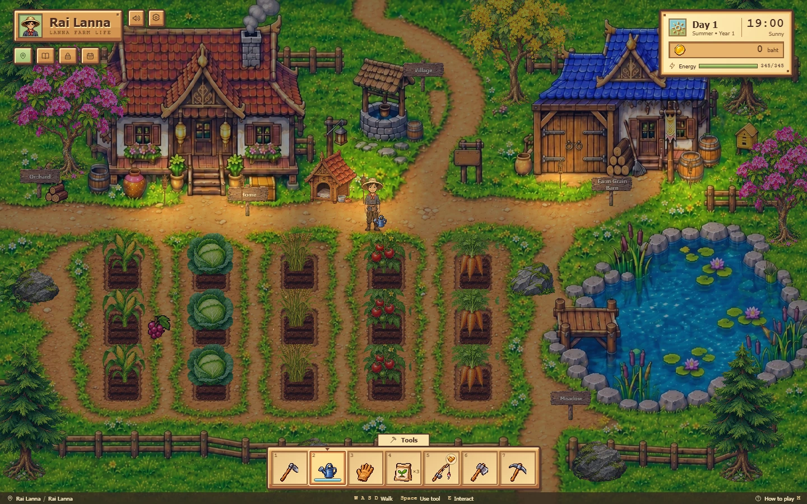</td><td width="50%">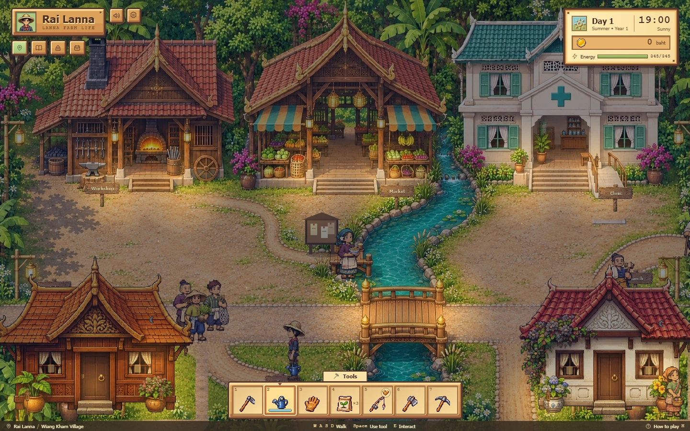</td></tr>
  <tr><td align="center">Farm buildings after dark</td><td align="center">Village homes and public lighting</td></tr>
</table>

### 🏮 Seven festivals a year

Each festival can be joined only on its day and during its hours, and a storm cancels it. Every festival raises friendship with all the neighbours.
The morning report announces a festival 2 days ahead with what to bring, and the calendar (C) shows the whole year.

| Festival | Day | Hours | What you get |
|---|---|---|---|
| 💦 Songkran, Lanna New Year | Summer, day 6 | 09:00–18:00 | Energy +25 |
| 🚀 Rocket Festival | Summer, day 12 | 10:00–18:00 | Costs 3 wood; tomorrow's forecast becomes rain |
| 🌱 Seed Swap Fair | Autumn, day 2 | 08:00–16:00 | 3 packs of cucumber seeds |
| 🚣 Longboat Race | Autumn, day 11 | 10:00–18:00 | Costs 30 energy; win (50% chance) ฿200, lose ฿40 |
| 🏮 Yi Peng Lantern Night | Winter, day 3 | 17:00–23:00 | Lantern fee ฿30; the neighbours are very impressed |
| 🌾 New Rice Offering & Crop Contest | Winter, day 10 | 09:00–17:00 | The dearest item in your bag wins 4× its price |
| 🌸 Blossom Fair | Spring, day 5 | 08:00–18:00 | 4 packs of lettuce seeds |

Festival artwork changes the village, both markets, ranch, NPC homes and the Fruit Research Center area to match the event.

<table>
  <tr><td width="33%">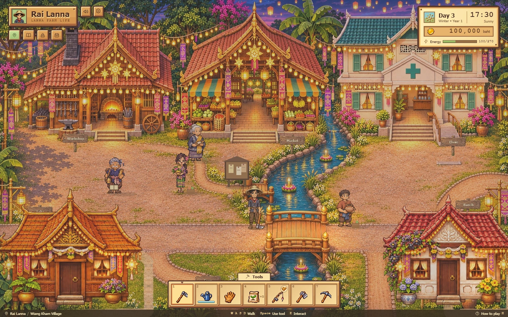</td><td width="33%">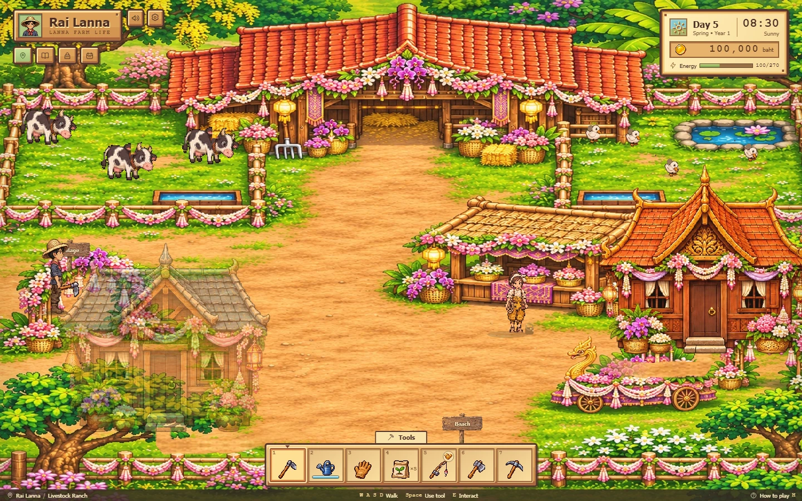</td><td width="33%">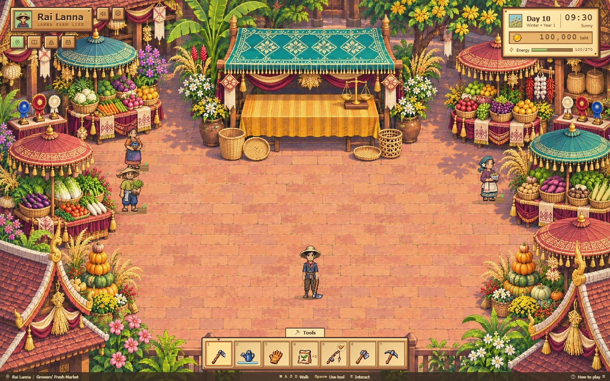</td></tr>
  <tr><td align="center">Festival village</td><td align="center">Festival ranch</td><td align="center">Festival market</td></tr>
</table>

### 🐕 Outfits and pets

Change clothes at the painted wardrobe inside the cottage. Adopt one permanent dog or cat at the Pet House beside the farm cottage after level 10 and four different festival wins. The choice cannot be changed; daily petting and following/staying home remain available.

<p align="center">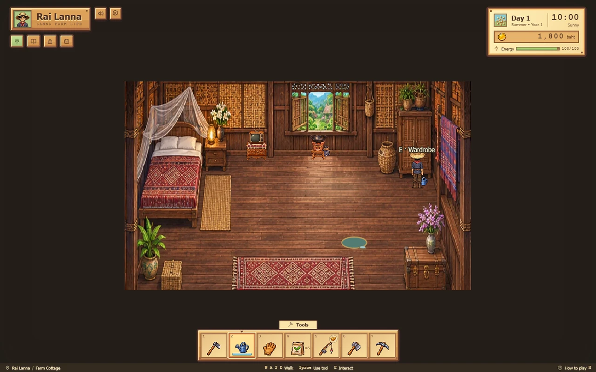</p>

### 💾 Autosave

The game saves into the browser (localStorage) every new morning, and older saves are upgraded to the current format automatically. Save format v16 preserves the new barn and wheat systems. When an old cottage field is resized to 15 spaces, plants are kept where possible; surplus living plants are returned as seeds or ripe produce.
You can also save from Settings or choose **Save & title** / **Exit game**, which save before stopping the session. Exit pauses the game and sound; close the browser tab to leave. Cancelling the new-farm form preserves the existing save.

## 📋 In-game reference tables

Values below come from the current development build. Prices use in-game baht. Rare shop items can also require seals earned from festivals or puzzles.

### Crops and vegetables · 30 types

Growth counts watered days; rain can water outdoor fields. The protected greenhouse grows every crop in every season, but still needs manual watering.

| Icon | Crop | Growing seasons | Days | Seed price | Sale price/item |
|---|---|---|---|---|---|
|  | Morning glory | All seasons | 3 | 15 | 25 |
|  | Yardlong bean | Summer, Autumn | 5 | 38 | 70 |
|  | Watermelon | Summer | 9 | 90 | 200 |
| 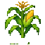 | Corn | Autumn | 6 | 45 | 90 |
|  | Chili | Autumn | 7 | 60 | 120 |
| 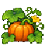 | Pumpkin | Autumn, Winter | 8 | 75 | 160 |
|  | Cabbage | Winter | 6 | 45 | 95 |
|  | Tomato | Winter | 7 | 60 | 125 |
|  | Strawberry | Winter, Spring | 9 | 105 | 230 |
|  | Carrot | Winter, Summer, Spring | 4 | 27 | 50 |
|  | Pineapple | Summer, Autumn | 8 | 75 | 165 |
|  | Eggplant | All seasons | 5 | 33 | 65 |
| 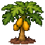 | Papaya | Summer, Autumn | 7 | 57 | 110 |
|  | Cucumber | Spring, Summer, Autumn | 4 | 27 | 48 |
|  | Beetroot | Winter | 5 | 36 | 74 |
|  | Broccoli | Winter, Autumn | 6 | 48 | 98 |
| 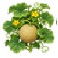 | Melon | Summer | 8 | 82 | 175 |
|  | Dragon fruit | Summer, Autumn | 9 | 93 | 195 |
|  | Passion fruit | Autumn, Winter | 7 | 63 | 132 |
|  | Bok choy | Winter, Spring | 3 | 18 | 32 |
|  | Radish | Spring, Winter | 4 | 24 | 48 |
|  | Cauliflower | Winter | 8 | 69 | 154 |
|  | Shallot | Summer, Winter | 6 | 48 | 98 |
|  | Garlic | Winter, Spring | 6 | 44 | 88 |
|  | Asparagus | Spring, Autumn | 8 | 72 | 153 |
| 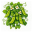 | Snow pea | Spring, Winter | 5 | 38 | 72 |
|  | Zucchini | Summer, Spring | 5 | 34 | 70 |
|  | Bell pepper | Summer, Autumn | 7 | 57 | 119 |
|  | Lettuce | Spring, Winter, Autumn | 4 | 24 | 46 |
|  | Wheat | Winter, Spring, Summer | 6 | 30 | 65 |

### Fruit trees · 15 types

Saplings are sold at the Fruit Research Center in Sweetleaf Glade. All trees mature after 56 watered days (one in-game year).

| Icon | Tree | Fruiting seasons | Days to mature | Harvest cycle/days | Fruit/cycle | Required level | Sapling price |
|---|---|---|---|---|---|---|---|
|  | Namwa banana | All seasons | 56 | 5 | 2 | 1 | 150 |
|  | Nam Dok Mai mango | Summer | 56 | 3 | 3 | 10 | 600 |
|  | Longan | Autumn | 56 | 3 | 3 | 15 | 1200 |
|  | Honey tangerine | Winter | 56 | 3 | 3 | 10 | 600 |
|  | Lychee | Summer | 56 | 3 | 3 | 20 | 2400 |
|  | Rambutan | Autumn | 56 | 3 | 3 | 15 | 1200 |
|  | Mangosteen | Autumn | 56 | 4 | 3 | 30 | 9600 |
|  | Durian | Summer | 56 | 6 | 2 | 30 | 9600 |
|  | Jackfruit | Summer, Autumn | 56 | 6 | 2 | 30 | 9600 |
| 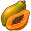 | Papaya | All seasons | 56 | 4 | 2 | 1 | 150 |
|  | Coconut | All seasons | 56 | 6 | 2 | 25 | 4800 |
|  | Guava | Winter, Spring | 56 | 3 | 3 | 5 | 300 |
| 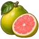 | Pomelo | Winter | 56 | 5 | 2 | 25 | 4800 |
|  | Sweet tamarind | Winter, Spring | 56 | 4 | 3 | 20 | 2400 |
|  | Starfruit | Spring, Autumn | 56 | 3 | 3 | 5 | 300 |

### Ore and gems · 15 types

Veins roll daily across five cave floors; deeper floors offer rarer materials. These are the pickaxe levels required to mine each type directly.

| Icon | Ore / gem | Minimum pickaxe level |
|---|---|---|
|  | Copper | 1 |
|  | Iron | 2 |
| 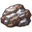 | Silver | 3 |
| 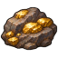 | Gold | 4 |
|  | Star crystal | 5 |
| 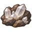 | Quartz | 6 |
|  | Jade | 7 |
|  | Amethyst | 8 |
|  | Garnet | 9 |
| 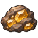 | Topaz | 10 |
|  | Sapphire | 11 |
| 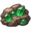 | Emerald | 12 |
| 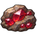 | Ruby | 13 |
| 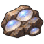 | Moonstone | 14 |
|  | Diamond | 15 |

### Aquatic species · 43 types

| Icon | Species | Water | Seasons | Time | Sale price |
|---|---|---|---|---|---|
|  | Mud crab | Beach / island sea | All seasons | 00:00–24:00 | 72 |
|  | Tiger prawn | Beach / island sea | All seasons | 00:00–24:00 | 68 |
| 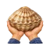 | Sea clam | Beach / island sea | All seasons | 00:00–24:00 | 90 |
|  | Green sea turtle | Beach / island sea | All seasons | 00:00–24:00 | 500 |
|  | Sea urchin | Beach / island sea | All seasons | 00:00–24:00 | 110 |
| 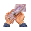 | Reef squid | Beach / island sea | All seasons | 00:00–24:00 | 125 |
|  | Coral trout | Island sea only | All seasons | 06:00–18:00 | 260 |
| 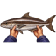 | Cobia | Island sea only | Summer, Autumn, Spring | 00:00–24:00 | 300 |
|  | Giant trevally | Island sea only | All seasons | 16:00–24:00 * | 360 |
|  | Nile tilapia | Farm pond / lake / river | All seasons | 00:00–24:00 | 12 |
|  | Silver barb | Farm pond / lake / river | Summer, Autumn | 06:00–18:00 | 18 |
|  | Snakeskin gourami | Farm pond / lake / river | Winter | 06:00–18:00 | 20 |
|  | Climbing perch | Farm pond / lake / river | Autumn | 00:00–24:00 | 25 |
|  | Catfish | Farm pond / lake / river | Summer, Autumn | 18:00–24:00 * | 35 |
| 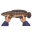 | Snakehead | Farm pond / lake / river | All seasons | 06:00–10:00 | 60 |
|  | Featherback | Farm pond / lake / river | Winter | 16:00–24:00 | 85 |
|  | Common carp | Lake / river | All seasons | 00:00–24:00 | 48 |
|  | Giant gourami | Lake / river | All seasons | 06:00–18:00 * | 85 |
| 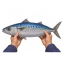 | Mackerel | Beach / island sea | All seasons | 00:00–24:00 | 32 |
|  | Red snapper | Beach / island sea | All seasons | 06:00–18:00 * | 78 |
|  | Grouper | Beach / island sea | Summer, Autumn | 06:00–24:00 | 105 |
| 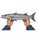 | Barracuda | Beach / island sea | All seasons | 16:00–24:00 | 125 |
|  | Eel | Farm pond / lake / river | Autumn | 20:00–24:00 | 110 |
|  | Koi | Farm pond / lake / river | All seasons | 00:00–24:00 * | 79 |
|  | Goldfish | Farm pond / lake / river | Summer, Spring | 06:00–20:00 | 42 |
|  | Grass carp | Lake / river | Autumn, Winter | 08:00–22:00 | 56 |
|  | Rohu | Lake / river | Summer, Autumn, Spring | 16:00–24:00 * | 62 |
|  | Tiger barb | Farm pond / lake / river | All seasons | 00:00–24:00 | 38 |
|  | Rasbora | Farm pond / lake / river | Summer, Spring | 06:00–20:00 | 16 |
|  | Mahseer | Lake / river | Autumn, Winter | 08:00–22:00 * | 118 |
|  | Redtail catfish | Lake / river | Summer, Autumn, Spring | 16:00–24:00 | 146 |
|  | Silver arowana | Lake / river | All seasons | 00:00–24:00 | 220 |
|  | Giant barb | Lake / river | Summer, Spring | 06:00–20:00 * | 190 |
| 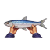 | Sardine | Beach / island sea | Autumn, Winter | 08:00–22:00 | 24 |
|  | Red mullet | Beach / island sea | Summer, Autumn, Spring | 16:00–24:00 | 52 |
|  | Bonito | Beach / island sea | All seasons | 00:00–24:00 * | 76 |
|  | Silver pomfret | Beach / island sea | Summer, Spring | 06:00–20:00 | 89 |
| 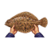 | Flounder | Beach / island sea | Autumn, Winter | 08:00–22:00 | 72 |
| 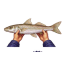 | Whiting | Beach / island sea | Summer, Autumn, Spring | 16:00–24:00 * | 28 |
|  | Golden trevally | Beach / island sea | All seasons | 00:00–24:00 | 105 |
|  | Mahi-mahi | Beach / island sea | Summer, Spring | 06:00–20:00 | 140 |
| 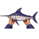 | Swordfish | Beach / island sea | Autumn, Winter | 08:00–22:00 * | 200 |
|  | Sailfish | Beach / island sea | Summer, Autumn, Spring | 16:00–24:00 | 235 |

\* Marked species are available all day in wet weather, within their habitat and season.

### Equipment and tools

| Icon | Key | Equipment | Use | Progression / notes |
|---|---|---|---|---|
|  | 1 | Hoe | Till soil and clear grass | Ore-based tool levels and the iron hoe |
|  | 2 | Watering can | Water crops/saplings; refill beside water | 10 uses initially; copper can holds 20 |
|  | 3 | Harvest hand | Harvest ripe crops | Also carry produce, fish or ore selected from the bag |
| 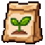 | 4 | Seed bag | Plant on tilled soil | Q switches seeds; respect growing seasons |
|  | 5 | Fishing rod | First-person fishing minigame | Carbon rod and bait improve fishing |
|  | 6 | Axe | Clear trees, stumps and logs | Ore-based levels clear tougher obstacles |
|  | 7 | Pickaxe | Break rocks and mine ore veins | Required levels are listed in the ore table |
|  | — | Rope ladder | Descend to lower cave floors | Buy from the smith or complete an available ore request |
|  | — | Path lamp | Light outdoor paths at night | Buy and place from the journal’s Notes category |
|  | — | Bag | Carry different item types in slots | 15 initial slots; expandable to 150 |

#### Shop equipment upgrades

| Icon | Upgrade | Price | Effect |
|---|---|---|---|
|  | Copper watering can | 165 | Watering costs 1 less energy |
|  | Iron hoe | 202 | Tilling costs 1 less energy |
|  | Carbon fishing rod | 232 | Fish bite 28% sooner |

#### Fishing bait

| Icon | Bait | Rare-fish selection weight | Price |
|---|---|---|---|
|  | Homemade bait | ×1 | Free / unlimited |
|  | Earthworm | ×1.8 | ฿18 / 3 pieces |
|  | Fresh shrimp | ×3 | ฿42 / 3 pieces |
|  | Glow bait | ×5 | ฿82 / 3 pieces |

Bait multipliers change rare fish selection weights, not a guaranteed catch rate. Tool upgrades combine multiple ore types and may require seals. Strength, Stamina and Luck are raised in the journal.

## 🚧 Roadmap

- [x] The daily loop
- [x] Calendar, seasons and weather (4 seasons, with snow)
- [x] Fishing (first-person view, bait)
- [x] ~~Rice paddy~~ removed; land expansion and the Frontier Meadow replace it
- [x] Orchard (with fruit jam)
- [x] 16 ranch animals, wheat threshing and grain feed
- [x] Village, neighbours, festivals (with the fresh-market stall and the calendar)
- [x] Mining, levels, tools and wild food
- [x] Expandable picture inventory, hidden shrine puzzles and seal-locked shops
- [x] Separate scenery objects and matching ground art on nine outdoor maps
- [x] Connected roads: loop routes between maps, with road ends that line up on both sides
- [x] English and Thai
- [ ] Lanna art and sound: mostly done

**Still to do**

- [ ] Seasonal scenery (the farm uses one picture in every season)
- [ ] Mobile controls and PWA installation (deferred)

## 🧰 About the `.claude/skills` folder

These are 17 game-development skills chosen from
[gamedev-skills/awesome-gamedev-agent-skills](https://github.com/gamedev-skills/awesome-gamedev-agent-skills)
for Claude Code to use while developing this game. They play no part when the game runs. They are under the Apache-2.0 licence
(`LICENSE` and `NOTICE` are in that folder) and can be deleted without affecting the game.

## ⚖️ Licensing

The project code, artwork and audio are reserved; no reuse license is granted for first-party material. See [LICENSE](LICENSE). Copyright and license texts for 39 installed npm packages and the vendored development skills are preserved in [THIRD_PARTY_LICENSES.md](THIRD_PARTY_LICENSES.md). Phaser and eventemitter3 use MIT; development components also include Apache-2.0, MPL-2.0, ISC and BSD-3-Clause.

---

<div align="center">

Made with 🌾 and Phaser · [⬆ Back to top](#-rai-lanna--ไร่ล้านนา)

</div>
