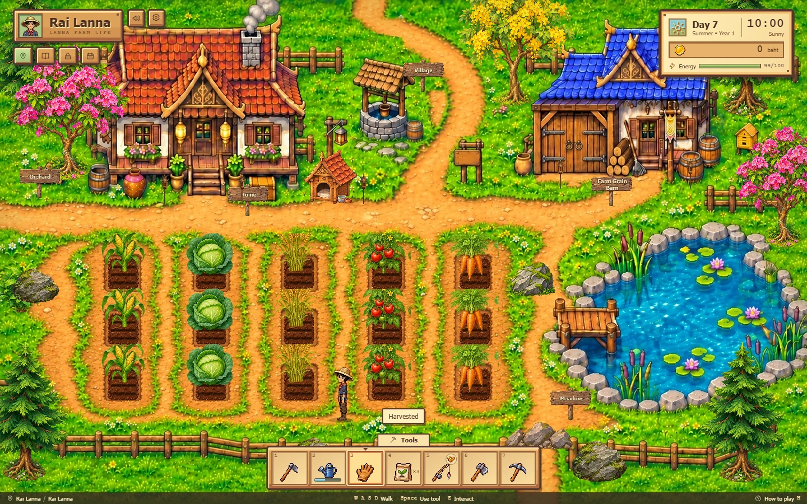
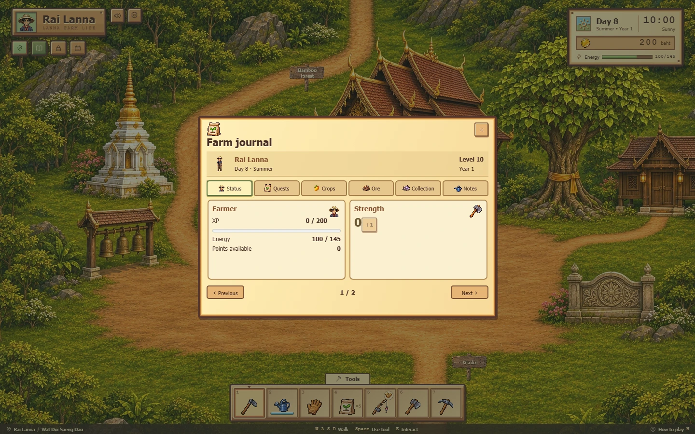
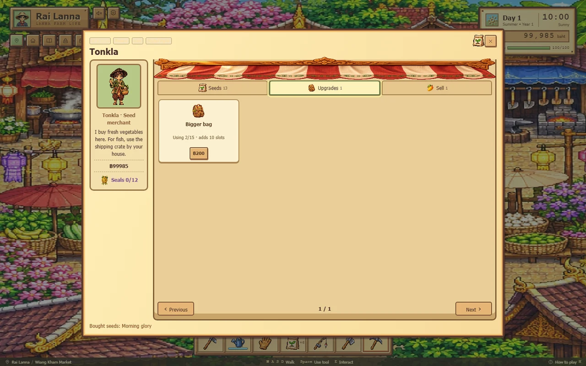

<div align="center">

# 🌾 Rai Lanna · ไร่ล้านนา

**A farm-life game set in northern Thailand, played in your browser**

<p>
  
  
  
  
</p>
<p>
  
  
  
</p>

**English** · [ภาษาไทย](README.th.md)

[🚀 Getting started](#-getting-started) · [🎮 How to play](#-how-to-play) · [✨ What is in the game](#-what-is-in-the-game) · [📋 Reference tables](#-in-game-reference-tables) · [🚧 Roadmap](#-roadmap)



</div>

A 2D farm-life game set in northern Thailand that runs in the web browser, built with Phaser 4, TypeScript and Vite.
Grow vegetables, keep an orchard, fish, mine, raise animals, sell at the market and join the village festivals.
It is our own game in the classic farming genre, with Lanna art and atmosphere.

The game is in English by default and can be switched to Thai at any time.

<div align="center">

<table>
  <tr>
    <td align="center" width="25%">🌱<br><b>29</b><br>crops</td>
    <td align="center" width="25%">🎣<br><b>37</b><br>fish</td>
    <td align="center" width="25%">🥭<br><b>15</b><br>fruit trees</td>
    <td align="center" width="25%">💎<br><b>15</b><br>ores</td>
  </tr>
  <tr>
    <td align="center" width="25%">🐄<br><b>15</b><br>ranch animals</td>
    <td align="center" width="25%">🏮<br><b>7</b><br>festivals a year</td>
    <td align="center" width="25%">👥<br><b>36</b><br>villagers</td>
    <td align="center" width="25%">🌦️<br><b>4 · 5</b><br>seasons · kinds of weather</td>
  </tr>
</table>

</div>

> [!NOTE]
> **Status: in development.** The main systems are playable from end to end (see [Roadmap](#-roadmap) for what is still open).
> Every picture on this page is taken from the real game. Some were staged first (crops already planted, animals already bought) so one picture can show a whole system.

> Screenshots and features describe the current development build. This update publishes documentation and screenshots only; the newer gameplay implementation is not included.

## 🚀 Getting started

You need [Node.js](https://nodejs.org) and npm (tested with Node 26).

```bash
npm install
npm run dev
```

Then open http://localhost:5173 in your browser. Choose **New farm**, name your farm, and confirm to start. **Load farm** continues your saved farm. The title screen also has settings and an exit option. Its artwork follows your computer’s local time: night 18:00–05:59, day 06:00–17:59.

Other commands

| Command | What it does |
|---|---|
| `npm test` | Runs the game-rule tests (Vitest) |
| `npm run typecheck` | Checks types with TypeScript |
| `npm run build` | Checks types, then builds the files to publish into `dist` |
| `npm run preview` | Serves the built files |

This version is for a desktop browser with a keyboard. Mouse and touch input are disabled.

<table>
  <tr>
    <td width="50%"></td>
    <td width="50%"></td>
  </tr>
  <tr><td align="center">Daytime title screen — local computer time</td><td align="center">Nighttime title screen — local computer time</td></tr>
</table>

### 🌐 Language

Open **Settings** (the gear at the top) and press the **Language · ภาษา** button. The farm is saved and the game reloads in the other language.
The choice is remembered by the browser.

## 🎮 How to play

Walk beside a plot, face the desired square, then use the hoe, seed bag and watering can with Space. Navigate menus with Tab/arrows and confirm with Enter.

### ⌨️ Keys

| Key | What it does |
|---|---|
| WASD or arrows | Walk |
| Space | Use the tool on the tile in front of you (or cast and reel in) |
| 1 hoe · 2 watering can · 3 harvest hand · 4 seed bag · 5 rod · 6 axe · 7 pickaxe | Choose a tool |
| Q | Switch the seed in the bag |
| E | Interact with the place or person nearby |
| M · I · J · C · H | Travel map · bag · farm journal · calendar · how to play |
| F3 · F10 | Settings · toggle sound |
| Tab / Shift+Tab · arrows · Enter | Select a menu control · navigate · confirm |
| [ / ] · Page Up / Page Down | Change item category · previous / next page |
| F2 | Open the new-farm naming screen |
| Esc | Close a window, put the rod away, or open settings from the farm |

### ☀️ One day

1. Wake up, look at the weather for today and tomorrow, and read the morning report (what sold, what grew, festival news).
2. Work: till, plant, water, harvest, fish, mine, look after the orchard and the animals.
3. Put what you want to sell in the shipping crate (paid next morning), or sell it yourself at your stall in the fresh market.
4. Visit the village and the market for seeds, tools, food and villagers' requests.
5. Go into the cottage and sleep in the bed before your energy runs out. The game saves every morning.

One day (06:00–24:00) lasts about 10 real minutes. If you are still up at bedtime you collapse and pay a clinic fee.
A higher level lets you stay up later and gives you more energy.

### 🧭 Getting around

Every place is its own painted map. Walk off the edge along a road, or through a doorway, and you arrive on the matching road of the next map.
The illustrated valley map (M) shows discovered places. A scene preview is revealed only after you reach that place. The map is informational; travel by walking along roads. There is no automatic return-home system.

The roads form loops, so few places are dead ends: the ranch and the Frontier Meadow both lead down to Pearl Bay Beach, and the orchard
links to Bua Kaew Lake and Sweetleaf Glade. A road leaves one map and enters the next at the same spot on the shared edge.

<table>
  <tr>
    <td width="50%"></td>
    <td width="50%"></td>
  </tr>
  <tr><td align="center">Exploration map with discovered locations</td><td align="center">Village river and larger NPC homes</td></tr>
</table>

### 🖥️ Desktop version

Keyboard controls cover gameplay, menus, shops, pages, puzzles and fishing. Mouse/touch are disabled; mobile support is deferred.

## ✨ What is in the game

### 🌱 Farm, crops and weather

- **29 crops.** Grow them in the field by the cottage and water them every day. Seeds are sold at the seed shop in Wiang Kham Market; price and growing time differ by crop.
- **4 seasons.** Summer → autumn → winter → spring, 14 days each (56 days a year). Crops that cannot stand the new season wither, and the game warns you 3 days ahead.
- **5 kinds of weather.** Sunny, rain, heatwave, storm and snow, always with a forecast for tomorrow. Rain waters the field for you, a storm can wilt plants and a heatwave makes every job more tiring.
- **Day and night.** The sky darkens with the clock and the lamps you have placed light up after dark.
- **Refill the watering can.** A fill waters 10 times (20 with the copper can). The blue bar below the can shows its water level. Select the can at the farm pond, lake or shore to refill it.
- **Picture inventory.** The bag is a compact window of small picture cells. Use category tabs and Previous/Next buttons to browse items without vertical scrolling. Start with 15 slots, one per kind of item. Existing stacks still accept more when the bag is full. Tonkla sells 10 more slots per upgrade, up to 150; the final upgrade adds 5. Prices double from ฿200 to ฿1,638,400 on the fourteenth purchase.

### 🎣 Fishing

37 fish: 20 freshwater and 17 saltwater species. Fish depend on season, time, weather and water. Use the farm pond, lake, village river, beach or Starwake Island; fishing uses a first-person minigame. Better equipment, bait and Luck help. The complete species table is below.
The small picture at the top right of the rod slot shows the selected bait; the same pictures appear in the bag and bait shop.

<table>
  <tr>
    <td width="50%"></td>
    <td width="50%"></td>
  </tr>
  <tr><td align="center">First-person fishing and the landed catch</td><td align="center">Villager homes and activities in the forest</td></tr>
</table>

### 🥭 Orchard and fruit jam

- 6 plots west of the farm and 15 kinds of tree, from banana, mango, longan and tangerine to durian, mangosteen and coconut. Clear the wood and rocks from a plot, plant a sapling, water it until it is grown, and it fruits in its own seasons in rounds.
- Manure gives extra fruit. A storm knocks down half of what is hanging, so pick before it comes. A tree you no longer want can be felled.
- Fruit can be sold, or made into jam at the stove in the dining room (the house has to be extended first): 2 fruit make 1 jar overnight, worth as much as 3 fruit.

<p align="center"></p>

The compact journal separates status, quests, crops, ore, collections and notes into tabs and pages, with no vertical scrolling.

### ⛏️ Mining, levels and tools

- **Star Stone Cave.** Five floors, with rarer ore deeper down. Buy a rope ladder from the smith or earn one through an ore request to descend. Each vein may or may not be there on a given day and is spent once mined. 15 ores (copper, iron, silver, gold, star crystal, then quartz, jade, amethyst, garnet, topaz, sapphire, emerald, ruby, moonstone and diamond), dug with the pickaxe, with a bonus ore of the next kind depending on Luck.
- **Frontier Meadow.** Open new farmland by clearing grass, trees and rocks, then till and plant it. Later plots need better tools.
- **Levels and stats.** Work earns XP. Each level gives points for Strength, Stamina and Luck, more energy and a later bedtime.
- **Blacksmith.** Trade ore to upgrade the hoe, axe and pickaxe, and buy lamps to place along the paths.
- **Village quests.** Rewards for clearing land, mining and fishing.
- **Hidden carvings and seals.** Explore five shrines; their stones and interaction hints appear as you approach. Solve puzzles or win festival trophies to earn seals that unlock rare seeds, saplings, animals, bait, rods and higher tool upgrades. The first three shrine seals also open the forest cache.

### 🐄 Ranch animals

15 kinds of animal live at the Livestock Ranch, including hens, ducks, cows, sheep, goats, buffalo and peafowl. Buy animals, feed each one a portion a day, and their produce is in your bag next morning.
You can also have a chicken coop built on your own farm.

### 🏘️ Village, markets and neighbours

- **Wiang Kham Village.** Mali and Uncle Chai have friendship levels, take gifts and have a daily request. Uncle Chai also sells new farm plots, extends the house as you level up and builds the chicken coop.
- **36 villagers with homes.** 22 roaming residents and 14 workers follow activity schedules, avoid one another and the player, head home after work and sleep at night. Eight private cottages are spread across the village, forest, glade and ranch; the temple adds a shared residence. Players stay outside, and NPCs stay out of the private farm.
- **A village river.** Cross the wooden bridge between banks, fish for freshwater species from the landing, or follow the southern road to the river estuary at the beach. River fishing has its own first-person background and the current ripples downstream.
- **Notice board.** Take one delivery job a day (vegetables for Mali's kitchen or fruit for Uncle Chai) for money and friendship.
- **Wiang Kham Market.** The seed shop, a food stall, the blacksmith and a trader who buys your goods.
- **Shop windows.** Meet the keeper beside a painted awning and illustrated wares. Category tabs and numbered pages keep controls on screen, including on smaller displays. Locked cards show the seals needed. Mali, Uncle Chai and the fruit nursery use the same layout. Buying prices have increased by 50%; selling prices are unchanged.
- **Growers' Fresh Market.** Open your own stall (07:00–18:00): choose an item, a quantity and a price. Customers buy according to their budget, the money comes at once, and festival days bring more of them.
- **Wiang Kham Clinic.** Recover when your energy runs out, or choose any ward bed to sleep until morning for ฿60. The farmer is shown resting in the bed.
- **Sweetleaf Glade and Bamboo Forest.** Gather fiddlehead ferns, wild mulberries and wild bananas in the glade (they grow back in a few days), and herbs and bamboo in the forest.

<p align="center"></p>

### 🏮 Seven festivals a year

Each festival can be joined only on its day and during its hours, and a storm cancels it. Every festival raises friendship with all the neighbours.
The morning report announces a festival 2 days ahead with what to bring, and the calendar (C) shows the whole year.

| Festival | Day | Hours | What you get |
|---|---|---|---|
| 💦 Songkran, Lanna New Year | Summer, day 6 | 09:00–18:00 | Energy +25 |
| 🚀 Rocket Festival | Summer, day 12 | 10:00–18:00 | Costs 3 wood; tomorrow's forecast becomes rain |
| 🌱 Seed Swap Fair | Autumn, day 2 | 08:00–16:00 | 3 packs of cucumber seeds |
| 🚣 Longboat Race | Autumn, day 11 | 10:00–18:00 | Costs 30 energy; win (50% chance) ฿200, lose ฿40 |
| 🏮 Yi Peng Lantern Night | Winter, day 3 | 17:00–23:00 | Lantern fee ฿30; the neighbours are very impressed |
| 🌾 New Rice Offering & Crop Contest | Winter, day 10 | 09:00–17:00 | The dearest item in your bag wins 4× its price |
| 🌸 Blossom Fair | Spring, day 5 | 08:00–18:00 | 4 packs of lettuce seeds |

### 🐕 Outfits and pets

Use the wardrobe or the pet nook **inside your cottage** to change among three outfits or adopt a dog or cat. Pet it once a day, and choose whether it follows you or waits at home. These choices have no HUD icon or global shortcut.

<p align="center"></p>

### 💾 Autosave

The game saves into the browser (localStorage) every new morning, and older saves are upgraded to the current format automatically.
You can also save from Settings or choose **Save & title** / **Exit game**, which save before stopping the session. Exit pauses the game and sound; close the browser tab to leave. Cancelling the new-farm form preserves the existing save.

## 📋 In-game reference tables

Values below come from the current development build. Prices use in-game baht. Rare shop items can also require seals earned from festivals or puzzles.

### Crops and vegetables · 29 types

Growth counts watered days; rain can water the field for you.

| Crop | Growing seasons | Days | Seed price | Sale price/item |
|---|---|---|---|---|
| Morning glory | All seasons | 3 | 15 | 25 |
| Yardlong bean | Summer, Autumn | 5 | 38 | 70 |
| Watermelon | Summer | 9 | 90 | 200 |
| Corn | Autumn | 6 | 45 | 90 |
| Chili | Autumn | 7 | 60 | 120 |
| Pumpkin | Autumn, Winter | 8 | 75 | 160 |
| Cabbage | Winter | 6 | 45 | 95 |
| Tomato | Winter | 7 | 60 | 125 |
| Strawberry | Winter, Spring | 9 | 105 | 230 |
| Carrot | Winter, Summer, Spring | 4 | 27 | 50 |
| Pineapple | Summer, Autumn | 8 | 75 | 165 |
| Eggplant | All seasons | 5 | 33 | 65 |
| Papaya | Summer, Autumn | 7 | 57 | 110 |
| Cucumber | Spring, Summer, Autumn | 4 | 27 | 48 |
| Beetroot | Winter | 5 | 36 | 74 |
| Broccoli | Winter, Autumn | 6 | 48 | 98 |
| Melon | Summer | 8 | 82 | 175 |
| Dragon fruit | Summer, Autumn | 9 | 93 | 195 |
| Passion fruit | Autumn, Winter | 7 | 63 | 132 |
| Bok choy | Winter, Spring | 3 | 18 | 32 |
| Radish | Spring, Winter | 4 | 24 | 48 |
| Cauliflower | Winter | 8 | 69 | 154 |
| Shallot | Summer, Winter | 6 | 48 | 98 |
| Garlic | Winter, Spring | 6 | 44 | 88 |
| Asparagus | Spring, Autumn | 8 | 72 | 153 |
| Snow pea | Spring, Winter | 5 | 38 | 72 |
| Zucchini | Summer, Spring | 5 | 34 | 70 |
| Bell pepper | Summer, Autumn | 7 | 57 | 119 |
| Lettuce | Spring, Winter, Autumn | 4 | 24 | 46 |

### Fruit trees · 15 types

Clear wood and rocks before planting. Water saplings until mature; harvest cycles apply during fruiting seasons.

| Tree | Fruiting seasons | Days to mature | Harvest cycle/days | Fruit/cycle |
|---|---|---|---|---|
| Namwa banana | All seasons | 6 | 5 | 2 |
| Nam Dok Mai mango | Summer | 10 | 3 | 3 |
| Longan | Autumn | 12 | 3 | 3 |
| Honey tangerine | Winter | 12 | 3 | 3 |
| Lychee | Summer | 12 | 3 | 3 |
| Rambutan | Autumn | 12 | 3 | 3 |
| Mangosteen | Autumn | 14 | 4 | 3 |
| Durian | Summer | 18 | 6 | 2 |
| Jackfruit | Summer, Autumn | 15 | 6 | 2 |
| Papaya | All seasons | 7 | 4 | 2 |
| Coconut | All seasons | 14 | 6 | 2 |
| Guava | Winter, Spring | 9 | 3 | 3 |
| Pomelo | Winter | 14 | 5 | 2 |
| Sweet tamarind | Winter, Spring | 13 | 4 | 3 |
| Starfruit | Spring, Autumn | 10 | 3 | 3 |

### Ore and gems · 15 types

Veins roll daily across five cave floors; deeper floors offer rarer materials. These are the pickaxe levels required to mine each type directly.

| Ore / gem | Minimum pickaxe level |
|---|---|
| Copper | 1 |
| Iron | 2 |
| Silver | 3 |
| Gold | 4 |
| Star crystal | 5 |
| Quartz | 6 |
| Jade | 7 |
| Amethyst | 8 |
| Garnet | 9 |
| Topaz | 10 |
| Sapphire | 11 |
| Emerald | 12 |
| Ruby | 13 |
| Moonstone | 14 |
| Diamond | 15 |

### Fish · 37 species

20 freshwater and 17 saltwater species. Farm ponds accept pond species; lakes and rivers accept all freshwater species. Three saltwater species are exclusive to Starwake Island after its bridge is built.

| Species | Fishing locations | Seasons | Hours | Sale price/fish |
|---|---|---|---|---|
| Coral trout | Island sea only | All seasons | 06:00–18:00 | 260 |
| Cobia | Island sea only | Summer, Autumn, Spring | 00:00–24:00 | 300 |
| Giant trevally | Island sea only | All seasons | 16:00–24:00 * | 360 |
| Nile tilapia | Farm pond / lake / river | All seasons | 00:00–24:00 | 12 |
| Silver barb | Farm pond / lake / river | Summer, Autumn | 06:00–18:00 | 18 |
| Snakeskin gourami | Farm pond / lake / river | Winter | 06:00–18:00 | 20 |
| Climbing perch | Farm pond / lake / river | Autumn | 00:00–24:00 | 25 |
| Catfish | Farm pond / lake / river | Summer, Autumn | 18:00–24:00 * | 35 |
| Snakehead | Farm pond / lake / river | All seasons | 06:00–10:00 | 60 |
| Featherback | Farm pond / lake / river | Winter | 16:00–24:00 | 85 |
| Common carp | Lake / river | All seasons | 00:00–24:00 | 48 |
| Giant gourami | Lake / river | All seasons | 06:00–18:00 * | 85 |
| Mackerel | Beach / island sea | All seasons | 00:00–24:00 | 32 |
| Red snapper | Beach / island sea | All seasons | 06:00–18:00 * | 78 |
| Grouper | Beach / island sea | Summer, Autumn | 06:00–24:00 | 105 |
| Barracuda | Beach / island sea | All seasons | 16:00–24:00 | 125 |
| Eel | Farm pond / lake / river | Autumn | 20:00–24:00 | 110 |
| Koi | Farm pond / lake / river | All seasons | 00:00–24:00 * | 79 |
| Goldfish | Farm pond / lake / river | Summer, Spring | 06:00–20:00 | 42 |
| Grass carp | Lake / river | Autumn, Winter | 08:00–22:00 | 56 |
| Rohu | Lake / river | Summer, Autumn, Spring | 16:00–24:00 * | 62 |
| Tiger barb | Farm pond / lake / river | All seasons | 00:00–24:00 | 38 |
| Rasbora | Farm pond / lake / river | Summer, Spring | 06:00–20:00 | 16 |
| Mahseer | Lake / river | Autumn, Winter | 08:00–22:00 * | 118 |
| Redtail catfish | Lake / river | Summer, Autumn, Spring | 16:00–24:00 | 146 |
| Silver arowana | Lake / river | All seasons | 00:00–24:00 | 220 |
| Giant barb | Lake / river | Summer, Spring | 06:00–20:00 * | 190 |
| Sardine | Beach / island sea | Autumn, Winter | 08:00–22:00 | 24 |
| Red mullet | Beach / island sea | Summer, Autumn, Spring | 16:00–24:00 | 52 |
| Bonito | Beach / island sea | All seasons | 00:00–24:00 * | 76 |
| Silver pomfret | Beach / island sea | Summer, Spring | 06:00–20:00 | 89 |
| Flounder | Beach / island sea | Autumn, Winter | 08:00–22:00 | 72 |
| Whiting | Beach / island sea | Summer, Autumn, Spring | 16:00–24:00 * | 28 |
| Golden trevally | Beach / island sea | All seasons | 00:00–24:00 | 105 |
| Mahi-mahi | Beach / island sea | Summer, Spring | 06:00–20:00 | 140 |
| Swordfish | Beach / island sea | Autumn, Winter | 08:00–22:00 * | 200 |
| Sailfish | Beach / island sea | Summer, Autumn, Spring | 16:00–24:00 | 235 |

\* When the weather is wet, these fish may bite outside their normal hours, but still only in their listed seasons and locations. Ship catches for payment next morning, or sell eligible goods at your fresh-market stall.

### Equipment and tools

| Key | Equipment | Use | Progression / notes |
|---|---|---|---|
| 1 | Hoe | Till soil and clear grass | Ore-based tool levels and the iron hoe |
| 2 | Watering can | Water crops/saplings; refill beside water | 10 uses initially; copper can holds 20 |
| 3 | Harvest hand | Harvest ripe crops | Also carry produce, fish or ore selected from the bag |
| 4 | Seed bag | Plant on tilled soil | Q switches seeds; respect growing seasons |
| 5 | Fishing rod | First-person fishing minigame | Carbon rod and bait improve fishing |
| 6 | Axe | Clear trees, stumps and logs | Ore-based levels clear tougher obstacles |
| 7 | Pickaxe | Break rocks and mine ore veins | Required levels are listed in the ore table |
| — | Rope ladder | Descend to lower cave floors | Buy from the smith or complete an available ore request |
| — | Path lamp | Light outdoor paths at night | Buy and place from the journal’s Notes category |
| — | Bag | Carry different item types in slots | 15 initial slots; expandable to 150 |

#### Shop equipment upgrades

| Upgrade | Price | Effect |
|---|---|---|
| Copper watering can | 165 | Watering costs 1 less energy |
| Iron hoe | 202 | Tilling costs 1 less energy |
| Carbon fishing rod | 232 | Fish bite 28% sooner |

#### Fishing bait

| Bait | Rare-fish selection weight | Price |
|---|---|---|
| Homemade bait | ×1 | Free / unlimited |
| Earthworm | ×1.8 | ฿18 / 3 pieces |
| Fresh shrimp | ×3 | ฿42 / 3 pieces |
| Glow bait | ×5 | ฿82 / 3 pieces |

Bait multipliers change rare fish selection weights, not a guaranteed catch rate. Tool upgrades combine multiple ore types and may require seals. Strength, Stamina and Luck are raised in the journal.

## 🚧 Roadmap

- [x] The daily loop
- [x] Calendar, seasons and weather (4 seasons, with snow)
- [x] Fishing (first-person view, bait)
- [x] ~~Rice paddy~~ removed; land expansion and the Frontier Meadow replace it
- [x] Orchard (with fruit jam)
- [x] 15 ranch animals
- [x] Village, neighbours, festivals (with the fresh-market stall and the calendar)
- [x] Mining, levels, tools and wild food
- [x] Expandable picture inventory, hidden shrine puzzles and seal-locked shops
- [x] Separate scenery objects and matching ground art on nine outdoor maps
- [x] Connected roads: loop routes between maps, with road ends that line up on both sides
- [x] English and Thai
- [ ] Lanna art and sound: mostly done

**Still to do**

- [ ] Seasonal scenery (the farm uses one picture in every season)
- [ ] Mobile controls and PWA installation (deferred)

## 🧰 About the `.claude/skills` folder

These are 17 game-development skills chosen from
[gamedev-skills/awesome-gamedev-agent-skills](https://github.com/gamedev-skills/awesome-gamedev-agent-skills)
for Claude Code to use while developing this game. They play no part when the game runs. They are under the Apache-2.0 licence
(`LICENSE` and `NOTICE` are in that folder) and can be deleted without affecting the game.

## 📜 Licence

No licence has been chosen for the game itself yet.

---

<div align="center">

Made with 🌾 and Phaser · [⬆ Back to top](#-rai-lanna--ไร่ล้านนา)

</div>
