<div align="center">

# 🌾 ไร่ล้านนา · Rai Lanna

**เกมทำฟาร์มบรรยากาศล้านนา เล่นได้บนเบราว์เซอร์**

<p>
  
  
  
  
</p>
<p>
  
  
  
</p>

[English](README.md) · **ภาษาไทย**

[🚀 เริ่มเล่น](#-เริ่มเล่น) · [🎮 วิธีเล่น](#-วิธีเล่น) · [✨ มีอะไรในเกม](#-มีอะไรในเกม) · [📋 ตารางข้อมูล](#-ตารางข้อมูลในเกม) · [🚧 แผนงาน](#-แผนงาน)

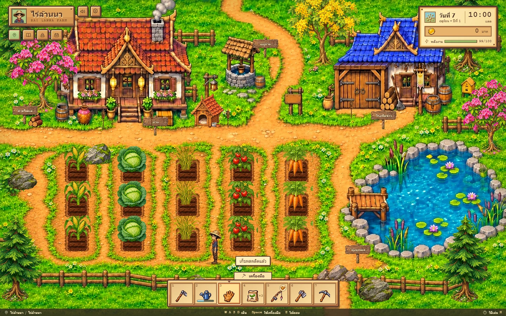

</div>

เกมทำฟาร์ม 2 มิติบรรยากาศล้านนา เล่นบนเว็บเบราว์เซอร์ สร้างด้วย Phaser 4, TypeScript และ Vite
ปลูกผัก ทำสวนผลไม้ ตกปลา ขุดแร่ เลี้ยงสัตว์ ขายของที่ตลาด และร่วมงานประเพณีของหมู่บ้าน
เป็นเกมของเราเองในแนวทำฟาร์มคลาสสิก ใช้ภาพและบรรยากาศแบบล้านนา

ตัวเกมรองรับอังกฤษและไทย ภาพในหน้านี้เป็นภาพจากเกมภาษาไทย

<div align="center">

<table>
  <tr>
    <td align="center" width="25%">🌱<br><b>30</b><br>ชนิดพืช</td>
    <td align="center" width="25%">🎣<br><b>43</b><br>ชนิดสัตว์น้ำ</td>
    <td align="center" width="25%">🥭<br><b>15</b><br>ชนิดไม้ผล</td>
    <td align="center" width="25%">💎<br><b>15</b><br>ชนิดแร่</td>
  </tr>
  <tr>
    <td align="center" width="25%">🐄<br><b>16</b><br>ชนิดสัตว์ในคอก</td>
    <td align="center" width="25%">🏮<br><b>7</b><br>งานประเพณีต่อปี</td>
    <td align="center" width="25%">👥<br><b>36</b><br>ชาวบ้าน</td>
    <td align="center" width="25%">🌦️<br><b>4 · 5</b><br>ฤดู · แบบอากาศ</td>
  </tr>
</table>

</div>

> [!NOTE]
> **สถานะ: อยู่ระหว่างพัฒนา** ระบบหลักเล่นได้ครบตั้งแต่ต้นจนจบ (ดูหัวข้อ [แผนงาน](#-แผนงาน) สำหรับสิ่งที่ยังเหลือ)
> ภาพทุกภาพในหน้านี้ถ่ายจากเกมจริง บางภาพจัดฉากก่อนถ่าย (ปลูกพืชไว้แล้ว ซื้อสัตว์ไว้แล้ว) เพื่อให้ภาพเดียวเห็นทั้งระบบ

> ภาพและฟีเจอร์อ้างอิงรุ่นพัฒนาปัจจุบัน การอัปเดตครั้งนี้เผยแพร่เฉพาะเอกสารและภาพประกอบ โค้ดเกมรุ่นใหม่ยังไม่ถูกรวม
> ภาพครัว ทีวี วัด ในวิหาร เกาะ ฟาร์ม เรือนกระจก ข้าวสาลี โรงฟัดข้าว หมูบ้าน และโคมไฟกลางคืนถ่ายจากเกมที่รันอยู่เมื่อ 16 พฤศจิกายน 2026 ส่วนภาพหมู่บ้านสี่ฤดูถ่ายจากรุ่นเว็บเมื่อ 17 พฤศจิกายน 2026 ภาพอื่นแสดงระบบที่ยังเหมือนเดิม ไอคอนในตารางใช้รูปไอเทมจากเกมจริง

## 🆕 ส่วนที่เพิ่มล่าสุด

- **ฉากเปลี่ยนตามฤดู:** แผนที่กลางแจ้งทั้ง 13 แห่งมีภาพของฤดูใบไม้ร่วง ฤดูหนาว และใบไม้ผลิ ส่วนฤดูร้อนใช้ภาพต้นฉบับ พื้น ต้นไม้ พุ่มไม้ และหินเปลี่ยนไปพร้อมกัน ใบไม้เป็นสีส้มในฤดูใบไม้ร่วง มีหิมะบนหลังคาและทางเดินในฤดูหนาว และดอกไม้บานในฤดูใบไม้ผลิ ภาพของแต่ละฤดูจะโหลดเมื่อเดินไปถึงแผนที่นั้นเท่านั้น
- **รุ่นเว็บสำหรับเว็บเกม:** `npm run build` สร้างโฟลเดอร์ `dist` ที่เปิดได้จากทุกที่อยู่เว็บ รวมถึงโฟลเดอร์ย่อย zip ของข้างใน `dist` (ให้ `index.html` อยู่ชั้นนอกสุด) แล้วอัปโหลดขึ้นเว็บอย่าง itch.io เป็นเกม HTML ได้เลย โหลดครั้งแรกประมาณ 19 MB ภาพของแผนที่อื่นจะโหลดตอนเดินทางไป

<table>
  <tr><td width="50%">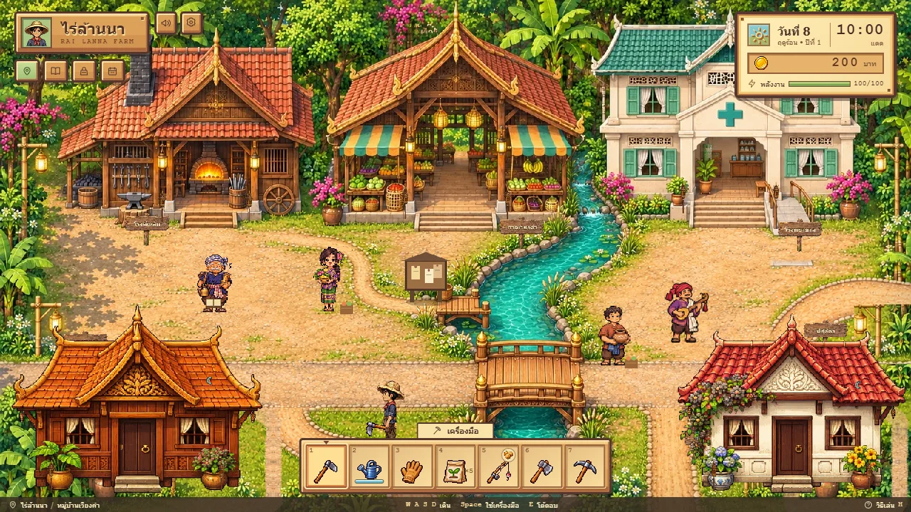</td><td width="50%">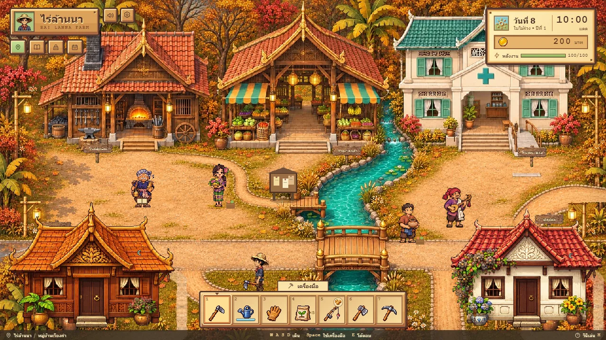</td></tr>
  <tr><td align="center">ฤดูร้อน: ภาพต้นฉบับของหมู่บ้านเวียงคำ</td><td align="center">ใบไม้ร่วง: ใบไม้สีส้มและแดง</td></tr>
  <tr><td width="50%">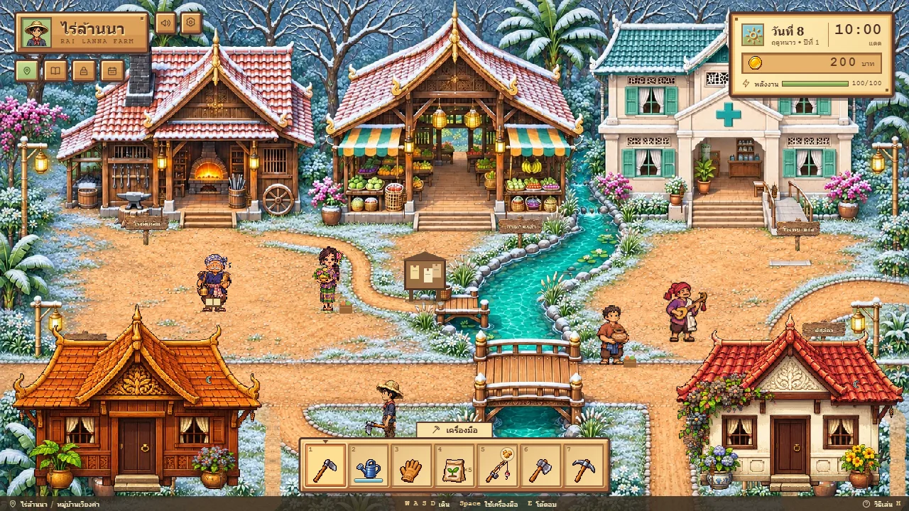</td><td width="50%">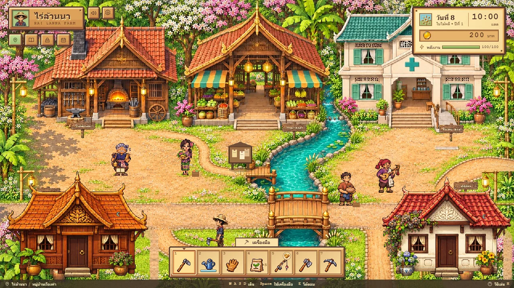</td></tr>
  <tr><td align="center">ฤดูหนาว: หิมะบนหลังคา ทางเดิน และริมน้ำ</td><td align="center">ใบไม้ผลิ: ดอกไม้สีชมพูและขาวบาน</td></tr>
</table>

**กลางเดือนพฤศจิกายน**

- **ทำอาหารที่บ้าน ระบุวัตถุดิบชัดเจน:** เตาในบ้านมี 20 เมนู แบ่งตามระดับครัว 4 ระดับ ทุกเมนูบอกชนิดปลา ผัก ผลไม้ ไข่ หรือนมที่ต้องใช้ (ต้องเป็นปลานิล ไม่ใช่ปลาอะไรก็ได้ ต้องเป็นไข่เป็ด ไม่ใช่ไข่ไก่) กินแล้วได้พลังงาน และหลายเมนูเพิ่มแรงงาน โชค หรือพลังสูงสุดจนถึงเช้าวันใหม่ ดูหัวข้อ [ทำอาหาร ครัว และทีวี](#-ทำอาหาร-ครัว-และทีวี)
- **อัปเกรดครัวและทีวีได้:** ต้องมีเลเวล เงิน และแร่ตามชนิดที่กำหนด หน้าต่างแสดงชื่อแร่แต่ละชนิดพร้อมจำนวนที่มีและที่ต้องใช้ ทีวีที่ดีขึ้นพยากรณ์อากาศพรุ่งนี้แม่นขึ้น 50% → 75% → 100%
- **วัดดอยแสงดาว:** วัดบนดอยระหว่างป่าไผ่ร่มเย็นกับป่าผักหวาน ในวิหารสักการะพระพุทธรูป ถวายผักหรือผลไม้ 1 ชิ้น หรือบริจาค 500 บาท รับโชค +3 นาน 7 วัน งานสงกรานต์และยี่เป็งย้ายมาจัดที่ลานวัด
- **เกาะรอยดาว:** ชนะถ้วยรางวัลงานประเพณีครบ 7 งาน รับกุญแจรอยดาวจากผู้ใหญ่ชัย แล้วไขประตูที่ปลายสะพานตกปลาหาดอ่าวมุก บนเกาะมีปลา 3 ชนิดที่หาได้เฉพาะที่นี่ สายแร่อัญมณี ของป่า และหีบปิดตรา
- **ถ้ำเปิดตามเลเวล:** ชั้น 2–5 ของถ้ำศิลาดาวเปิดเมื่อเลเวล 10, 20, 30 และ 40

<table>
  <tr><td width="50%">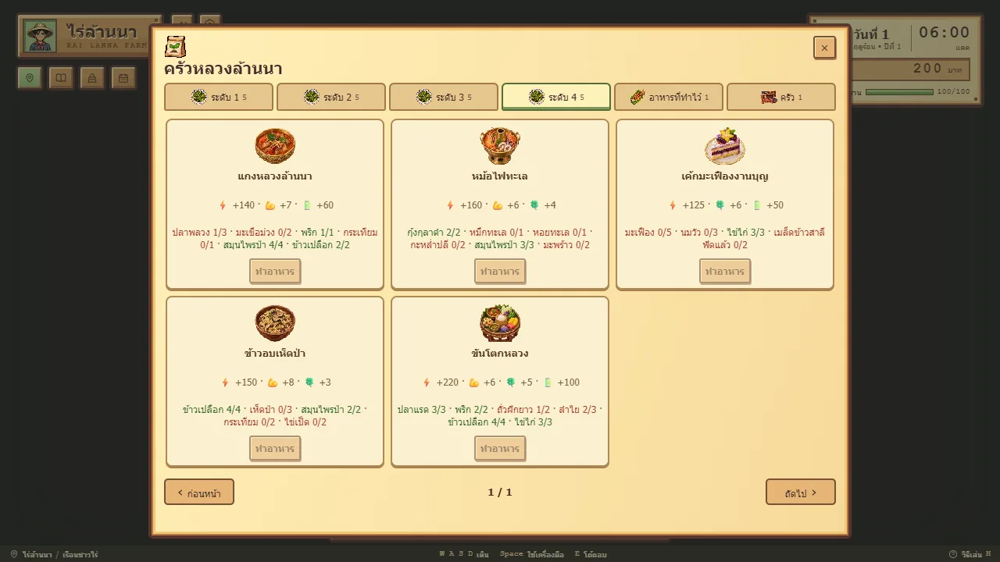</td><td width="50%">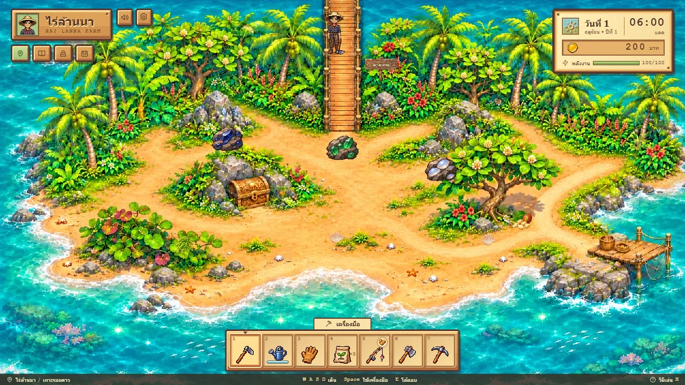</td></tr>
  <tr><td align="center">เมนูระดับ 4 แสดงวัตถุดิบแต่ละชนิดพร้อมจำนวนที่มี/ที่ต้องใช้</td><td align="center">เกาะรอยดาวเลยหาดอ่าวมุกออกไป</td></tr>
</table>

**อัปเดตก่อนหน้าในเดือนพฤศจิกายน**

- **ช่องปลูกขนาดใหม่:** หน้าบ้านและเรือนกระจกจัดเป็น 5 คอลัมน์ คอลัมน์ละ 3 ต้น มีทางเดินระหว่างแปลง ช่องใหญ่ขึ้น 1.5 เท่า และภาพพืชโตเต็มที่ใหญ่ขึ้น 2 เท่าจากรุ่นก่อน ต้องพรวนดินก่อนหว่านเมล็ด
- **พืช 30 ชนิด เติบโต 4 ระยะ:** เมล็ด → ต้นอ่อน → ต้นยังโตไม่เต็ม → โตเต็มที่พร้อมเก็บเกี่ยว เพิ่มข้าวสาลีเป็นชนิดล่าสุด
- **โรงฟัดข้าวใช้งานได้:** ซื้อสัตว์ปศุสัตว์ตัวแรกเพื่อเปิดโรงเรือนหลังคาฟ้าข้างบ้าน นำข้าวสาลีไปฟัดเป็นเมล็ดสะอาดสำหรับเลี้ยงสัตว์
- **ปศุสัตว์ 16 ชนิด:** เพิ่มหมูบ้านสีชมพูแยกจากหมูป่าเลี้ยง ให้อาหารแล้วได้รับปุ๋ยคอกหมู
- **โคมไฟกลางคืน:** หน้าบ้านตัวเอก โรงฟัดข้าว บ้านสัตว์ บ้าน NPC และอาคารสาธารณะมีโคมไฟ ส่องสว่างเวลา 18:00–05:59
- **เรือนกระจกและช่วงเริ่มเกม:** แปลงสองและเรือนกระจกลับมีเงื่อนไขความก้าวหน้าสำหรับปลดล็อก เรือนกระจกมีบ่อเติมบัวรดน้ำ ปลูกได้ทุกฤดู ป้องกันแมลง วัชพืช และความเสียหายจากอากาศ แปลงภายนอกเริ่มมีแมลงและวัชพืชในพืชเมื่อเลเวล 10 ทำบุญได้ทุก 7 วัน รับโชค +3 นาน 7 วันและไม่ซ้อนทับกัน

<table>
  <tr><td width="50%">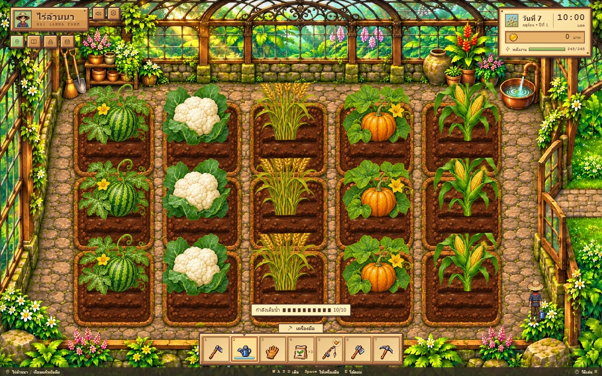</td><td width="50%">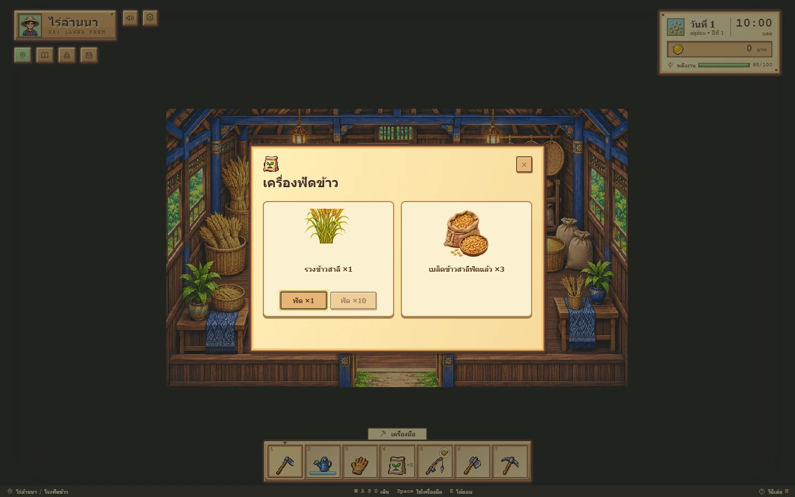</td></tr>
  <tr><td align="center">แปลงเรือนกระจกขนาดใหม่และบ่อเติมน้ำ</td><td align="center">ฟัดรวงข้าวสาลีเป็นเมล็ดสำหรับเลี้ยงสัตว์</td></tr>
</table>

## 🚀 เริ่มเล่น

ต้องมี [Node.js](https://nodejs.org) และ npm (ทดสอบกับ Node 26)

```bash
npm install
npm run dev
```

แล้วเปิด http://localhost:5173 ในเบราว์เซอร์

คำสั่งอื่น

| คำสั่ง | ทำอะไร |
|---|---|
| `npm test` | รันชุดทดสอบกติกาเกม (Vitest) |
| `npm run typecheck` | ตรวจชนิดข้อมูลด้วย TypeScript |
| `npm run build` | ตรวจชนิดข้อมูล แล้วสร้างไฟล์สำหรับเผยแพร่ลงใน `dist` |
| `npm run preview` | เปิดดูไฟล์ที่ build แล้ว |

ถ้าจะเผยแพร่บนเว็บเกม ให้ zip ของข้างใน `dist` โดยให้ `index.html` อยู่ชั้นนอกสุด แล้วอัปโหลดเป็นเกมเล่นบนเบราว์เซอร์ (HTML) เซฟเกมจะอยู่ในเบราว์เซอร์ของผู้เล่นแต่ละคน

รุ่นปัจจุบันรองรับคอมพิวเตอร์และคีย์บอร์ด ปิดการควบคุมด้วยเมาส์และสัมผัสไว้

<table>
  <tr>
    <td width="50%"></td>
    <td width="50%"></td>
  </tr>
  <tr><td align="center">หน้าเริ่มเกมกลางวันตามเวลาเครื่อง</td><td align="center">หน้าเริ่มเกมกลางคืนตามเวลาเครื่อง</td></tr>
</table>

### 🌐 เปลี่ยนภาษา

เปิด **Settings** (รูปเฟืองด้านบน) แล้วกดปุ่ม **Language · ภาษา** เกมจะบันทึกฟาร์มแล้วโหลดใหม่เป็นอีกภาษาหนึ่ง
เบราว์เซอร์จะจำภาษาที่เลือกไว้

เมื่อเปิดเกม เลือก **เริ่มฟาร์มใหม่** ตั้งชื่อฟาร์มและยืนยัน หรือเลือก **โหลดบันทึก** เพื่อเล่นฟาร์มเดิม หน้าแรกมีตั้งค่าและออกจากเกม ภาพเปลี่ยนตามเวลาเครื่อง: กลางคืน 18:00–05:59 กลางวัน 06:00–17:59 ใช้คีย์บอร์ดบนคอมพิวเตอร์ในการเล่น

## 🎮 วิธีเล่น

เดินเข้าข้างแปลง หันหน้าไปยังช่องที่ต้องการ แล้วใช้จอบพรวนดิน ถุงเมล็ดปลูก และบัวรดน้ำด้วย Space เลือกเมนูด้วย Tab/ลูกศร และยืนยันด้วย Enter

### ⌨️ ปุ่ม

| ปุ่ม | ทำอะไร |
|---|---|
| WASD หรือลูกศร | เดิน |
| Space | ใช้เครื่องมือกับช่องตรงหน้า (หรือเหวี่ยงเบ็ดและดึงปลา) |
| 1 จอบ · 2 บัวรดน้ำ · 3 มือเก็บเกี่ยว · 4 ถุงเมล็ด · 5 เบ็ด · 6 ขวาน · 7 อีเต้อ | เลือกเครื่องมือ |
| Q | สลับเมล็ดในถุง |
| E | ใช้งานสถานที่หรือคุยกับคนที่อยู่ใกล้ |
| M · I · J · C · H | แผนที่เดินทาง · กระเป๋า · สมุดฟาร์ม · ปฏิทิน · วิธีเล่น |
| F3 · F10 | ตั้งค่า · เปิด/ปิดเสียง |
| Tab / ลูกศร / Enter | เลือกและยืนยันเมนู |
| [ / ] · Page Up / Page Down | เปลี่ยนหมวด · ย้อนหน้า/หน้าถัดไป |
| F2 | เปิดหน้าตั้งชื่อฟาร์มใหม่ |
| Esc | ปิดหน้าต่าง หรือเก็บเบ็ด |

### ☀️ หนึ่งวันในเกม

1. ตื่นนอน ดูอากาศวันนี้และพรุ่งนี้ อ่านรายงานยามเช้า (ขายอะไรได้ พืชโตแค่ไหน ข่าวงานประเพณี)
2. ทำงาน: พรวนดิน ปลูก รดน้ำ เก็บเกี่ยว ตกปลา ขุดแร่ ดูแลสวนผลไม้และสัตว์
3. ใส่ของที่จะขายลงลังส่งของ (ได้เงินเช้าวันถัดไป) หรือขายเองที่แผงของคุณในตลาดสด
4. แวะหมู่บ้านและตลาดเพื่อซื้อเมล็ด เครื่องมือ อาหาร และรับคำขอของชาวบ้าน
5. เข้าบ้านแล้วนอนบนเตียงก่อนพลังงานหมด เกมบันทึกทุกเช้า

หนึ่งวัน (06:00–24:00) ใช้เวลาจริงประมาณ 10 นาที ถ้ายังไม่นอนเมื่อถึงเวลาเข้านอนจะหมดแรงล้มและต้องจ่ายค่ารักษา
เลเวลสูงขึ้นจะอยู่ดึกได้นานขึ้นและมีพลังงานมากขึ้น

### 🧭 การเดินทาง

แต่ละสถานที่เป็นแผนที่ภาพวาดของตัวเอง เดินออกขอบจอตามถนนหรือผ่านประตู ก็จะไปโผล่บนถนนเส้นเดียวกันของแผนที่ถัดไป
แผนภาพหุบเขา (M) แสดงสถานที่ที่เคยไปถึงแล้ว ภาพฉากจะเปิดเมื่อสำรวจถึงเท่านั้น ใช้ดูข้อมูลและเดินทางตามถนนด้วยตัวเอง ไม่มีระบบกลับบ้านอัตโนมัติ

ถนนเชื่อมกันเป็นวง จึงแทบไม่มีทางตัน: คอกปศุสัตว์และทุ่งบุกเบิกมีทางลงไปหาดอ่าวมุก ส่วนสวนผลไม้เชื่อมกับสระบัวแก้วและป่าผักหวาน วัดบนดอยเชื่อมป่าไผ่ร่มเย็นกับป่าผักหวาน และสะพานไม้จากหาดอ่าวมุกพาไปเกาะรอยดาวเมื่อไขประตูแล้ว
ถนนที่ออกจากแผนที่หนึ่งจะเข้าแผนที่ถัดไปตรงตำแหน่งเดียวกันบนขอบที่ติดกัน

<table>
  <tr>
    <td width="50%">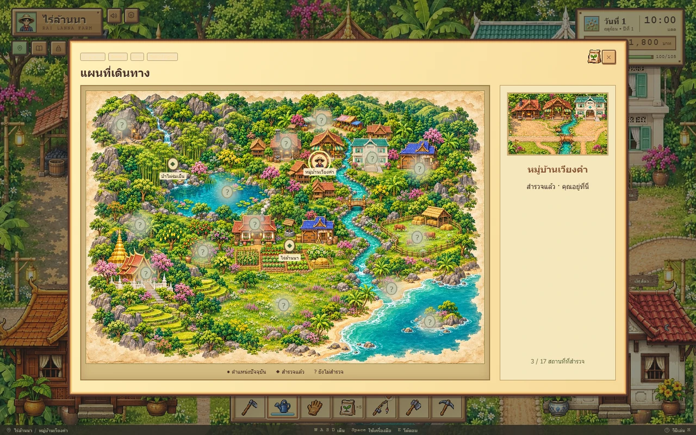</td>
    <td width="50%">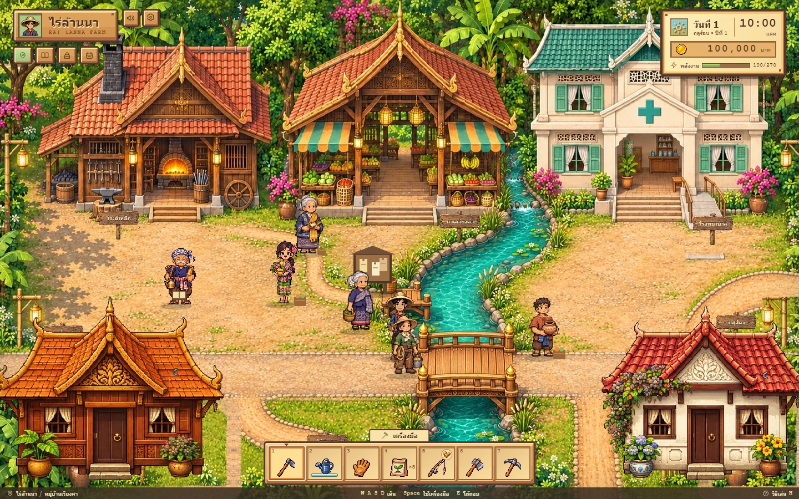</td>
  </tr>
  <tr><td align="center">แผนภาพสถานที่ที่สำรวจแล้ว</td><td align="center">หมู่บ้าน แม่น้ำ และบ้าน NPC ขนาดใหม่</td></tr>
</table>

### 🖥️ เล่นบนคอมพิวเตอร์

เล่นด้วยคีย์บอร์ดทั้งฉากและเมนู ปิดเมาส์และสัมผัสไว้ โหมดมือถือยังพักการพัฒนา

## ✨ มีอะไรในเกม

### 🌱 ฟาร์ม พืช และอากาศ

- **พืช 30 ชนิด** พรวนดินเป็นช่อง หว่านเมล็ด และรดน้ำในแต่ละวัน แปลงหน้าบ้านมีช่องปลูกขนาดใหญ่ 15 ช่อง จัดเป็น 5 คอลัมน์ คอลัมน์ละ 3 ต้น พร้อมทางเดิน ซื้อเมล็ดได้ที่ร้านเมล็ดพันธุ์ในกาดเวียงคำ
- **เห็นการเติบโต 4 ระยะ** หว่านแล้วเห็นเมล็ด ก่อนกลายเป็นต้นอ่อน ต้นยังโตไม่เต็ม และต้นโตเต็มที่ ระยะเติบโตเพิ่มตามวันที่ได้รับน้ำ ข้าวสาลีใช้ 6 วัน ปลูกได้ในฤดูหนาว ใบไม้ผลิ และร้อน
- **4 ฤดู** ร้อน → ใบไม้ร่วง → หนาว → ใบไม้ผลิ ฤดูละ 14 วัน (ปีละ 56 วัน) แผนที่กลางแจ้งทุกแห่งมีภาพของแต่ละฤดู พืชที่ทนฤดูใหม่ไม่ได้จะเหี่ยว และเกมเตือนล่วงหน้า 3 วัน
- **อากาศ 5 แบบ** แดด ฝน แดดจัด พายุฝน และหิมะ มีพยากรณ์ของวันพรุ่งนี้เสมอ ฝนรดน้ำแปลงให้ พายุทำให้พืชเฉาได้ แดดจัดทำให้ทุกงานเหนื่อยขึ้น
- **กลางวันกลางคืน** ท้องฟ้ามืดลงตามเวลา โคมไฟหน้าอาคารและโคมที่ผู้เล่นวางส่องสว่างเวลา 18:00–05:59
- **เติมน้ำบัวรดน้ำ** เติมหนึ่งครั้งรดได้ 10 ช่อง หรือ 20 ช่องเมื่อใช้บัวทองแดง แถบสีฟ้าใต้รูปบัวแสดงระดับน้ำ เลือกบัวที่บ่อในไร่ สระ ชายทะเล หรือบ่อในเรือนกระจกเพื่อเติมน้ำ
- **กระเป๋าเป็นรูปไอเทม** หน้าต่างกระเป๋ามีขนาดกะทัดรัด แสดงของเป็นช่องรูปเล็ก เลือกแท็บหมวดหมู่และปุ่มก่อนหน้า–ถัดไปเพื่อดูของโดยไม่ต้องเลื่อนขึ้นลง เริ่ม 15 ช่อง นับหนึ่งช่องต่อชนิด ของชนิดเดิมเพิ่มจำนวนได้แม้กระเป๋าเต็ม ซื้อเพิ่มจากต้นกล้าครั้งละ 10 ช่องจนถึง 150 ช่อง ครั้งสุดท้ายเพิ่ม 5 ช่อง ราคาทวีคูณจาก ฿200 จนถึง ฿1,638,400 ในการซื้อครั้งที่ 14

ภาพขยายจากแปลงข้าวสาลีเดียวกันในเกมจริง แสดงแต่ละระยะการเติบโต

<table>
  <tr><td width="25%"></td><td width="25%"></td><td width="25%"></td><td width="25%"></td></tr>
  <tr><td align="center">1 · เมล็ด</td><td align="center">2 · ต้นอ่อน</td><td align="center">3 · ยังโตไม่เต็ม</td><td align="center">4 · พร้อมเก็บเกี่ยว</td></tr>
</table>

### 🎣 ตกปลา

สัตว์น้ำ 43 ชนิด แยกน้ำจืด 20 และน้ำเค็ม 23 รวมปู กุ้ง หอย เต่า เม่นทะเล และหมึก ชายหาดสุ่มเกิดเปลือกหอยและไข่มุกที่หายากมากประจำวัน ตกปลาแบบมุมมองบุคคลที่หนึ่งตามแหล่งน้ำ ฤดู เวลา อากาศ เหยื่อ อุปกรณ์ และโชค นำสัตว์น้ำเข้าลังส่งของเพื่อรับเงินเช้าวันถัดไป

<table>
  <tr>
    <td width="50%"></td>
    <td width="50%"></td>
  </tr>
  <tr><td align="center">ตกปลาและแสดงปลาที่จับได้</td><td align="center">บ้านและกิจกรรมของชาวบ้านในป่า</td></tr>
</table>

### 🥭 สวนผลไม้และแยม

- ถางต้นไม้และหินในสวนด้านตะวันตก 6 หลุมก่อนปลูก ศูนย์วิจัยผลไม้ย้ายมาอยู่มุมล่างซ้ายของป่าผักหวาน พร้อมถนนเข้าถึงหน้าศูนย์
- กิ่งพันธุ์ 15 ชนิดปลดล็อกเป็น 7 รุ่นตามเลเวล 1–30 ราคาเพิ่มเท่าตัวตามรุ่น ตั้งแต่ 150 ถึง 9,600 บาท รดน้ำครบหนึ่งปีในเกมจึงโตและออกผลตามฤดู
- ปุ๋ยเพิ่มผลผลิต พายุอาจทำผลไม้ร่วง เตาในห้องกินข้าวแปรรูปผลไม้ 2 ชิ้นเป็นแยม 1 กระปุกข้ามคืน

<table>
  <tr><td width="50%">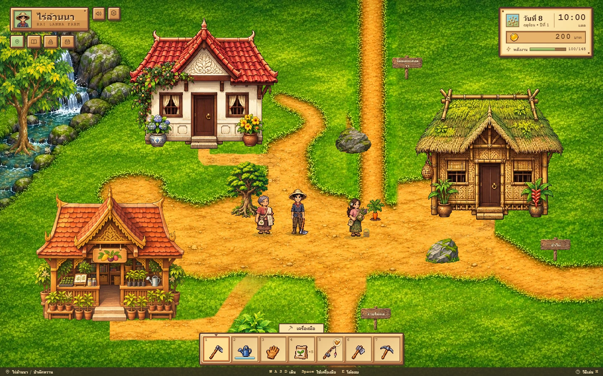</td><td width="50%">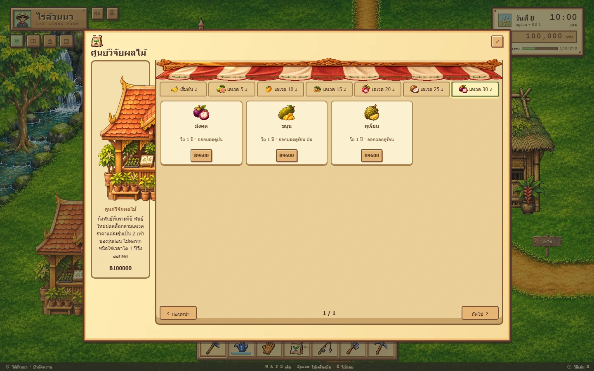</td></tr>
  <tr><td align="center">ศูนย์วิจัยผลไม้ในป่าผักหวาน</td><td align="center">กิ่งพันธุ์และของจากศูนย์วิจัย</td></tr>
</table>

<p align="center">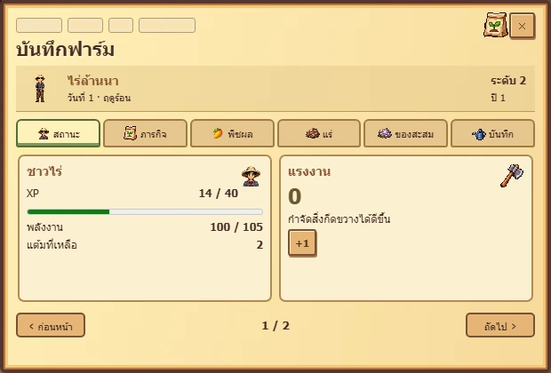</p>

สมุดฟาร์มขนาดกะทัดรัด แยกหมวดสถานะ ภารกิจ พืชผล แร่ ของสะสม และบันทึก ใช้แท็บกับปุ่มเปลี่ยนหน้าโดยไม่มีแถบเลื่อนแนวตั้ง

### ⛏️ ขุดแร่ เลเวล และเครื่องมือ

- **ถ้ำศิลาดาว** มี 5 ชั้น ยิ่งลึกยิ่งมีแร่หายาก ชั้น 2, 3, 4 และ 5 เปิดเมื่อเลเวล 10, 20, 30 และ 40 สายแร่แต่ละจุดอาจมีหรือไม่มีในแต่ละวัน และขุดแล้วหมดไป มีแร่ 15 ชนิด (ทองแดง เหล็ก เงิน ทอง ผลึกดาว ต่อด้วยควอตซ์ หยก อเมทิสต์ โกเมน บุษราคัม ไพลิน มรกต ทับทิม มูนสโตน และเพชร) ขุดด้วยอีเต้อ และมีโอกาสได้แร่ชนิดถัดไปเพิ่มตามค่าโชค
- **ทุ่งบุกเบิก** เปิดที่ดินทำกินใหม่โดยถางหญ้า ต้นไม้ และหิน แล้วพรวนดินปลูกพืช แปลงถัดไปต้องใช้เครื่องมือที่ดีขึ้น
- **เลเวลและค่าพลัง** ทำงานได้ XP แต่ละเลเวลได้แต้มสำหรับ กำลัง ความอึด และโชค พลังงานเพิ่ม และเข้านอนได้ดึกขึ้น
- **ช่างตีเหล็ก** เอาแร่ไปแลกอัปเกรดจอบ ขวาน และอีเต้อ และซื้อโคมไฟไปวางตามทางเดิน
- **ปริศนาศิลาและตรารางวัล** มีศิลาซ่อนอยู่ 5 แห่ง ตัวศิลาและคำใบ้โต้ตอบปรากฏเมื่อเดินเข้าใกล้ แก้ปริศนาหรือชนะการแข่งขันเทศกาลเพื่อรับตราปลดล็อกเมล็ด กิ่งพันธุ์ สัตว์ เหยื่อ เบ็ด และการตีเครื่องมือระดับสูง ศิลาสามแห่งแรกใช้เปิดหีบสมบัติในป่าได้ด้วย
- **ภารกิจหมู่บ้าน** มีรางวัลสำหรับการถางที่ ขุดแร่ และตกปลา

### 🐄 สัตว์ในคอกปศุสัตว์

**ปศุสัตว์ 16 ชนิด** มีไก่ เป็ด วัว แกะ แพะ หมูป่าเลี้ยง ควาย ม้า กระต่าย ห่าน นกกระทา ไก่งวง นกยูง ไก่ต๊อก ไก่แจ้ และหมูบ้านสีชมพู ซื้อได้โดยไม่มีเงื่อนไขเลเวลหรือเทศกาล แต่สัตว์และอาหารราคาแพง ให้อาหารตัวละ 1 ส่วนต่อวันเพื่อรับผลผลิตเช้าวันถัดไป สร้างเล้าไก่ในฟาร์มได้ด้วย

หมูบ้านราคาซื้อ **27,200 บาท** ขายคืน **12,800 บาท** เมื่อให้อาหารจะได้ปุ๋ยคอกหมูมูลค่า **600 บาท** สุนัขและแมวยังใช้เงื่อนไขรับเลี้ยงแยกต่างหาก

<table>
  <tr><td width="50%">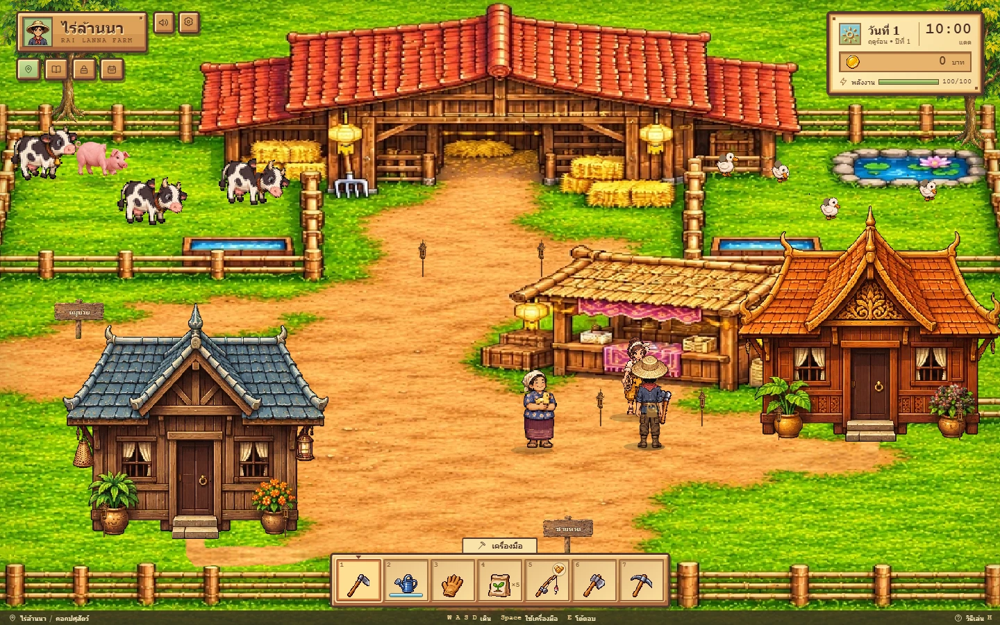</td><td width="50%">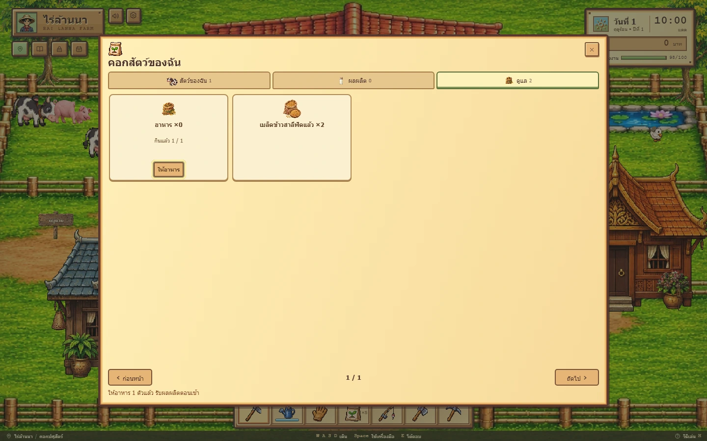</td></tr>
  <tr><td align="center">หมูบ้านสีชมพูในคอกปศุสัตว์</td><td align="center">ใช้เมล็ดข้าวสาลีฟัดแล้วเลี้ยงสัตว์</td></tr>
</table>

### 🌾 ข้าวสาลีและโรงฟัดข้าว

โรงเรือนหลังคาฟ้าข้างบ้านเปิดถาวรเมื่อซื้อปศุสัตว์ตัวแรก การรับสุนัขหรือแมวไม่ปลดล็อกโรงเรือน เดินเข้าประตู ไปหน้าเครื่องแล้วกด **E** เลือกฟัดครั้งละ 1 หรือ 10 รวง: **ข้าวสาลี 1 รวง + พลังงาน 2 → เมล็ดสะอาด 3 ส่วน**

สัตว์กินอาหารตัวละ 1 ส่วนต่อวัน ระบบใช้อาหารที่ซื้อมาก่อน แล้วจึงใช้เมล็ดข้าวสาลีฟัดแล้วทดแทนส่วนที่ขาด รวงข้าวดิบยังใช้เลี้ยงไม่ได้ เมล็ดสะอาดนำเข้าลังส่งของหรือขายที่ตลาดสดได้

| ไอคอน | ไอเทม | ที่มา / การใช้ | ราคาขาย |
|---|---|---|---|
| 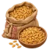 | เมล็ดข้าวสาลีฟัดแล้ว | ฟัดข้าวสาลี; 1 ส่วนเลี้ยงสัตว์ 1 ตัว | 25 |
|  | ปุ๋ยคอกหมู | รับเช้าวันถัดไปจากหมูบ้านที่ได้รับอาหาร | 600 |

<p align="center">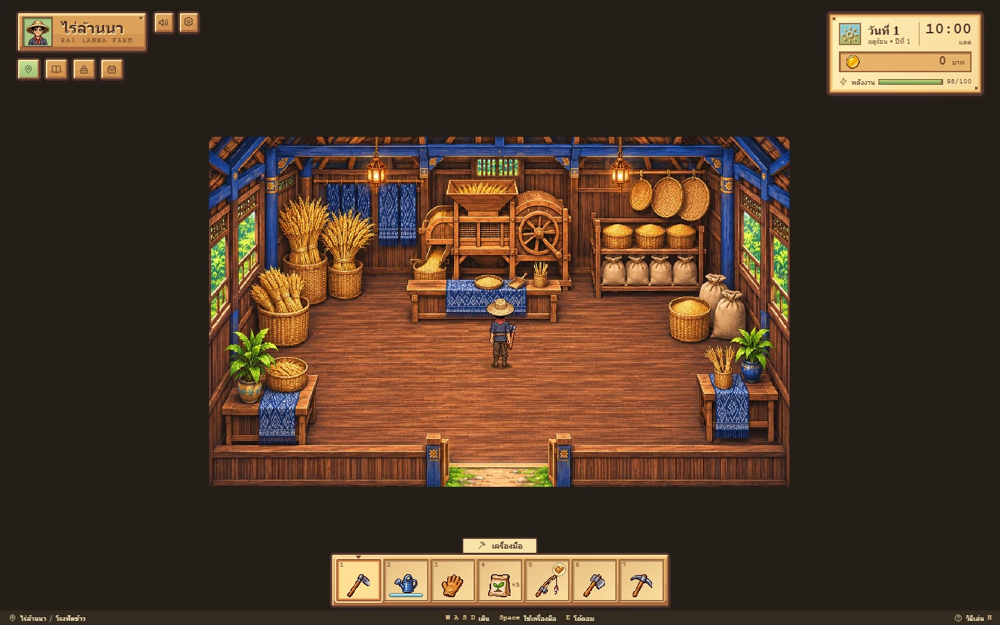</p>

### 🍲 ทำอาหาร ครัว และทีวี

ทำอาหารที่เตาในบ้าน เมนูละ 10 นาที พกได้เมนูละไม่เกิน 9 จาน สูตรระบุชนิดของที่ใช้ และเกมหักเฉพาะของชนิดนั้น สูตรปลานิลจะไม่หักปลาช่อนแทน ถ้าของไม่ครบ การ์ดจะแสดงตัวที่ขาดเป็นสีแดงพร้อมจำนวนที่มี/ที่ต้องใช้ และข้อความบอกชื่อของที่ขาด เช่น "ยังขาด ปลานิล ×1"

กินแล้วได้พลังงานคืน เมนูตั้งแต่ระดับ 2 ขึ้นไปให้ผลจากอาหารจนถึงเช้าวันใหม่ด้วย แรงงานทำให้ทำงานเหนื่อยน้อยลง โชคช่วยเรื่องปลาและแร่โบนัส ส่วนพลังงานเพิ่มพลังสูงสุดของวันนั้น กินเมนูใหม่จะแทนที่ผลเดิม ไม่ซ้อนทับกัน

| ระดับ | เมนู | วัตถุดิบ | พลังงาน | ผลจากอาหาร |
|---|---|---|---|---|
| 1 | ไข่ต้ม | ไข่ไก่ 1 | 14 | — |
| 1 | ผัดผักบุ้งไฟแดง | ผักบุ้ง 2 | 20 | — |
| 1 | ปลานิลย่าง | ปลานิล 1 | 24 | — |
| 1 | ข้าวต้มสมุนไพร | ข้าวเปลือก 1, สมุนไพรป่า 1 | 18 | พลังงาน +10 |
| 1 | ชาสมุนไพร | สมุนไพรป่า 2 | 8 | โชค +1 |
| 2 | ข้าวไข่เจียว | ไข่ไก่ 2, ข้าวเปลือก 2, หอมแดง 1 | 38 | พลังงาน +20 |
| 2 | แกงแคถั่วฝักยาว | สมุนไพรป่า 2, ถั่วฝักยาว 1, มะเขือม่วง 1, ข้าวเปลือก 1 | 46 | แรงงาน +1, พลังงาน +25 |
| 2 | แกงปลาช่อนราดข้าว | ปลาช่อน 2, มะเขือม่วง 1, พริก 1, ข้าวเปลือก 1, สมุนไพรป่า 1 | 52 | แรงงาน +2, โชค +2 |
| 2 | ข้าวผัดแครอตข้าวโพด | ข้าวเปลือก 2, แครอต 1, ข้าวโพด 1 | 48 | แรงงาน +2 |
| 2 | ยำส้มโอฝรั่ง | ส้มโอ 1, ฝรั่ง 1, เงาะ 1, สมุนไพรป่า 1 | 40 | โชค +2 |
| 3 | มะม่วงกล้วยนมสด | มะม่วง 2, กล้วยน้ำว้า 1, นมวัว 2, สมุนไพรป่า 1 | 64 | พลังงาน +30 |
| 3 | ขันโตกมื้อใหญ่ | ปลาดุก 2, พริก 1, แตงกวา 1, ถั่วฝักยาว 1, ไข่เป็ด 2, ข้าวเปลือก 2 | 90 | แรงงาน +4 |
| 3 | ต้มปลาไนสมุนไพร | ปลาไน 2, สมุนไพรป่า 3, มะเขือเทศ 1, หอมแดง 1 | 75 | แรงงาน +3, โชค +2 |
| 3 | ขนมปังชีสนมแพะ | นมแพะ 3, เมล็ดข้าวสาลีฟัดแล้ว 2, ไข่ไก่ 2 | 82 | พลังงาน +40 |
| 3 | ซุปฟักทองเข้มข้น | ฟักทอง 3, นมวัว 2, สมุนไพรป่า 2 | 78 | แรงงาน +3, พลังงาน +30 |
| 4 | แกงหลวงล้านนา | ปลาพลวง 3, มะเขือม่วง 2, พริก 1, กระเทียม 1, สมุนไพรป่า 4, ข้าวเปลือก 2 | 140 | แรงงาน +7, พลังงาน +60 |
| 4 | หม้อไฟทะเล | กุ้งกุลาดำ 2, หมึกทะเล 1, หอยทะเล 1, กะหล่ำปลี 2, สมุนไพรป่า 3, มะพร้าว 2 | 160 | แรงงาน +6, โชค +4 |
| 4 | เค้กมะเฟืองงานบุญ | มะเฟือง 5, นมวัว 3, ไข่ไก่ 3, เมล็ดข้าวสาลีฟัดแล้ว 2 | 125 | โชค +6, พลังงาน +50 |
| 4 | ข้าวอบเห็ดป่า | ข้าวเปลือก 4, เห็ดป่า 3, สมุนไพรป่า 2, กระเทียม 2, ไข่เป็ด 2 | 150 | แรงงาน +8, โชค +3 |
| 4 | ขันโตกหลวง | ปลาแรด 3, พริก 2, ถั่วฝักยาว 2, ลำไย 3, ข้าวเปลือก 4, ไข่ไก่ 3 | 220 | แรงงาน +6, โชค +5, พลังงาน +100 |

**การอัปเกรด** อัปเกรดครัวและทีวีได้จากหน้าต่างของแต่ละอย่าง ทุกรายการระบุชื่อแร่ และแสดงจำนวนที่มีเทียบกับที่ต้องใช้ ถ้าเลเวล เงิน หรือแร่ตัวใดยังไม่ครบ เกมจะไม่หักอะไรเลย

| อัปเกรด | เลเวล | ราคา | แร่ |
|---|---|---|---|
| ครัวระดับ 2 · ครัวก่ออิฐ | 10 | ฿5,000 | ทองแดง 12, เหล็ก 6 |
| ครัวระดับ 3 · ครัวล้านนาเต็มชุด | 20 | ฿20,000 | เหล็ก 12, เงิน 8, ควอตซ์ 6 |
| ครัวระดับ 4 · ครัวหลวงล้านนา | 35 | ฿60,000 | ทอง 10, ผลึกดาว 6, ทับทิม 4 |
| ทีวีระดับ 2 · พยากรณ์ถูก 75% ของวัน | 10 | ฿5,000 | ทองแดง 12, เหล็ก 6 |
| ทีวีระดับ 3 · พยากรณ์ถูกทุกวัน | 25 | ฿18,000 | เงิน 10, ทอง 6, ควอตซ์ 8 |

ทีวีเริ่มต้นพยากรณ์ถูกครึ่งหนึ่ง และผลพยากรณ์ของแต่ละวันคงที่ ปิดแล้วเปิดใหม่ก็ไม่เปลี่ยน

<p align="center">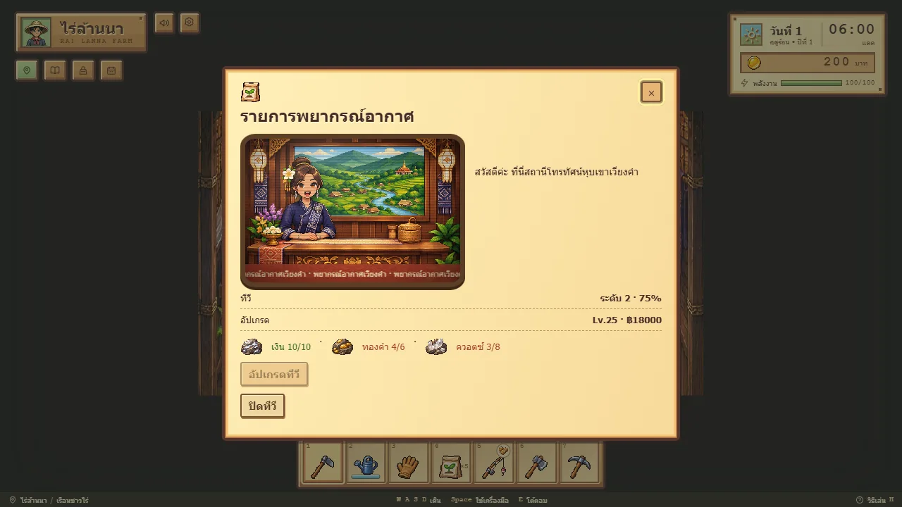</p>

หน้าต่างทีวีแสดงชื่อแร่สำหรับอัปเกรดขั้นต่อไปพร้อมจำนวนที่มี/ที่ต้องใช้ แร่ที่ยังไม่พอเป็นสีแดง

### 🏘️ หมู่บ้าน ตลาด และเพื่อนบ้าน

- **หมู่บ้านเวียงคำ** มะลิและลุงชัยมีระดับความสนิท รับของขวัญ และมีคำขอประจำวัน ลุงชัยยังขายแปลงเพิ่ม ต่อเติมบ้านตามเลเวล และสร้างเล้าไก่ให้
- **ชาวบ้าน 36 คน** ชาวบ้านเดินทาง 22 คนและผู้ทำงาน 14 คน มีตารางกิจกรรม เดินหลบกันและผู้เล่น กลับบ้านหลังเลิกงานและนอนตอนกลางคืน
- **กระดานประกาศ** รับงานส่งของได้วันละ 1 งาน (ผักให้ครัวของมะลิ หรือผลไม้ให้ลุงชัย) ได้เงินและความสนิท
- **บ้านส่วนตัว NPC** กระจาย 8 หลังในหมู่บ้าน ป่า และคอกสัตว์ รวมกุฏิที่วัดอีก 1 แห่ง ขนาดเข้ากับอาคารรอบข้าง ผู้เล่นเข้าไม่ได้ และไม่มี NPC เข้าพื้นที่ฟาร์มส่วนตัว
- **หน้าร้าน** เห็นรูปเจ้าของร้าน กันสาด และสินค้าเป็นภาพ แบ่งแท็บหมวดหมู่และเปลี่ยนหน้าด้วยปุ่ม ปุ่มใช้งานอยู่ในจอเสมอรวมถึงจอเล็ก ของที่ล็อกบอกจำนวนตราที่ต้องใช้ มะลิ ลุงชัย และร้านกิ่งพันธุ์ใช้รูปแบบเดียวกัน ราคาซื้อเพิ่มขึ้น 50% ราคาขายคงเดิม
- **กาดเวียงคำ** ร้านเมล็ดพันธุ์ ร้านอาหาร ช่างตีเหล็ก และพ่อค้าที่รับซื้อของ
- **ตลาดสดชาวสวน** เปิดแผงของตัวเอง (07:00–18:00): เลือกของ จำนวน และราคา ลูกค้าซื้อตามงบของเขา ได้เงินทันที และวันงานประเพณีลูกค้าจะมากขึ้น
- **โรงพยาบาลเวียงคำ** พักฟื้นเมื่อพลังงานหมด หรือเลือกเตียงใดก็ได้ในหอผู้ป่วยเพื่อนอนถึงเช้าราคา ฿60 มีภาพตัวละครนอนอยู่บนเตียง
- **ป่าผักหวานและป่าไผ่ร่มเย็น** เก็บผักกูด ลูกหม่อนป่า และกล้วยป่าที่ป่าผักหวาน (ขึ้นใหม่ในไม่กี่วัน) และเก็บสมุนไพรกับไม้ไผ่ในป่าไผ่

<p align="center">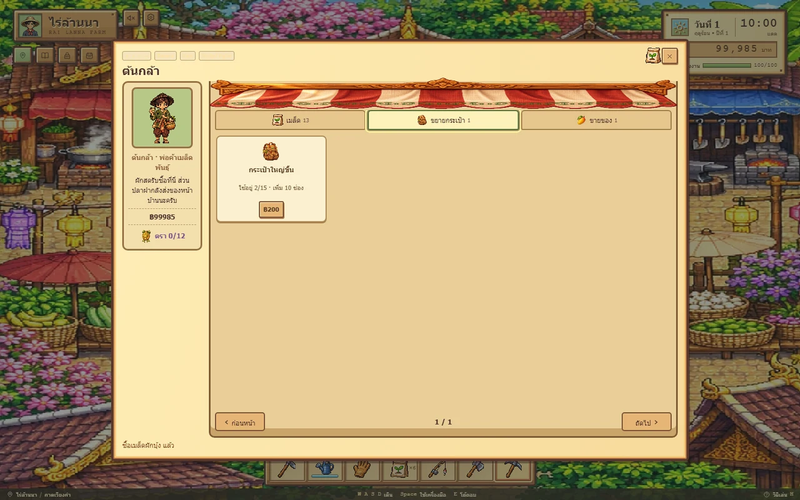</p>

บ้าน NPC และอาคารสาธารณะทุกหลังมีโคมไฟหน้าบ้าน รวมถึงบริเวณศูนย์วิจัย โคมสว่างกลางคืนแม้เจ้าของบ้านเข้านอนแล้ว

<table>
  <tr><td width="50%">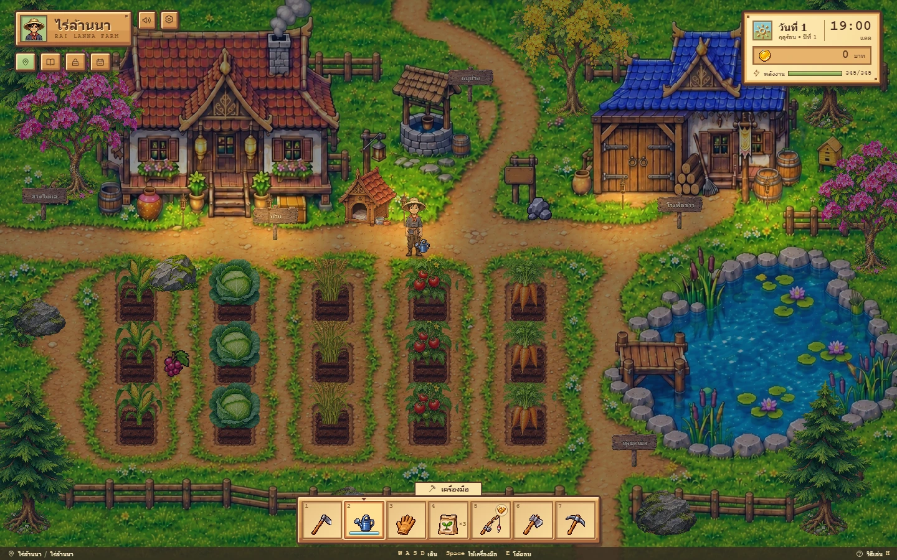</td><td width="50%">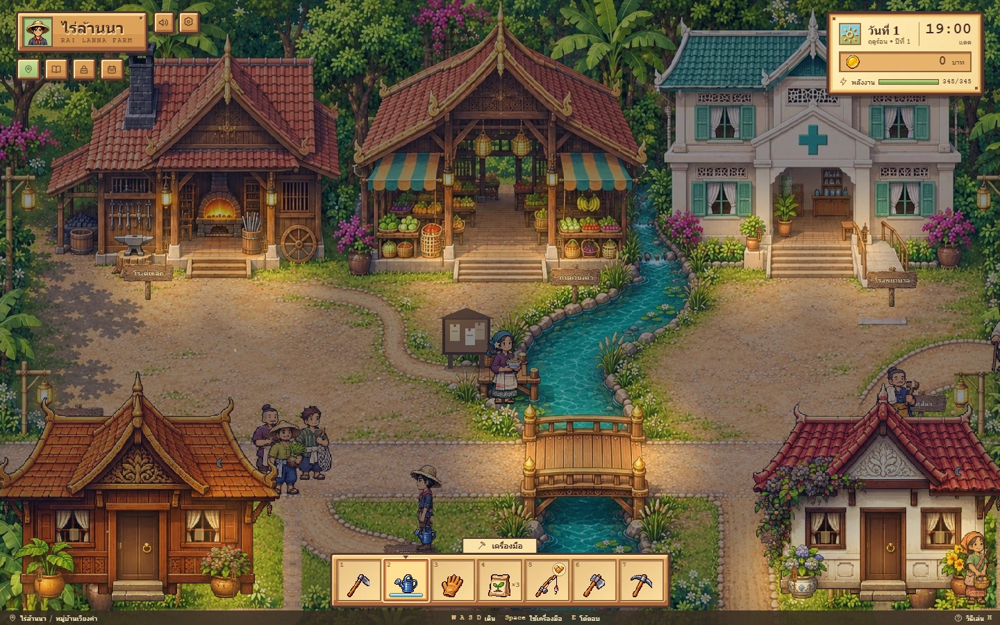</td></tr>
  <tr><td align="center">แสงโคมหน้าอาคารในฟาร์มยามค่ำ</td><td align="center">โคมไฟบ้านชาวบ้านและอาคารสาธารณะ</td></tr>
</table>

### 🛕 วัดดอยแสงดาว

วัดบนดอยริมถนนระหว่างป่าไผ่ร่มเย็นกับป่าผักหวาน ลานวัดมีวิหาร เจดีย์ขาวทอง แถวระฆัง ต้นโพธิ์ และกำแพงตราที่แสดงตราศาลและถ้วยรางวัลงานประเพณีที่ได้มาแล้ว พระอินทร์และป้าลำดวนพักอยู่ที่กุฏิในวัด

ในวิหารทำบุญได้ 3 แบบ เลือกแบบใดก็ได้: สักการะพระพุทธรูป (ไม่เสียอะไร) ถวายผักหรือผลไม้ที่เก็บเกี่ยวมา 1 ชิ้น (เกมเลือกชิ้นที่ราคาถูกที่สุดในย่าม และเพื่อนบ้านทุกคนสนิทขึ้น 1) หรือบริจาค 500 บาท ทุกแบบให้ **โชค +3 นาน 7 วัน** ทำได้สัปดาห์ละครั้ง และไม่ซ้อนทับกัน รับของถวายเวลา 08:00–18:00

<table>
  <tr><td width="50%">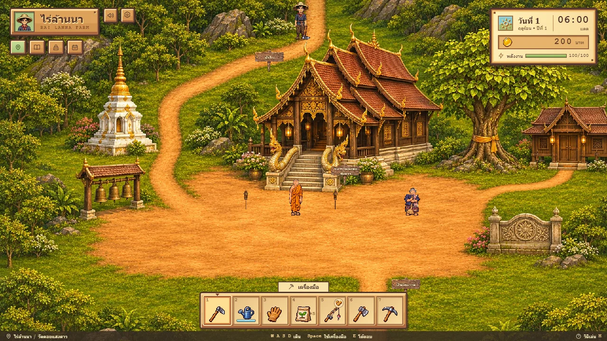</td><td width="50%">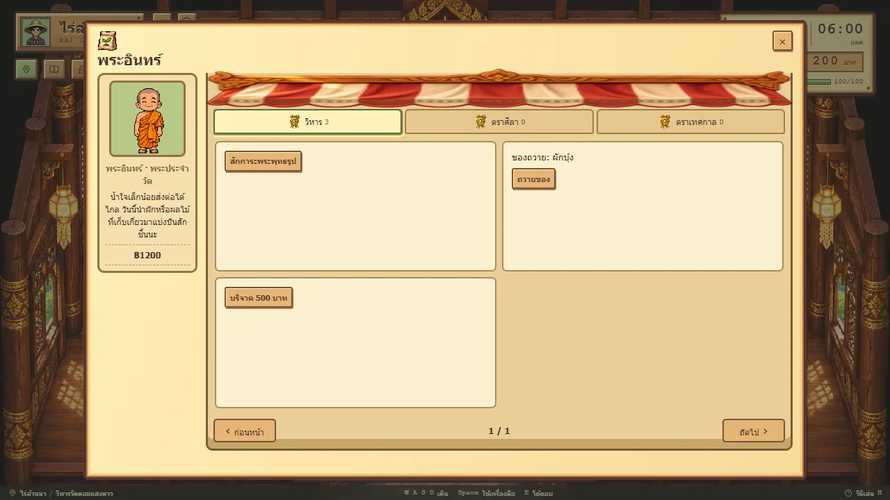</td></tr>
  <tr><td align="center">ลานวัด</td><td align="center">ทำบุญกับพระอินทร์ในวิหาร</td></tr>
</table>

### 🏝️ เกาะรอยดาว

เกาะนี้เป็นรางวัลช่วงท้ายเกม ชนะถ้วยรางวัลงานประเพณีให้ครบ 7 งาน แล้วไปคุยกับผู้ใหญ่ชัยในหมู่บ้านเพื่อรับกุญแจรอยดาว จากนั้นไขประตูที่ปลายสะพานตกปลาหาดอ่าวมุก สะพานจะพาข้ามไปเกาะ

- **ปลาเฉพาะเกาะ:** ปลากะรังจุดฟ้า ปลาช่อนทะเล และปลากะมงพร้าว นอกเหนือจากปลาทะเลปกติ
- **สายแร่อัญมณี:** ไพลิน มรกต และมูนสโตน สุ่มใหม่ทุกวันเหมือนในถ้ำ
- **ของป่า:** สาหร่ายพวงองุ่น (2 ชิ้นทุก 2 วัน) และเมล็ดหูกวาง (2 ชิ้นทุก 3 วัน)
- **หีบผู้ดูแลคลื่น:** เปิดได้เมื่อมีตรา 8 ดวง ได้เครื่องรางที่เพิ่มความอึดถาวร +2 (พลังสูงสุด +20) และ 40 XP

### 🏮 งานประเพณี 7 งานต่อปี

แต่ละงานร่วมได้เฉพาะวันและช่วงเวลาของงาน และพายุจะทำให้งานยกเลิก ทุกงานเพิ่มความสนิทกับเพื่อนบ้านทุกคน
รายงานยามเช้าจะประกาศงานล่วงหน้า 2 วันพร้อมบอกของที่ต้องเตรียม และปฏิทิน (C) แสดงทั้งปี งานสงกรานต์และยี่เป็งจัดที่ลานวัดดอยแสงดาว อีก 5 งานจัดที่ลานกลางเวียง

| งาน | วัน | เวลา | สิ่งที่ได้ |
|---|---|---|---|
| 💦 สงกรานต์ ปี๋ใหม่เมือง | ฤดูร้อน วันที่ 6 | 09:00–18:00 | พลังงาน +25 |
| 🚀 บุญบั้งไฟ | ฤดูร้อน วันที่ 12 | 10:00–18:00 | ใช้ไม้ 3 ท่อน พยากรณ์พรุ่งนี้กลายเป็นฝน |
| 🌱 งานแลกเมล็ดพันธุ์ | ใบไม้ร่วง วันที่ 2 | 08:00–16:00 | เมล็ดแตงกวา 3 ซอง |
| 🚣 แข่งเรือยาว | ใบไม้ร่วง วันที่ 11 | 10:00–18:00 | ใช้พลังงาน 30 ชนะ (โอกาส 50%) ได้ ฿200 แพ้ได้ ฿40 |
| 🏮 ยี่เป็ง ลอยโคม | ฤดูหนาว วันที่ 3 | 17:00–23:00 | ค่าโคม ฿30 เพื่อนบ้านประทับใจเป็นพิเศษ |
| 🌾 ตานข้าวใหม่และประกวดพืชผล | ฤดูหนาว วันที่ 10 | 09:00–17:00 | ของที่แพงที่สุดในกระเป๋าได้รางวัล 4 เท่าของราคา |
| 🌸 กาดดอกไม้บาน | ใบไม้ผลิ วันที่ 5 | 08:00–18:00 | เมล็ดผักกาดหอม 4 ซอง |

ช่วงเทศกาล หมู่บ้าน ตลาดทั้งสองแห่ง ปศุสัตว์ บ้าน NPC และบริเวณศูนย์วิจัยผลไม้เปลี่ยนภาพให้เข้ากับงานนั้น

<table>
  <tr><td width="33%">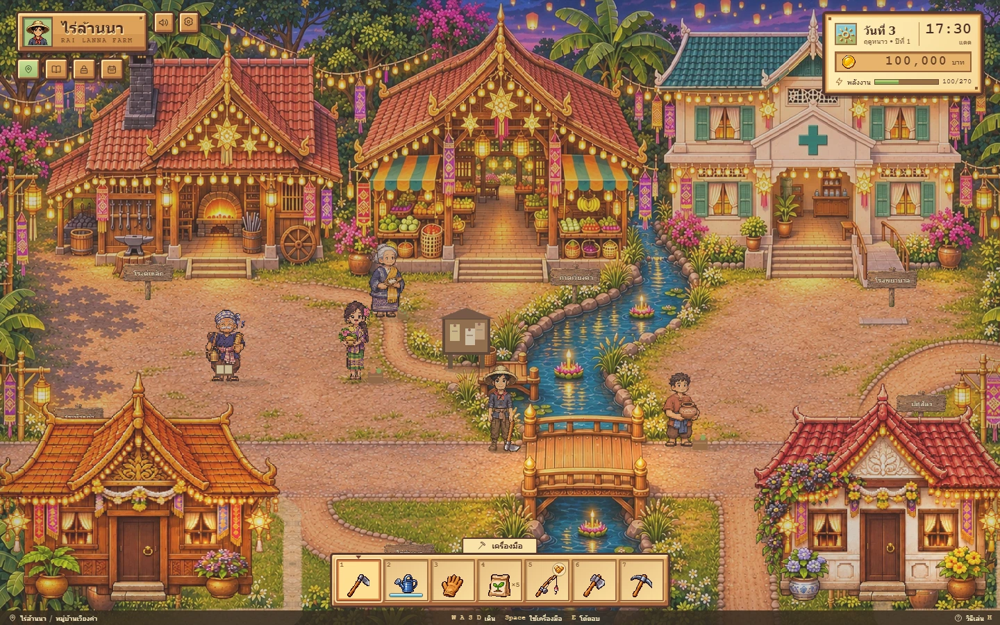</td><td width="33%">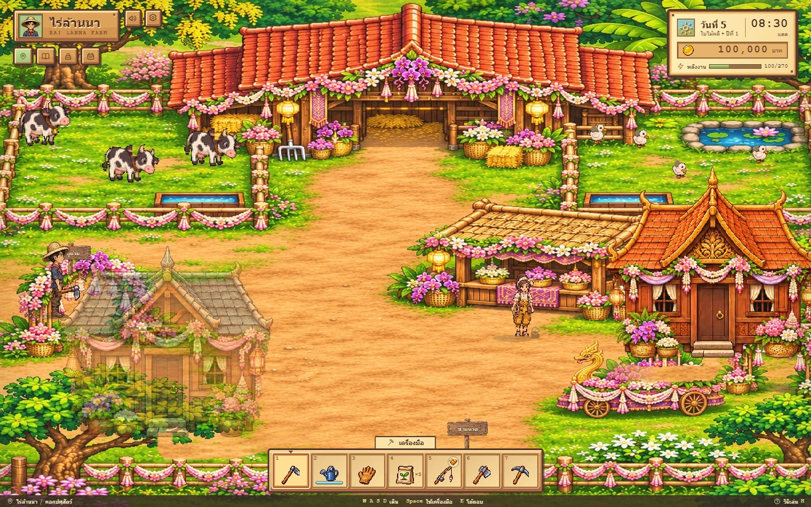</td><td width="33%">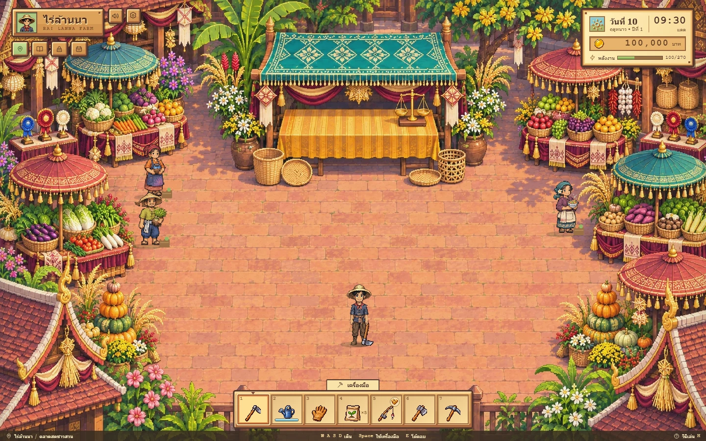</td></tr>
  <tr><td align="center">หมู่บ้านช่วงเทศกาล</td><td align="center">ปศุสัตว์ช่วงเทศกาล</td><td align="center">ตลาดช่วงเทศกาล</td></tr>
</table>

### 🐕 ชุดและสัตว์เลี้ยง

เปลี่ยนชุดที่ตู้เสื้อผ้าในบ้าน เลือกสุนัขหรือแมวที่บ้านสัตว์ข้างบ้านเมื่อเลเวล 10 และชนะ 4 เทศกาลต่างกัน เลือกได้ครั้งเดียวและเปลี่ยนไม่ได้ ลูบหัวได้ทุกวันและเลือกให้เดินตามหรือรอที่บ้านได้

<p align="center"></p>

### 💾 บันทึกอัตโนมัติ

เกมบันทึกในเบราว์เซอร์ (localStorage) ทุกเช้าวันใหม่ และปรับบันทึกเก่าเป็นรูปแบบปัจจุบันให้อัตโนมัติ รูปแบบ v18 เก็บครัว ทีวี ผลจากอาหาร ความคืบหน้าที่วัดและเกาะไว้ด้วย เมื่อปรับแปลงหน้าบ้านจากเซฟเก่าให้เหลือ 15 ช่อง ระบบเก็บต้นเดิมไว้เท่าที่ลงได้ และคืนต้นที่ยังมีชีวิตส่วนเกินเป็นเมล็ดหรือผลผลิตสุก
บันทึกเองได้ที่ตั้งค่า หรือเลือกบันทึกและกลับหน้าแรก/ออกจากเกม ซึ่งจะบันทึกก่อนหยุดเล่น ปุ่มออกจากเกมหยุดเวลาและเสียง จากนั้นปิดแท็บเบราว์เซอร์ได้ การย้อนกลับจากหน้าตั้งชื่อฟาร์มใหม่จะไม่เขียนทับเซฟเดิม

## 📋 ตารางข้อมูลในเกม

ข้อมูลด้านล่างดึงจากรุ่นพัฒนาปัจจุบัน ราคาเป็นเงินในเกม สินค้าหายากบางชนิดต้องใช้ตราจากการแข่งขันหรือปริศนาเพื่อปลดล็อกด้วย

### พืชและผัก · 30 ชนิด

นับเวลาโตตามวันที่ได้รับน้ำ ฝนรดน้ำให้แปลงกลางแจ้ง เรือนกระจกปลูกได้ทุกชนิดทุกฤดู แต่ยังต้องรดน้ำเอง

| ภาพ | ชนิด | ฤดูที่ปลูกได้ | วันโต | ราคาเมล็ด | ราคาขาย/ชิ้น |
|---|---|---|---|---|---|
|  | ผักบุ้ง | ทุกฤดู | 3 | 15 | 25 |
|  | ถั่วฝักยาว | ฤดูร้อน, ใบไม้ร่วง | 5 | 38 | 70 |
|  | แตงโม | ฤดูร้อน | 9 | 90 | 200 |
|  | ข้าวโพด | ใบไม้ร่วง | 6 | 45 | 90 |
|  | พริก | ใบไม้ร่วง | 7 | 60 | 120 |
|  | ฟักทอง | ใบไม้ร่วง, ฤดูหนาว | 8 | 75 | 160 |
|  | กะหล่ำปลี | ฤดูหนาว | 6 | 45 | 95 |
|  | มะเขือเทศ | ฤดูหนาว | 7 | 60 | 125 |
|  | สตรอว์เบอร์รี | ฤดูหนาว, ใบไม้ผลิ | 9 | 105 | 230 |
|  | แครอต | ฤดูหนาว, ฤดูร้อน, ใบไม้ผลิ | 4 | 27 | 50 |
|  | สับปะรด | ฤดูร้อน, ใบไม้ร่วง | 8 | 75 | 165 |
|  | มะเขือม่วง | ทุกฤดู | 5 | 33 | 65 |
|  | มะละกอ | ฤดูร้อน, ใบไม้ร่วง | 7 | 57 | 110 |
|  | แตงกวา | ใบไม้ผลิ, ฤดูร้อน, ใบไม้ร่วง | 4 | 27 | 48 |
|  | บีตรูต | ฤดูหนาว | 5 | 36 | 74 |
|  | บรอกโคลี | ฤดูหนาว, ใบไม้ร่วง | 6 | 48 | 98 |
|  | เมลอน | ฤดูร้อน | 8 | 82 | 175 |
|  | แก้วมังกร | ฤดูร้อน, ใบไม้ร่วง | 9 | 93 | 195 |
|  | เสาวรส | ใบไม้ร่วง, ฤดูหนาว | 7 | 63 | 132 |
| 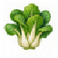 | ผักกวางตุ้ง | ฤดูหนาว, ใบไม้ผลิ | 3 | 18 | 32 |
|  | แรดิช | ใบไม้ผลิ, ฤดูหนาว | 4 | 24 | 48 |
| 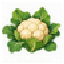 | กะหล่ำดอก | ฤดูหนาว | 8 | 69 | 154 |
|  | หอมแดง | ฤดูร้อน, ฤดูหนาว | 6 | 48 | 98 |
|  | กระเทียม | ฤดูหนาว, ใบไม้ผลิ | 6 | 44 | 88 |
| 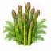 | หน่อไม้ฝรั่ง | ใบไม้ผลิ, ใบไม้ร่วง | 8 | 72 | 153 |
| 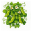 | ถั่วลันเตา | ใบไม้ผลิ, ฤดูหนาว | 5 | 38 | 72 |
|  | ซูกินี | ฤดูร้อน, ใบไม้ผลิ | 5 | 34 | 70 |
|  | พริกหวาน | ฤดูร้อน, ใบไม้ร่วง | 7 | 57 | 119 |
|  | ผักกาดหอม | ใบไม้ผลิ, ฤดูหนาว, ใบไม้ร่วง | 4 | 24 | 46 |
| 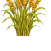 | ข้าวสาลี | ฤดูหนาว, ใบไม้ผลิ, ฤดูร้อน | 6 | 30 | 65 |

### ไม้ผล · 15 ชนิด

ซื้อกิ่งพันธุ์ที่ศูนย์วิจัยผลไม้ในป่าผักหวาน ไม้ผลทุกชนิดโตหลังได้รับน้ำ 56 วัน หรือหนึ่งปีในเกม

| ไอคอน | ชนิด | ฤดูออกผล | วันโต | รอบเก็บ/วัน | ผล/รอบ | เลเวลที่ซื้อได้ | ราคากิ่งพันธุ์ |
|---|---|---|---|---|---|---|---|
|  | กล้วยน้ำว้า | ทุกฤดู | 56 | 5 | 2 | 1 | 150 |
|  | มะม่วงน้ำดอกไม้ | ฤดูร้อน | 56 | 3 | 3 | 10 | 600 |
|  | ลำไย | ใบไม้ร่วง | 56 | 3 | 3 | 15 | 1200 |
|  | ส้มสายน้ำผึ้ง | ฤดูหนาว | 56 | 3 | 3 | 10 | 600 |
|  | ลิ้นจี่ | ฤดูร้อน | 56 | 3 | 3 | 20 | 2400 |
|  | เงาะ | ใบไม้ร่วง | 56 | 3 | 3 | 15 | 1200 |
|  | มังคุด | ใบไม้ร่วง | 56 | 4 | 3 | 30 | 9600 |
|  | ทุเรียน | ฤดูร้อน | 56 | 6 | 2 | 30 | 9600 |
|  | ขนุน | ฤดูร้อน, ใบไม้ร่วง | 56 | 6 | 2 | 30 | 9600 |
|  | มะละกอ | ทุกฤดู | 56 | 4 | 2 | 1 | 150 |
|  | มะพร้าว | ทุกฤดู | 56 | 6 | 2 | 25 | 4800 |
|  | ฝรั่ง | ฤดูหนาว, ใบไม้ผลิ | 56 | 3 | 3 | 5 | 300 |
|  | ส้มโอ | ฤดูหนาว | 56 | 5 | 2 | 25 | 4800 |
|  | มะขามหวาน | ฤดูหนาว, ใบไม้ผลิ | 56 | 4 | 3 | 20 | 2400 |
|  | มะเฟือง | ใบไม้ผลิ, ใบไม้ร่วง | 56 | 3 | 3 | 5 | 300 |

### แร่และอัญมณี · 15 ชนิด

สายแร่สุ่มใหม่แต่ละวันในถ้ำ 5 ชั้น ยิ่งลึกยิ่งมีแร่หายาก ตารางแสดงระดับอีเต้อที่ต้องใช้ขุดแร่นั้นโดยตรง

| ภาพ | แร่ | อีเต้อขั้นต่ำ/ระดับ |
|---|---|---|
|  | ทองแดง | 1 |
|  | เหล็ก | 2 |
|  | เงิน | 3 |
| 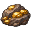 | ทองคำ | 4 |
|  | ผลึกดาว | 5 |
|  | ควอตซ์ | 6 |
| 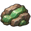 | หยก | 7 |
|  | อเมทิสต์ | 8 |
|  | โกเมน | 9 |
|  | บุษราคัม | 10 |
|  | ไพลิน | 11 |
|  | มรกต | 12 |
|  | ทับทิม | 13 |
|  | มุกดาหาร | 14 |
|  | เพชร | 15 |

### สัตว์น้ำ · 43 ชนิด

| ไอคอน | ชนิด | แหล่งน้ำ | ฤดู | เวลา | ราคาขาย |
|---|---|---|---|---|---|
|  | ปูทะเล | ชายหาด / ทะเลที่เกาะ | ทุกฤดู | 00:00–24:00 | 72 |
|  | กุ้งกุลาดำ | ชายหาด / ทะเลที่เกาะ | ทุกฤดู | 00:00–24:00 | 68 |
|  | หอยทะเล | ชายหาด / ทะเลที่เกาะ | ทุกฤดู | 00:00–24:00 | 90 |
|  | เต่าทะเล | ชายหาด / ทะเลที่เกาะ | ทุกฤดู | 00:00–24:00 | 500 |
|  | เม่นทะเล | ชายหาด / ทะเลที่เกาะ | ทุกฤดู | 00:00–24:00 | 110 |
|  | หมึกทะเล | ชายหาด / ทะเลที่เกาะ | ทุกฤดู | 00:00–24:00 | 125 |
|  | ปลากะรังจุดฟ้า | ทะเลที่เกาะเท่านั้น | ทุกฤดู | 06:00–18:00 | 260 |
| 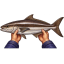 | ปลาช่อนทะเล | ทะเลที่เกาะเท่านั้น | ฤดูร้อน, ใบไม้ร่วง, ใบไม้ผลิ | 00:00–24:00 | 300 |
|  | ปลากะมงพร้าว | ทะเลที่เกาะเท่านั้น | ทุกฤดู | 16:00–24:00 * | 360 |
| 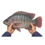 | ปลานิล | บ่อฟาร์ม / สระ / แม่น้ำ | ทุกฤดู | 00:00–24:00 | 12 |
|  | ปลาตะเพียน | บ่อฟาร์ม / สระ / แม่น้ำ | ฤดูร้อน, ใบไม้ร่วง | 06:00–18:00 | 18 |
| 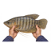 | ปลาสลิด | บ่อฟาร์ม / สระ / แม่น้ำ | ฤดูหนาว | 06:00–18:00 | 20 |
|  | ปลาหมอ | บ่อฟาร์ม / สระ / แม่น้ำ | ใบไม้ร่วง | 00:00–24:00 | 25 |
|  | ปลาดุก | บ่อฟาร์ม / สระ / แม่น้ำ | ฤดูร้อน, ใบไม้ร่วง | 18:00–24:00 * | 35 |
| 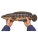 | ปลาช่อน | บ่อฟาร์ม / สระ / แม่น้ำ | ทุกฤดู | 06:00–10:00 | 60 |
|  | ปลากราย | บ่อฟาร์ม / สระ / แม่น้ำ | ฤดูหนาว | 16:00–24:00 | 85 |
| 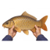 | ปลาไน | สระ / แม่น้ำ | ทุกฤดู | 00:00–24:00 | 48 |
|  | ปลาแรด | สระ / แม่น้ำ | ทุกฤดู | 06:00–18:00 * | 85 |
| 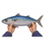 | ปลาทู | ชายหาด / ทะเลที่เกาะ | ทุกฤดู | 00:00–24:00 | 32 |
| 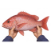 | ปลากะพงแดง | ชายหาด / ทะเลที่เกาะ | ทุกฤดู | 06:00–18:00 * | 78 |
|  | ปลาเก๋า | ชายหาด / ทะเลที่เกาะ | ฤดูร้อน, ใบไม้ร่วง | 06:00–24:00 | 105 |
|  | ปลาสาก | ชายหาด / ทะเลที่เกาะ | ทุกฤดู | 16:00–24:00 | 125 |
|  | ปลาไหล | บ่อฟาร์ม / สระ / แม่น้ำ | ใบไม้ร่วง | 20:00–24:00 | 110 |
|  | ปลาคาร์ป | บ่อฟาร์ม / สระ / แม่น้ำ | ทุกฤดู | 00:00–24:00 * | 79 |
|  | ปลาทอง | บ่อฟาร์ม / สระ / แม่น้ำ | ฤดูร้อน, ใบไม้ผลิ | 06:00–20:00 | 42 |
|  | ปลาเฉาฮื้อ | สระ / แม่น้ำ | ใบไม้ร่วง, ฤดูหนาว | 08:00–22:00 | 56 |
|  | ปลายี่สกเทศ | สระ / แม่น้ำ | ฤดูร้อน, ใบไม้ร่วง, ใบไม้ผลิ | 16:00–24:00 * | 62 |
|  | ปลาเสือสุมาตรา | บ่อฟาร์ม / สระ / แม่น้ำ | ทุกฤดู | 00:00–24:00 | 38 |
|  | ปลาซิว | บ่อฟาร์ม / สระ / แม่น้ำ | ฤดูร้อน, ใบไม้ผลิ | 06:00–20:00 | 16 |
|  | ปลาพลวง | สระ / แม่น้ำ | ใบไม้ร่วง, ฤดูหนาว | 08:00–22:00 * | 118 |
|  | ปลาเรดเทล | สระ / แม่น้ำ | ฤดูร้อน, ใบไม้ร่วง, ใบไม้ผลิ | 16:00–24:00 | 146 |
|  | ปลามังกรเงิน | สระ / แม่น้ำ | ทุกฤดู | 00:00–24:00 | 220 |
|  | ปลากระโห้ | สระ / แม่น้ำ | ฤดูร้อน, ใบไม้ผลิ | 06:00–20:00 * | 190 |
|  | ปลาซาร์ดีน | ชายหาด / ทะเลที่เกาะ | ใบไม้ร่วง, ฤดูหนาว | 08:00–22:00 | 24 |
|  | ปลาแพะลาย | ชายหาด / ทะเลที่เกาะ | ฤดูร้อน, ใบไม้ร่วง, ใบไม้ผลิ | 16:00–24:00 | 52 |
|  | ปลาโอ | ชายหาด / ทะเลที่เกาะ | ทุกฤดู | 00:00–24:00 * | 76 |
|  | ปลาจาระเม็ดเงิน | ชายหาด / ทะเลที่เกาะ | ฤดูร้อน, ใบไม้ผลิ | 06:00–20:00 | 89 |
|  | ปลาลิ้นหมา | ชายหาด / ทะเลที่เกาะ | ใบไม้ร่วง, ฤดูหนาว | 08:00–22:00 | 72 |
|  | ปลาเห็ดโคน | ชายหาด / ทะเลที่เกาะ | ฤดูร้อน, ใบไม้ร่วง, ใบไม้ผลิ | 16:00–24:00 * | 28 |
|  | ปลากะมงทอง | ชายหาด / ทะเลที่เกาะ | ทุกฤดู | 00:00–24:00 | 105 |
|  | ปลาอีโต้มอญ | ชายหาด / ทะเลที่เกาะ | ฤดูร้อน, ใบไม้ผลิ | 06:00–20:00 | 140 |
|  | ปลากระโทงดาบ | ชายหาด / ทะเลที่เกาะ | ใบไม้ร่วง, ฤดูหนาว | 08:00–22:00 * | 200 |
|  | ปลากระโทงร่ม | ชายหาด / ทะเลที่เกาะ | ฤดูร้อน, ใบไม้ร่วง, ใบไม้ผลิ | 16:00–24:00 | 235 |

\* ชนิดที่มีเครื่องหมายนี้พบได้ตลอดวันเมื่ออากาศเปียกชื้น แต่ยังต้องตรงฤดูและแหล่งน้ำ

### อุปกรณ์และเครื่องมือ

| ภาพ | ปุ่ม | อุปกรณ์ | การใช้งาน | พัฒนา/ข้อสังเกต |
|---|---|---|---|---|
|  | 1 | จอบ | พรวนดินและกำจัดหญ้า | อัปเกรดระดับด้วยแร่ และซื้อจอบเหล็ก |
|  | 2 | บัวรดน้ำ | รดพืชและต้นอ่อน; เติมน้ำริมบ่อ/สระ/แม่น้ำ/ทะเล | เริ่มต้น 10 ครั้ง; บัวทองแดงเพิ่มเป็น 20 ครั้ง |
|  | 3 | มือเก็บเกี่ยว | เก็บผักที่โตเต็มที่ | ใช้ถือผลผลิต ปลา หรือแร่ที่เลือกจากกระเป๋า |
|  | 4 | ถุงเมล็ด | ปลูกลงดินที่พรวนแล้ว | Q เปลี่ยนชนิดเมล็ด; ปลูกตามฤดู |
|  | 5 | เบ็ดตกปลา | ตกปลาด้วยมินิเกมมุมมองบุคคลที่หนึ่ง | คันเบ็ดคาร์บอนและเหยื่อช่วยตกปลาหายาก |
|  | 6 | ขวาน | ตัดต้นไม้ ตอไม้ และขอนไม้ | อัปเกรดระดับด้วยแร่เพื่อเปิดพื้นที่ยากขึ้น |
|  | 7 | อีเต้อ | ทุบหินและขุดสายแร่ | ระดับที่ต้องใช้ตามตารางแร่ด้านบน |
|  | — | บันไดลิง | ของจากรุ่นก่อน | ช่างยังขายอยู่ แต่ไม่จำเป็นแล้ว ชั้นถ้ำเปิดตามเลเวล |
|  | — | โคมทางเดิน | ให้แสงเฉพาะกลางคืน | ซื้อแล้วปักจากหมวดบันทึกในสมุดฟาร์ม |
|  | — | กระเป๋า | เก็บไอเทมแยกชนิดเป็นช่อง | เริ่มต้น 15 ช่อง; ซื้อขยายได้สูงสุด 150 ช่อง |

#### อุปกรณ์อัปเกรดจากร้าน

| ภาพ | อุปกรณ์ | ราคา | ผลที่ได้ |
|---|---|---|---|
|  | บัวรดน้ำทองแดง | 165 | ลดพลังรดน้ำ 1 หน่วย |
|  | จอบเหล็ก | 202 | ลดพลังพรวนดิน 1 หน่วย |
|  | คันเบ็ดคาร์บอน | 232 | ปลากินเหยื่อเร็วขึ้น 28% |

#### เหยื่อตกปลา

| ภาพ | เหยื่อ | ตัวคูณน้ำหนักสุ่มปลาหายาก | ราคา |
|---|---|---|---|
|  | เหยื่อพื้นบ้าน | ×1 | ฟรี / ใช้ได้ไม่จำกัด |
|  | ไส้เดือน | ×1.8 | ฿18 / 3 ชิ้น |
|  | กุ้งสด | ×3 | ฿42 / 3 ชิ้น |
|  | เหยื่อเรืองแสง | ×5 | ฿82 / 3 ชิ้น |

ตัวคูณเหยื่อเพิ่มน้ำหนักในการสุ่มปลาหายาก ไม่ใช่อัตราจับสำเร็จที่รับประกัน การอัปเกรดเครื่องมือใช้แร่หลายชนิดและอาจต้องใช้ตราปลดล็อก เพิ่มแรงงาน ความอึด และโชคได้ในสมุดฟาร์ม

## 🚧 แผนงาน

- [x] วงจรประจำวัน
- [x] ปฏิทิน ฤดู และอากาศ (4 ฤดู มีหิมะ)
- [x] ตกปลา (มุมมองบุคคลที่หนึ่ง มีเหยื่อ)
- [x] ~~นาข้าว~~ ถอดออกแล้ว ใช้การขยายที่ดินและทุ่งบุกเบิกแทน
- [x] สวนผลไม้ (พร้อมแยมผลไม้)
- [x] ปศุสัตว์ 16 ชนิด โรงฟัดข้าวและอาหารจากข้าวสาลี
- [x] หมู่บ้าน เพื่อนบ้าน งานประเพณี (พร้อมแผงตลาดสดและปฏิทิน)
- [x] ขุดแร่ เลเวล เครื่องมือ และของป่า
- [x] กระเป๋ารูปไอเทมที่ขยายได้ ปริศนาที่ซ่อนอยู่ และร้านค้าปลดล็อกด้วยตรา
- [x] พื้นฉากใหม่และวัตถุประกอบฉากแยกชิ้นในแผนที่กลางแจ้ง 9 แห่ง
- [x] ถนนเชื่อมถึงกัน: มีเส้นทางวนระหว่างแผนที่ และปลายถนนสองฝั่งตรงกัน
- [x] ภาษาอังกฤษและภาษาไทย
- [x] ทำอาหารที่บ้าน 20 เมนู อัปเกรดครัวและทีวี
- [x] วัดดอยแสงดาวและเกาะรอยดาว
- [x] ฉากตามฤดูในแผนที่กลางแจ้งทั้ง 13 แห่ง
- [x] รุ่นเว็บที่เปิดได้จากทุกโฟลเดอร์ (พร้อมขึ้น itch.io)
- [ ] ภาพและเสียงแบบล้านนา: เสร็จเกือบหมดแล้ว

**ยังต้องทำ**

- [ ] โหมดมือถือและ PWA (พักการพัฒนาไว้ก่อน)

## 🧰 เกี่ยวกับโฟลเดอร์ `.claude/skills`

เป็นสกิลพัฒนาเกม 17 ตัวที่เลือกมาจาก
[gamedev-skills/awesome-gamedev-agent-skills](https://github.com/gamedev-skills/awesome-gamedev-agent-skills)
สำหรับให้ Claude Code ใช้ระหว่างพัฒนาเกมนี้ ไม่มีส่วนเกี่ยวข้องตอนเกมทำงาน อยู่ภายใต้สัญญาอนุญาต Apache-2.0
(`LICENSE` และ `NOTICE` อยู่ในโฟลเดอร์นั้น) และลบทิ้งได้โดยไม่กระทบเกม

## ⚖️ ใบอนุญาต

สงวนสิทธิ์โค้ด ภาพ และเสียงของเกม ไม่ได้อนุญาตให้นำเนื้อหาของเกมไปใช้ต่อ ดู [LICENSE](LICENSE) เก็บข้อความลิขสิทธิ์และใบอนุญาตของแพ็กเกจ npm ที่ติดตั้ง 39 รายการ รวมถึงชุดสกิลพัฒนาเกมที่อยู่ใน repo ไว้ใน [THIRD_PARTY_LICENSES.md](THIRD_PARTY_LICENSES.md) Phaser และ eventemitter3 ใช้ MIT ส่วนเครื่องมือพัฒนายังมี Apache-2.0, MPL-2.0, ISC และ BSD-3-Clause

---

<div align="center">

สร้างด้วย 🌾 และ Phaser · [⬆ กลับขึ้นด้านบน](#-ไร่ล้านนา--rai-lanna)

</div>
