<div align="center">

# 🌾 ไร่ล้านนา · Rai Lanna

**เกมทำฟาร์มบรรยากาศล้านนา เล่นได้บนเบราว์เซอร์**

<p>
  
  
  
  
</p>
<p>
  
  
  
</p>

[English](README.md) · **ภาษาไทย**

[🚀 เริ่มเล่น](#-เริ่มเล่น) · [🎮 วิธีเล่น](#-วิธีเล่น) · [✨ มีอะไรในเกม](#-มีอะไรในเกม) · [📋 ตารางข้อมูล](#-ตารางข้อมูลในเกม) · [🚧 แผนงาน](#-แผนงาน)


</div>

เกมทำฟาร์ม 2 มิติบรรยากาศล้านนา เล่นบนเว็บเบราว์เซอร์ สร้างด้วย Phaser 4, TypeScript และ Vite
ปลูกผัก ทำสวนผลไม้ ตกปลา ขุดแร่ เลี้ยงสัตว์ ขายของที่ตลาด และร่วมงานประเพณีของหมู่บ้าน
เป็นเกมของเราเองในแนวทำฟาร์มคลาสสิก ใช้ภาพและบรรยากาศแบบล้านนา

ตัวเกมรองรับอังกฤษและไทย ภาพในหน้านี้เป็นภาพจากเกมภาษาไทย

<div align="center">

<table>
  <tr>
    <td align="center" width="25%">🌱<br><b>29</b><br>ชนิดพืช</td>
    <td align="center" width="25%">🎣<br><b>37</b><br>ชนิดปลา</td>
    <td align="center" width="25%">🥭<br><b>15</b><br>ชนิดไม้ผล</td>
    <td align="center" width="25%">💎<br><b>15</b><br>ชนิดแร่</td>
  </tr>
  <tr>
    <td align="center" width="25%">🐄<br><b>15</b><br>ชนิดสัตว์ในคอก</td>
    <td align="center" width="25%">🏮<br><b>7</b><br>งานประเพณีต่อปี</td>
    <td align="center" width="25%">👥<br><b>36</b><br>ชาวบ้าน</td>
    <td align="center" width="25%">🌦️<br><b>4 · 5</b><br>ฤดู · แบบอากาศ</td>
  </tr>
</table>

</div>

> [!NOTE]
> **สถานะ: อยู่ระหว่างพัฒนา** ระบบหลักเล่นได้ครบตั้งแต่ต้นจนจบ (ดูหัวข้อ [แผนงาน](#-แผนงาน) สำหรับสิ่งที่ยังเหลือ)
> ภาพทุกภาพในหน้านี้ถ่ายจากเกมจริง บางภาพจัดฉากก่อนถ่าย (ปลูกพืชไว้แล้ว ซื้อสัตว์ไว้แล้ว) เพื่อให้ภาพเดียวเห็นทั้งระบบ

> ภาพและฟีเจอร์อ้างอิงรุ่นพัฒนาปัจจุบัน การอัปเดตครั้งนี้เผยแพร่เฉพาะเอกสารและภาพประกอบ โค้ดเกมรุ่นใหม่ยังไม่ถูกรวม
> ภาพหน้าจอถ่ายใหม่จากเกมที่รันอยู่เมื่อ 15 พฤศจิกายน 2026 ไอคอนในตารางใช้รูปไอเทมจากเกมจริง

## 🚀 เริ่มเล่น

ต้องมี [Node.js](https://nodejs.org) และ npm (ทดสอบกับ Node 26)

```bash
npm install
npm run dev
```

แล้วเปิด http://localhost:5173 ในเบราว์เซอร์

คำสั่งอื่น

| คำสั่ง | ทำอะไร |
|---|---|
| `npm test` | รันชุดทดสอบกติกาเกม (Vitest) |
| `npm run typecheck` | ตรวจชนิดข้อมูลด้วย TypeScript |
| `npm run build` | ตรวจชนิดข้อมูล แล้วสร้างไฟล์สำหรับเผยแพร่ลงใน `dist` |
| `npm run preview` | เปิดดูไฟล์ที่ build แล้ว |

รุ่นปัจจุบันรองรับคอมพิวเตอร์และคีย์บอร์ด ปิดการควบคุมด้วยเมาส์และสัมผัสไว้

<table>
  <tr>
    <td width="50%"></td>
    <td width="50%"></td>
  </tr>
  <tr><td align="center">หน้าเริ่มเกมกลางวันตามเวลาเครื่อง</td><td align="center">หน้าเริ่มเกมกลางคืนตามเวลาเครื่อง</td></tr>
</table>

### 🌐 เปลี่ยนภาษา

เปิด **Settings** (รูปเฟืองด้านบน) แล้วกดปุ่ม **Language · ภาษา** เกมจะบันทึกฟาร์มแล้วโหลดใหม่เป็นอีกภาษาหนึ่ง
เบราว์เซอร์จะจำภาษาที่เลือกไว้

เมื่อเปิดเกม เลือก **เริ่มฟาร์มใหม่** ตั้งชื่อฟาร์มและยืนยัน หรือเลือก **โหลดบันทึก** เพื่อเล่นฟาร์มเดิม หน้าแรกมีตั้งค่าและออกจากเกม ภาพเปลี่ยนตามเวลาเครื่อง: กลางคืน 18:00–05:59 กลางวัน 06:00–17:59 ใช้คีย์บอร์ดบนคอมพิวเตอร์ในการเล่น

## 🎮 วิธีเล่น

เดินเข้าข้างแปลง หันหน้าไปยังช่องที่ต้องการ แล้วใช้จอบพรวนดิน ถุงเมล็ดปลูก และบัวรดน้ำด้วย Space เลือกเมนูด้วย Tab/ลูกศร และยืนยันด้วย Enter

### ⌨️ ปุ่ม

| ปุ่ม | ทำอะไร |
|---|---|
| WASD หรือลูกศร | เดิน |
| Space | ใช้เครื่องมือกับช่องตรงหน้า (หรือเหวี่ยงเบ็ดและดึงปลา) |
| 1 จอบ · 2 บัวรดน้ำ · 3 มือเก็บเกี่ยว · 4 ถุงเมล็ด · 5 เบ็ด · 6 ขวาน · 7 อีเต้อ | เลือกเครื่องมือ |
| Q | สลับเมล็ดในถุง |
| E | ใช้งานสถานที่หรือคุยกับคนที่อยู่ใกล้ |
| M · I · J · C · H | แผนที่เดินทาง · กระเป๋า · สมุดฟาร์ม · ปฏิทิน · วิธีเล่น |
| F3 · F10 | ตั้งค่า · เปิด/ปิดเสียง |
| Tab / ลูกศร / Enter | เลือกและยืนยันเมนู |
| [ / ] · Page Up / Page Down | เปลี่ยนหมวด · ย้อนหน้า/หน้าถัดไป |
| F2 | เปิดหน้าตั้งชื่อฟาร์มใหม่ |
| Esc | ปิดหน้าต่าง หรือเก็บเบ็ด |

### ☀️ หนึ่งวันในเกม

1. ตื่นนอน ดูอากาศวันนี้และพรุ่งนี้ อ่านรายงานยามเช้า (ขายอะไรได้ พืชโตแค่ไหน ข่าวงานประเพณี)
2. ทำงาน: พรวนดิน ปลูก รดน้ำ เก็บเกี่ยว ตกปลา ขุดแร่ ดูแลสวนผลไม้และสัตว์
3. ใส่ของที่จะขายลงลังส่งของ (ได้เงินเช้าวันถัดไป) หรือขายเองที่แผงของคุณในตลาดสด
4. แวะหมู่บ้านและตลาดเพื่อซื้อเมล็ด เครื่องมือ อาหาร และรับคำขอของชาวบ้าน
5. เข้าบ้านแล้วนอนบนเตียงก่อนพลังงานหมด เกมบันทึกทุกเช้า

หนึ่งวัน (06:00–24:00) ใช้เวลาจริงประมาณ 10 นาที ถ้ายังไม่นอนเมื่อถึงเวลาเข้านอนจะหมดแรงล้มและต้องจ่ายค่ารักษา
เลเวลสูงขึ้นจะอยู่ดึกได้นานขึ้นและมีพลังงานมากขึ้น

### 🧭 การเดินทาง

แต่ละสถานที่เป็นแผนที่ภาพวาดของตัวเอง เดินออกขอบจอตามถนนหรือผ่านประตู ก็จะไปโผล่บนถนนเส้นเดียวกันของแผนที่ถัดไป
แผนภาพหุบเขา (M) แสดงสถานที่ที่เคยไปถึงแล้ว ภาพฉากจะเปิดเมื่อสำรวจถึงเท่านั้น ใช้ดูข้อมูลและเดินทางตามถนนด้วยตัวเอง ไม่มีระบบกลับบ้านอัตโนมัติ

ถนนเชื่อมกันเป็นวง จึงแทบไม่มีทางตัน: คอกปศุสัตว์และทุ่งบุกเบิกมีทางลงไปหาดอ่าวมุก ส่วนสวนผลไม้เชื่อมกับสระบัวแก้วและป่าผักหวาน
ถนนที่ออกจากแผนที่หนึ่งจะเข้าแผนที่ถัดไปตรงตำแหน่งเดียวกันบนขอบที่ติดกัน

<table>
  <tr>
    <td width="50%"></td>
    <td width="50%"></td>
  </tr>
  <tr><td align="center">แผนภาพสถานที่ที่สำรวจแล้ว</td><td align="center">หมู่บ้าน แม่น้ำ และบ้าน NPC ขนาดใหม่</td></tr>
</table>

### 🖥️ เล่นบนคอมพิวเตอร์

เล่นด้วยคีย์บอร์ดทั้งฉากและเมนู ปิดเมาส์และสัมผัสไว้ โหมดมือถือยังพักการพัฒนา

## ✨ มีอะไรในเกม

### 🌱 ฟาร์ม พืช และอากาศ

- **พืช 29 ชนิด** ปลูกในแปลงข้างบ้านและรดน้ำทุกวัน เมล็ดขายที่ร้านเมล็ดพันธุ์ในกาดเวียงคำ ราคาและเวลาโตต่างกันไปตามชนิด
- **4 ฤดู** ร้อน → ใบไม้ร่วง → หนาว → ใบไม้ผลิ ฤดูละ 14 วัน (ปีละ 56 วัน) พืชที่ทนฤดูใหม่ไม่ได้จะเหี่ยว และเกมเตือนล่วงหน้า 3 วัน
- **อากาศ 5 แบบ** แดด ฝน แดดจัด พายุฝน และหิมะ มีพยากรณ์ของวันพรุ่งนี้เสมอ ฝนรดน้ำแปลงให้ พายุทำให้พืชเฉาได้ แดดจัดทำให้ทุกงานเหนื่อยขึ้น
- **กลางวันกลางคืน** ท้องฟ้ามืดลงตามเวลา และโคมไฟที่วางไว้จะสว่างหลังพลบค่ำ
- **เติมน้ำบัวรดน้ำ** เติมหนึ่งครั้งรดได้ 10 ช่อง หรือ 20 ช่องเมื่อใช้บัวทองแดง แถบสีฟ้าใต้รูปบัวแสดงระดับน้ำ เลือกบัวที่บ่อในไร่ สระ หรือชายทะเลเพื่อเติมน้ำ
- **กระเป๋าเป็นรูปไอเทม** หน้าต่างกระเป๋ามีขนาดกะทัดรัด แสดงของเป็นช่องรูปเล็ก เลือกแท็บหมวดหมู่และปุ่มก่อนหน้า–ถัดไปเพื่อดูของโดยไม่ต้องเลื่อนขึ้นลง เริ่ม 15 ช่อง นับหนึ่งช่องต่อชนิด ของชนิดเดิมเพิ่มจำนวนได้แม้กระเป๋าเต็ม ซื้อเพิ่มจากต้นกล้าครั้งละ 10 ช่องจนถึง 150 ช่อง ครั้งสุดท้ายเพิ่ม 5 ช่อง ราคาทวีคูณจาก ฿200 จนถึง ฿1,638,400 ในการซื้อครั้งที่ 14

### 🎣 ตกปลา

ปลา 37 ชนิด แยกน้ำจืด 20 และน้ำเค็ม 17 พบตามฤดู เวลา อากาศ และแหล่งน้ำ ตกได้ที่บ่อฟาร์ม สระ แม่น้ำ ชายหาด และเกาะรอยดาว ใช้มินิเกมมุมมองบุคคลที่หนึ่ง เบ็ดและเหยื่อที่ดีขึ้นช่วยให้ตกปลาหายากได้มากขึ้น ดูข้อมูลครบในตารางด้านล่าง

<table>
  <tr>
    <td width="50%">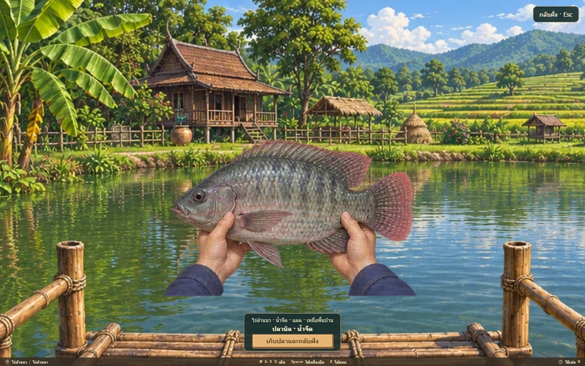</td>
    <td width="50%">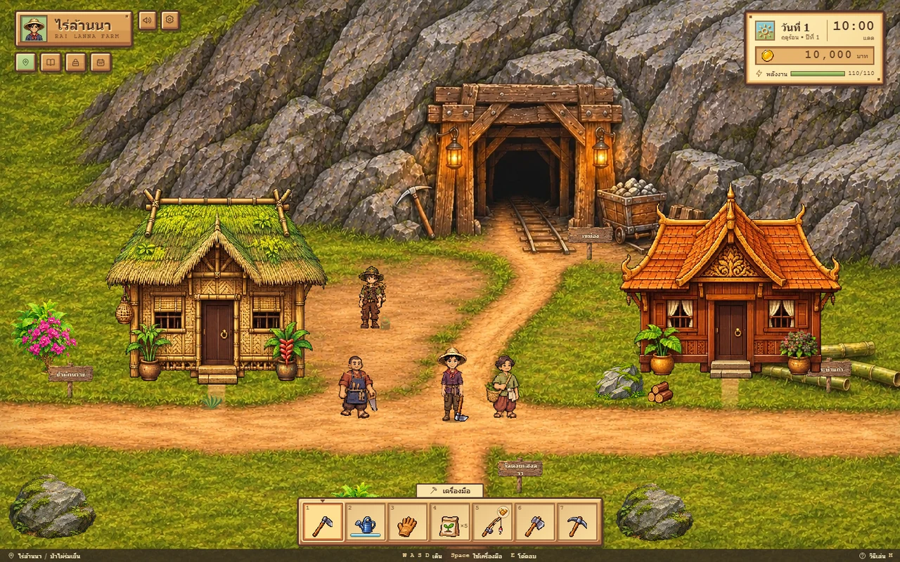</td>
  </tr>
  <tr><td align="center">ตกปลาและแสดงปลาที่จับได้</td><td align="center">บ้านและกิจกรรมของชาวบ้านในป่า</td></tr>
</table>

### 🥭 สวนผลไม้และแยมผลไม้

- 6 แปลงทางตะวันตกของฟาร์ม ต้นไม้ 15 ชนิด ตั้งแต่กล้วย มะม่วง ลำไย และส้ม ไปจนถึงทุเรียน มังคุด และมะพร้าว เคลียร์ไม้และหินออกจากแปลง ปลูกต้นกล้า รดน้ำจนโต แล้วจะออกผลเป็นรอบตามฤดูของมัน
- ปุ๋ยคอกทำให้ได้ผลเพิ่ม พายุทำให้ผลที่ติดอยู่ร่วงครึ่งหนึ่ง จึงควรเก็บก่อนพายุมา ต้นที่ไม่ต้องการแล้วโค่นทิ้งได้
- ผลไม้ขายได้ หรือทำแยมที่เตาในห้องอาหาร (ต้องต่อเติมบ้านก่อน): ผลไม้ 2 ผลได้แยม 1 ขวดในข้ามคืน มีค่าเท่าผลไม้ 3 ผล

<p align="center"></p>

สมุดฟาร์มขนาดกะทัดรัด แยกหมวดสถานะ ภารกิจ พืชผล แร่ ของสะสม และบันทึก ใช้แท็บกับปุ่มเปลี่ยนหน้าโดยไม่มีแถบเลื่อนแนวตั้ง

### ⛏️ ขุดแร่ เลเวล และเครื่องมือ

- **ถ้ำศิลาดาว** มี 5 ชั้น ยิ่งลึกยิ่งมีแร่หายาก ซื้อบันไดลิงจากช่างหรือรับจากคำขอส่งแร่เพื่อปีนลง สายแร่แต่ละจุดอาจมีหรือไม่มีในแต่ละวัน และขุดแล้วหมดไป มีแร่ 15 ชนิด (ทองแดง เหล็ก เงิน ทอง ผลึกดาว ต่อด้วยควอตซ์ หยก อเมทิสต์ โกเมน บุษราคัม ไพลิน มรกต ทับทิม มูนสโตน และเพชร) ขุดด้วยอีเต้อ และมีโอกาสได้แร่ชนิดถัดไปเพิ่มตามค่าโชค
- **ทุ่งบุกเบิก** เปิดที่ดินทำกินใหม่โดยถางหญ้า ต้นไม้ และหิน แล้วพรวนดินปลูกพืช แปลงถัดไปต้องใช้เครื่องมือที่ดีขึ้น
- **เลเวลและค่าพลัง** ทำงานได้ XP แต่ละเลเวลได้แต้มสำหรับ กำลัง ความอึด และโชค พลังงานเพิ่ม และเข้านอนได้ดึกขึ้น
- **ช่างตีเหล็ก** เอาแร่ไปแลกอัปเกรดจอบ ขวาน และอีเต้อ และซื้อโคมไฟไปวางตามทางเดิน
- **ปริศนาศิลาและตรารางวัล** มีศิลาซ่อนอยู่ 5 แห่ง ตัวศิลาและคำใบ้โต้ตอบปรากฏเมื่อเดินเข้าใกล้ แก้ปริศนาหรือชนะการแข่งขันเทศกาลเพื่อรับตราปลดล็อกเมล็ด กิ่งพันธุ์ สัตว์ เหยื่อ เบ็ด และการตีเครื่องมือระดับสูง ศิลาสามแห่งแรกใช้เปิดหีบสมบัติในป่าได้ด้วย
- **ภารกิจหมู่บ้าน** มีรางวัลสำหรับการถางที่ ขุดแร่ และตกปลา

### 🐄 สัตว์ในคอกปศุสัตว์

สัตว์ 15 ชนิดอยู่ที่คอกปศุสัตว์ (ไก่ เป็ด วัว แกะ แพะ หมู ควาย ม้า กระต่าย ห่าน นกกระทา ไก่งวง นกยูง ไก่ต๊อก และไก่แจ้) ซื้อสัตว์ ให้อาหารตัวละหนึ่งส่วนต่อวัน แล้วผลผลิต (ไข่ นม ขนแกะ) จะอยู่ในกระเป๋าเช้าวันถัดไป
และสร้างเล้าไก่ไว้ในฟาร์มของตัวเองได้ด้วย

### 🏘️ หมู่บ้าน ตลาด และเพื่อนบ้าน

- **หมู่บ้านเวียงคำ** มะลิและลุงชัยมีระดับความสนิท รับของขวัญ และมีคำขอประจำวัน ลุงชัยยังขายแปลงเพิ่ม ต่อเติมบ้านตามเลเวล และสร้างเล้าไก่ให้
- **ชาวบ้าน 36 คน** ชาวบ้านเดินทาง 22 คนและผู้ทำงาน 14 คน มีตารางกิจกรรม เดินหลบกันและผู้เล่น กลับบ้านหลังเลิกงานและนอนตอนกลางคืน
- **กระดานประกาศ** รับงานส่งของได้วันละ 1 งาน (ผักให้ครัวของมะลิ หรือผลไม้ให้ลุงชัย) ได้เงินและความสนิท
- **บ้านส่วนตัว NPC** กระจาย 8 หลังในหมู่บ้าน ป่า และคอกสัตว์ รวมกุฏิที่วัดอีก 1 แห่ง ขนาดเข้ากับอาคารรอบข้าง ผู้เล่นเข้าไม่ได้ และไม่มี NPC เข้าพื้นที่ฟาร์มส่วนตัว
- **หน้าร้าน** เห็นรูปเจ้าของร้าน กันสาด และสินค้าเป็นภาพ แบ่งแท็บหมวดหมู่และเปลี่ยนหน้าด้วยปุ่ม ปุ่มใช้งานอยู่ในจอเสมอรวมถึงจอเล็ก ของที่ล็อกบอกจำนวนตราที่ต้องใช้ มะลิ ลุงชัย และร้านกิ่งพันธุ์ใช้รูปแบบเดียวกัน ราคาซื้อเพิ่มขึ้น 50% ราคาขายคงเดิม
- **กาดเวียงคำ** ร้านเมล็ดพันธุ์ ร้านอาหาร ช่างตีเหล็ก และพ่อค้าที่รับซื้อของ
- **ตลาดสดชาวสวน** เปิดแผงของตัวเอง (07:00–18:00): เลือกของ จำนวน และราคา ลูกค้าซื้อตามงบของเขา ได้เงินทันที และวันงานประเพณีลูกค้าจะมากขึ้น
- **โรงพยาบาลเวียงคำ** พักฟื้นเมื่อพลังงานหมด หรือเลือกเตียงใดก็ได้ในหอผู้ป่วยเพื่อนอนถึงเช้าราคา ฿60 มีภาพตัวละครนอนอยู่บนเตียง
- **ป่าผักหวานและป่าไผ่ร่มเย็น** เก็บผักกูด ลูกหม่อนป่า และกล้วยป่าที่ป่าผักหวาน (ขึ้นใหม่ในไม่กี่วัน) และเก็บสมุนไพรกับไม้ไผ่ในป่าไผ่

<p align="center"></p>

### 🏮 งานประเพณี 7 งานต่อปี

แต่ละงานร่วมได้เฉพาะวันและช่วงเวลาของงาน และพายุจะทำให้งานยกเลิก ทุกงานเพิ่มความสนิทกับเพื่อนบ้านทุกคน
รายงานยามเช้าจะประกาศงานล่วงหน้า 2 วันพร้อมบอกของที่ต้องเตรียม และปฏิทิน (C) แสดงทั้งปี

| งาน | วัน | เวลา | สิ่งที่ได้ |
|---|---|---|---|
| 💦 สงกรานต์ ปี๋ใหม่เมือง | ฤดูร้อน วันที่ 6 | 09:00–18:00 | พลังงาน +25 |
| 🚀 บุญบั้งไฟ | ฤดูร้อน วันที่ 12 | 10:00–18:00 | ใช้ไม้ 3 ท่อน พยากรณ์พรุ่งนี้กลายเป็นฝน |
| 🌱 งานแลกเมล็ดพันธุ์ | ใบไม้ร่วง วันที่ 2 | 08:00–16:00 | เมล็ดแตงกวา 3 ซอง |
| 🚣 แข่งเรือยาว | ใบไม้ร่วง วันที่ 11 | 10:00–18:00 | ใช้พลังงาน 30 ชนะ (โอกาส 50%) ได้ ฿200 แพ้ได้ ฿40 |
| 🏮 ยี่เป็ง ลอยโคม | ฤดูหนาว วันที่ 3 | 17:00–23:00 | ค่าโคม ฿30 เพื่อนบ้านประทับใจเป็นพิเศษ |
| 🌾 ตานข้าวใหม่และประกวดพืชผล | ฤดูหนาว วันที่ 10 | 09:00–17:00 | ของที่แพงที่สุดในกระเป๋าได้รางวัล 4 เท่าของราคา |
| 🌸 กาดดอกไม้บาน | ใบไม้ผลิ วันที่ 5 | 08:00–18:00 | เมล็ดผักกาดหอม 4 ซอง |

### 🐕 ชุดและสัตว์เลี้ยง

ไปใช้ตู้เสื้อผ้าหรือมุมสัตว์เลี้ยงภายในบ้านเพื่อเลือกชุด 3 ชุด และรับเลี้ยงหมาหรือแมว 1 ตัว ลูบหัวได้วันละครั้ง เลือกให้เดินตามหรือรอที่บ้านได้ ไม่มีไอคอนติดตัวหรือคีย์ลัดเปิดจากนอกบ้าน

<p align="center">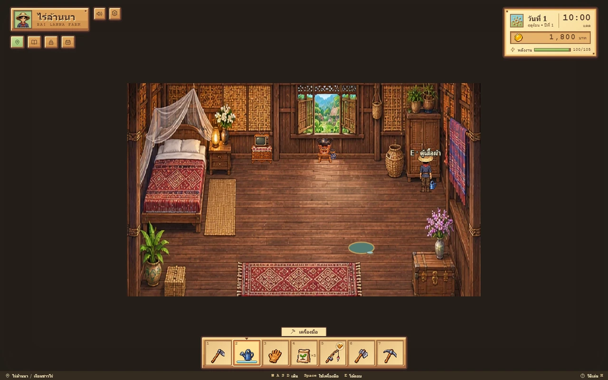</p>

### 💾 บันทึกอัตโนมัติ

เกมบันทึกลงเบราว์เซอร์ (localStorage) ทุกเช้าวันใหม่ และเซฟรุ่นเก่าจะถูกอัปเกรดเป็นรูปแบบปัจจุบันให้เอง
บันทึกเองได้ที่ตั้งค่า หรือเลือกบันทึกและกลับหน้าแรก/ออกจากเกม ซึ่งจะบันทึกก่อนหยุดเล่น ปุ่มออกจากเกมหยุดเวลาและเสียง จากนั้นปิดแท็บเบราว์เซอร์ได้ การย้อนกลับจากหน้าตั้งชื่อฟาร์มใหม่จะไม่เขียนทับเซฟเดิม

## 📋 ตารางข้อมูลในเกม

ข้อมูลด้านล่างดึงจากรุ่นพัฒนาปัจจุบัน ราคาเป็นเงินในเกม สินค้าหายากบางชนิดต้องใช้ตราจากการแข่งขันหรือปริศนาเพื่อปลดล็อกด้วย

### พืชและผัก · 29 ชนิด

ระยะโตนับวันที่ได้รับน้ำ ฝนสามารถรดน้ำให้แปลงได้

| ภาพ | ชนิด | ฤดูที่ปลูกได้ | วันโต | ราคาเมล็ด | ราคาขาย/ชิ้น |
|---|---|---|---|---|---|
|  | ผักบุ้ง | ทุกฤดู | 3 | 15 | 25 |
|  | ถั่วฝักยาว | ฤดูร้อน, ใบไม้ร่วง | 5 | 38 | 70 |
|  | แตงโม | ฤดูร้อน | 9 | 90 | 200 |
|  | ข้าวโพด | ใบไม้ร่วง | 6 | 45 | 90 |
|  | พริก | ใบไม้ร่วง | 7 | 60 | 120 |
|  | ฟักทอง | ใบไม้ร่วง, ฤดูหนาว | 8 | 75 | 160 |
| 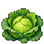 | กะหล่ำปลี | ฤดูหนาว | 6 | 45 | 95 |
|  | มะเขือเทศ | ฤดูหนาว | 7 | 60 | 125 |
| 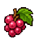 | สตรอว์เบอร์รี | ฤดูหนาว, ใบไม้ผลิ | 9 | 105 | 230 |
|  | แครอต | ฤดูหนาว, ฤดูร้อน, ใบไม้ผลิ | 4 | 27 | 50 |
|  | สับปะรด | ฤดูร้อน, ใบไม้ร่วง | 8 | 75 | 165 |
| 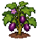 | มะเขือม่วง | ทุกฤดู | 5 | 33 | 65 |
|  | มะละกอ | ฤดูร้อน, ใบไม้ร่วง | 7 | 57 | 110 |
|  | แตงกวา | ใบไม้ผลิ, ฤดูร้อน, ใบไม้ร่วง | 4 | 27 | 48 |
| 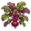 | บีตรูต | ฤดูหนาว | 5 | 36 | 74 |
| 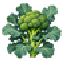 | บรอกโคลี | ฤดูหนาว, ใบไม้ร่วง | 6 | 48 | 98 |
|  | เมลอน | ฤดูร้อน | 8 | 82 | 175 |
|  | แก้วมังกร | ฤดูร้อน, ใบไม้ร่วง | 9 | 93 | 195 |
|  | เสาวรส | ใบไม้ร่วง, ฤดูหนาว | 7 | 63 | 132 |
|  | ผักกวางตุ้ง | ฤดูหนาว, ใบไม้ผลิ | 3 | 18 | 32 |
|  | แรดิช | ใบไม้ผลิ, ฤดูหนาว | 4 | 24 | 48 |
|  | กะหล่ำดอก | ฤดูหนาว | 8 | 69 | 154 |
|  | หอมแดง | ฤดูร้อน, ฤดูหนาว | 6 | 48 | 98 |
| 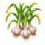 | กระเทียม | ฤดูหนาว, ใบไม้ผลิ | 6 | 44 | 88 |
|  | หน่อไม้ฝรั่ง | ใบไม้ผลิ, ใบไม้ร่วง | 8 | 72 | 153 |
|  | ถั่วลันเตา | ใบไม้ผลิ, ฤดูหนาว | 5 | 38 | 72 |
|  | ซูกินี | ฤดูร้อน, ใบไม้ผลิ | 5 | 34 | 70 |
|  | พริกหวาน | ฤดูร้อน, ใบไม้ร่วง | 7 | 57 | 119 |
|  | ผักกาดหอม | ใบไม้ผลิ, ฤดูหนาว, ใบไม้ร่วง | 4 | 24 | 46 |

### ไม้ผล · 15 ชนิด

ตัดไม้และทุบหินก่อนปลูก รดน้ำต้นอ่อนจนโต รอบเก็บเกี่ยวใช้เฉพาะฤดูที่ออกผล

| ภาพ | ชนิด | ฤดูออกผล | วันโตจากต้นอ่อน | รอบเก็บ/วัน | ผล/รอบ |
|---|---|---|---|---|---|
|  | กล้วยน้ำว้า | ทุกฤดู | 6 | 5 | 2 |
|  | มะม่วงน้ำดอกไม้ | ฤดูร้อน | 10 | 3 | 3 |
|  | ลำไย | ใบไม้ร่วง | 12 | 3 | 3 |
|  | ส้มสายน้ำผึ้ง | ฤดูหนาว | 12 | 3 | 3 |
|  | ลิ้นจี่ | ฤดูร้อน | 12 | 3 | 3 |
|  | เงาะ | ใบไม้ร่วง | 12 | 3 | 3 |
| 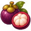 | มังคุด | ใบไม้ร่วง | 14 | 4 | 3 |
|  | ทุเรียน | ฤดูร้อน | 18 | 6 | 2 |
|  | ขนุน | ฤดูร้อน, ใบไม้ร่วง | 15 | 6 | 2 |
|  | มะละกอ | ทุกฤดู | 7 | 4 | 2 |
|  | มะพร้าว | ทุกฤดู | 14 | 6 | 2 |
|  | ฝรั่ง | ฤดูหนาว, ใบไม้ผลิ | 9 | 3 | 3 |
|  | ส้มโอ | ฤดูหนาว | 14 | 5 | 2 |
|  | มะขามหวาน | ฤดูหนาว, ใบไม้ผลิ | 13 | 4 | 3 |
|  | มะเฟือง | ใบไม้ผลิ, ใบไม้ร่วง | 10 | 3 | 3 |

### แร่และอัญมณี · 15 ชนิด

สายแร่สุ่มใหม่แต่ละวันในถ้ำ 5 ชั้น ยิ่งลึกยิ่งมีแร่หายาก ตารางแสดงระดับอีเต้อที่ต้องใช้ขุดแร่นั้นโดยตรง

| ภาพ | แร่ | อีเต้อขั้นต่ำ/ระดับ |
|---|---|---|
|  | ทองแดง | 1 |
|  | เหล็ก | 2 |
|  | เงิน | 3 |
|  | ทองคำ | 4 |
|  | ผลึกดาว | 5 |
|  | ควอตซ์ | 6 |
|  | หยก | 7 |
|  | อเมทิสต์ | 8 |
| 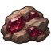 | โกเมน | 9 |
|  | บุษราคัม | 10 |
|  | ไพลิน | 11 |
|  | มรกต | 12 |
|  | ทับทิม | 13 |
|  | มุกดาหาร | 14 |
|  | เพชร | 15 |

### ปลา · 37 ชนิด

ปลาน้ำจืด 20 ชนิด และน้ำเค็ม 17 ชนิด บ่อฟาร์มมีปลากลุ่มบ่อ ส่วนสระและแม่น้ำมีปลาน้ำจืดทั้งหมด ปลาน้ำเค็ม 3 ชนิดพบเฉพาะเกาะรอยดาวหลังสร้างสะพาน

| ภาพ | ชนิด | สถานที่ | ฤดู | เวลา | ราคาขาย/ตัว |
|---|---|---|---|---|---|
|  | ปลากะรังจุดฟ้า | ทะเลที่เกาะเท่านั้น | ทุกฤดู | 06:00–18:00 | 260 |
|  | ปลาช่อนทะเล | ทะเลที่เกาะเท่านั้น | ฤดูร้อน, ใบไม้ร่วง, ใบไม้ผลิ | 00:00–24:00 | 300 |
|  | ปลากะมงพร้าว | ทะเลที่เกาะเท่านั้น | ทุกฤดู | 16:00–24:00 * | 360 |
|  | ปลานิล | บ่อฟาร์ม / สระ / แม่น้ำ | ทุกฤดู | 00:00–24:00 | 12 |
| 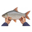 | ปลาตะเพียน | บ่อฟาร์ม / สระ / แม่น้ำ | ฤดูร้อน, ใบไม้ร่วง | 06:00–18:00 | 18 |
|  | ปลาสลิด | บ่อฟาร์ม / สระ / แม่น้ำ | ฤดูหนาว | 06:00–18:00 | 20 |
| 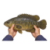 | ปลาหมอ | บ่อฟาร์ม / สระ / แม่น้ำ | ใบไม้ร่วง | 00:00–24:00 | 25 |
| 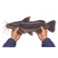 | ปลาดุก | บ่อฟาร์ม / สระ / แม่น้ำ | ฤดูร้อน, ใบไม้ร่วง | 18:00–24:00 * | 35 |
|  | ปลาช่อน | บ่อฟาร์ม / สระ / แม่น้ำ | ทุกฤดู | 06:00–10:00 | 60 |
|  | ปลากราย | บ่อฟาร์ม / สระ / แม่น้ำ | ฤดูหนาว | 16:00–24:00 | 85 |
|  | ปลาไน | สระ / แม่น้ำ | ทุกฤดู | 00:00–24:00 | 48 |
| 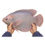 | ปลาแรด | สระ / แม่น้ำ | ทุกฤดู | 06:00–18:00 * | 85 |
|  | ปลาทู | ชายหาด / ทะเลที่เกาะ | ทุกฤดู | 00:00–24:00 | 32 |
|  | ปลากะพงแดง | ชายหาด / ทะเลที่เกาะ | ทุกฤดู | 06:00–18:00 * | 78 |
|  | ปลาเก๋า | ชายหาด / ทะเลที่เกาะ | ฤดูร้อน, ใบไม้ร่วง | 06:00–24:00 | 105 |
|  | ปลาสาก | ชายหาด / ทะเลที่เกาะ | ทุกฤดู | 16:00–24:00 | 125 |
|  | ปลาไหล | บ่อฟาร์ม / สระ / แม่น้ำ | ใบไม้ร่วง | 20:00–24:00 | 110 |
|  | ปลาคาร์ป | บ่อฟาร์ม / สระ / แม่น้ำ | ทุกฤดู | 00:00–24:00 * | 79 |
|  | ปลาทอง | บ่อฟาร์ม / สระ / แม่น้ำ | ฤดูร้อน, ใบไม้ผลิ | 06:00–20:00 | 42 |
|  | ปลาเฉาฮื้อ | สระ / แม่น้ำ | ใบไม้ร่วง, ฤดูหนาว | 08:00–22:00 | 56 |
|  | ปลายี่สกเทศ | สระ / แม่น้ำ | ฤดูร้อน, ใบไม้ร่วง, ใบไม้ผลิ | 16:00–24:00 * | 62 |
|  | ปลาเสือสุมาตรา | บ่อฟาร์ม / สระ / แม่น้ำ | ทุกฤดู | 00:00–24:00 | 38 |
|  | ปลาซิว | บ่อฟาร์ม / สระ / แม่น้ำ | ฤดูร้อน, ใบไม้ผลิ | 06:00–20:00 | 16 |
|  | ปลาพลวง | สระ / แม่น้ำ | ใบไม้ร่วง, ฤดูหนาว | 08:00–22:00 * | 118 |
|  | ปลาเรดเทล | สระ / แม่น้ำ | ฤดูร้อน, ใบไม้ร่วง, ใบไม้ผลิ | 16:00–24:00 | 146 |
|  | ปลามังกรเงิน | สระ / แม่น้ำ | ทุกฤดู | 00:00–24:00 | 220 |
|  | ปลากระโห้ | สระ / แม่น้ำ | ฤดูร้อน, ใบไม้ผลิ | 06:00–20:00 * | 190 |
|  | ปลาซาร์ดีน | ชายหาด / ทะเลที่เกาะ | ใบไม้ร่วง, ฤดูหนาว | 08:00–22:00 | 24 |
|  | ปลาแพะลาย | ชายหาด / ทะเลที่เกาะ | ฤดูร้อน, ใบไม้ร่วง, ใบไม้ผลิ | 16:00–24:00 | 52 |
|  | ปลาโอ | ชายหาด / ทะเลที่เกาะ | ทุกฤดู | 00:00–24:00 * | 76 |
|  | ปลาจาระเม็ดเงิน | ชายหาด / ทะเลที่เกาะ | ฤดูร้อน, ใบไม้ผลิ | 06:00–20:00 | 89 |
|  | ปลาลิ้นหมา | ชายหาด / ทะเลที่เกาะ | ใบไม้ร่วง, ฤดูหนาว | 08:00–22:00 | 72 |
|  | ปลาเห็ดโคน | ชายหาด / ทะเลที่เกาะ | ฤดูร้อน, ใบไม้ร่วง, ใบไม้ผลิ | 16:00–24:00 * | 28 |
|  | ปลากะมงทอง | ชายหาด / ทะเลที่เกาะ | ทุกฤดู | 00:00–24:00 | 105 |
|  | ปลาอีโต้มอญ | ชายหาด / ทะเลที่เกาะ | ฤดูร้อน, ใบไม้ผลิ | 06:00–20:00 | 140 |
|  | ปลากระโทงดาบ | ชายหาด / ทะเลที่เกาะ | ใบไม้ร่วง, ฤดูหนาว | 08:00–22:00 * | 200 |
|  | ปลากระโทงร่ม | ชายหาด / ทะเลที่เกาะ | ฤดูร้อน, ใบไม้ร่วง, ใบไม้ผลิ | 16:00–24:00 | 235 |

\* เมื่ออากาศเปียก ปลาเหล่านี้มีโอกาสกินเหยื่อนอกเวลาปกติ แต่ยังต้องตรงฤดูและสถานที่ นำปลาใส่ลังส่งของเพื่อรับเงินเช้าวันถัดไป หรือขายของที่รองรับได้ที่แผงตลาดสด

### อุปกรณ์และเครื่องมือ

| ภาพ | ปุ่ม | อุปกรณ์ | การใช้งาน | พัฒนา/ข้อสังเกต |
|---|---|---|---|---|
|  | 1 | จอบ | พรวนดินและกำจัดหญ้า | อัปเกรดระดับด้วยแร่ และซื้อจอบเหล็ก |
|  | 2 | บัวรดน้ำ | รดพืชและต้นอ่อน; เติมน้ำริมบ่อ/สระ/แม่น้ำ/ทะเล | เริ่มต้น 10 ครั้ง; บัวทองแดงเพิ่มเป็น 20 ครั้ง |
|  | 3 | มือเก็บเกี่ยว | เก็บผักที่โตเต็มที่ | ใช้ถือผลผลิต ปลา หรือแร่ที่เลือกจากกระเป๋า |
|  | 4 | ถุงเมล็ด | ปลูกลงดินที่พรวนแล้ว | Q เปลี่ยนชนิดเมล็ด; ปลูกตามฤดู |
|  | 5 | เบ็ดตกปลา | ตกปลาด้วยมินิเกมมุมมองบุคคลที่หนึ่ง | คันเบ็ดคาร์บอนและเหยื่อช่วยตกปลาหายาก |
|  | 6 | ขวาน | ตัดต้นไม้ ตอไม้ และขอนไม้ | อัปเกรดระดับด้วยแร่เพื่อเปิดพื้นที่ยากขึ้น |
|  | 7 | อีเต้อ | ทุบหินและขุดสายแร่ | ระดับที่ต้องใช้ตามตารางแร่ด้านบน |
|  | — | บันไดลิง | ลงถ้ำชั้นล่าง | ซื้อจากช่างหรือนำแร่ไปแลกในวันที่มีคำขอ |
|  | — | โคมทางเดิน | ให้แสงเฉพาะกลางคืน | ซื้อแล้วปักจากหมวดบันทึกในสมุดฟาร์ม |
|  | — | กระเป๋า | เก็บไอเทมแยกชนิดเป็นช่อง | เริ่มต้น 15 ช่อง; ซื้อขยายได้สูงสุด 150 ช่อง |

#### อุปกรณ์อัปเกรดจากร้าน

| ภาพ | อุปกรณ์ | ราคา | ผลที่ได้ |
|---|---|---|---|
|  | บัวรดน้ำทองแดง | 165 | ลดพลังรดน้ำ 1 หน่วย |
|  | จอบเหล็ก | 202 | ลดพลังพรวนดิน 1 หน่วย |
|  | คันเบ็ดคาร์บอน | 232 | ปลากินเหยื่อเร็วขึ้น 28% |

#### เหยื่อตกปลา

| ภาพ | เหยื่อ | ตัวคูณน้ำหนักสุ่มปลาหายาก | ราคา |
|---|---|---|---|
|  | เหยื่อพื้นบ้าน | ×1 | ฟรี / ใช้ได้ไม่จำกัด |
|  | ไส้เดือน | ×1.8 | ฿18 / 3 ชิ้น |
|  | กุ้งสด | ×3 | ฿42 / 3 ชิ้น |
|  | เหยื่อเรืองแสง | ×5 | ฿82 / 3 ชิ้น |

ตัวคูณเหยื่อเพิ่มน้ำหนักในการสุ่มปลาหายาก ไม่ใช่อัตราจับสำเร็จที่รับประกัน การอัปเกรดเครื่องมือใช้แร่หลายชนิดและอาจต้องใช้ตราปลดล็อก เพิ่มแรงงาน ความอึด และโชคได้ในสมุดฟาร์ม

## 🚧 แผนงาน

- [x] วงจรประจำวัน
- [x] ปฏิทิน ฤดู และอากาศ (4 ฤดู มีหิมะ)
- [x] ตกปลา (มุมมองบุคคลที่หนึ่ง มีเหยื่อ)
- [x] ~~นาข้าว~~ ถอดออกแล้ว ใช้การขยายที่ดินและทุ่งบุกเบิกแทน
- [x] สวนผลไม้ (พร้อมแยมผลไม้)
- [x] สัตว์ 15 ชนิด
- [x] หมู่บ้าน เพื่อนบ้าน งานประเพณี (พร้อมแผงตลาดสดและปฏิทิน)
- [x] ขุดแร่ เลเวล เครื่องมือ และของป่า
- [x] กระเป๋ารูปไอเทมที่ขยายได้ ปริศนาที่ซ่อนอยู่ และร้านค้าปลดล็อกด้วยตรา
- [x] พื้นฉากใหม่และวัตถุประกอบฉากแยกชิ้นในแผนที่กลางแจ้ง 9 แห่ง
- [x] ถนนเชื่อมถึงกัน: มีเส้นทางวนระหว่างแผนที่ และปลายถนนสองฝั่งตรงกัน
- [x] ภาษาอังกฤษและภาษาไทย
- [ ] ภาพและเสียงแบบล้านนา: เสร็จเกือบหมดแล้ว

**ยังต้องทำ**

- [ ] ฉากตามฤดู (ฟาร์มใช้ภาพเดียวทุกฤดู)
- [ ] โหมดมือถือและ PWA (พักการพัฒนาไว้ก่อน)

## 🧰 เกี่ยวกับโฟลเดอร์ `.claude/skills`

เป็นสกิลพัฒนาเกม 17 ตัวที่เลือกมาจาก
[gamedev-skills/awesome-gamedev-agent-skills](https://github.com/gamedev-skills/awesome-gamedev-agent-skills)
สำหรับให้ Claude Code ใช้ระหว่างพัฒนาเกมนี้ ไม่มีส่วนเกี่ยวข้องตอนเกมทำงาน อยู่ภายใต้สัญญาอนุญาต Apache-2.0
(`LICENSE` และ `NOTICE` อยู่ในโฟลเดอร์นั้น) และลบทิ้งได้โดยไม่กระทบเกม

## 📜 สัญญาอนุญาต

ยังไม่ได้เลือกสัญญาอนุญาตสำหรับตัวเกม

---

<div align="center">

สร้างด้วย 🌾 และ Phaser · [⬆ กลับขึ้นด้านบน](#-ไร่ล้านนา--rai-lanna)

</div>
